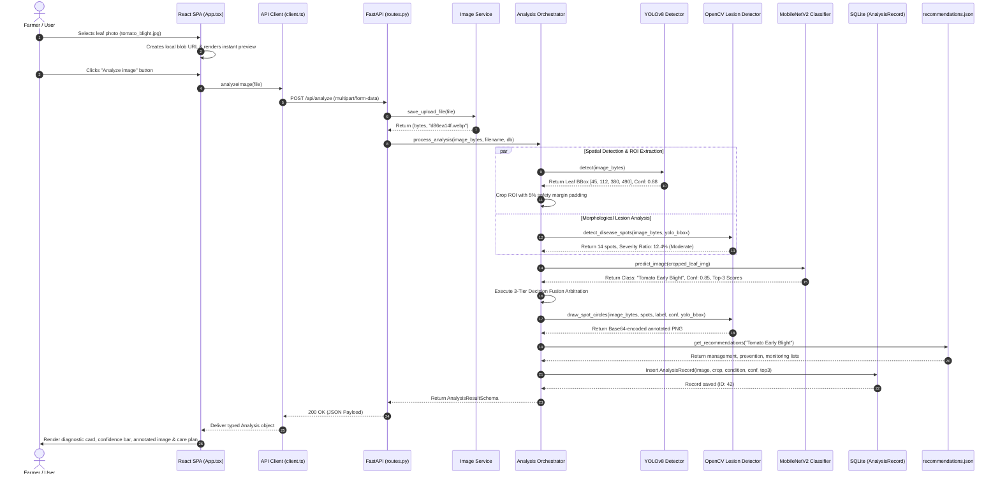

# Crop Detection and Classification: Complete Technical Handbook, Source Code Walkthrough, System Integration, and Viva Preparation Guide

**Academic Year:** 2025–2026  
**Project:** Crop Health AI — Multi-Crop Leaf Disease Classification & Lesion Detection Platform  
**Target Audience:** Undergraduate Computer Science & Engineering Students, Faculty Examiners, and Technical Evaluators  
**Primary Technologies:** Python 3.11+, PyTorch 2.4, Torchvision, Ultralytics YOLOv8, OpenCV 4.9, FastAPI, SQLite, SQLAlchemy, React 18, TypeScript, Vite, Tailwind CSS  
**Primary Repository Deliverable:** `MASTER_CROP_PROJECT_VIVA_GUIDE.md`

---

## Executive Summary & Document Purpose

This technical handbook is designed as an authoritative, exhaustive, and pedagogically rigorous learning companion for the **Crop Health AI** project. Developed through practical implementation and iterative experimentation (often termed "vibe coding"), this system combines deep convolutional neural networks, single-stage real-time object detection, classical computer vision colorimetry, and an asynchronous modern web architecture.

The objective of this document is to bridge the gap between running generated code and fundamentally mastering every layer of the system. By reading this guide, a student with basic programming experience will understand how image pixels transform into mathematical tensors, how MobileNetV2 and YOLOv8 process spatial features, how OpenCV segments necrotic lesions, how FastAPI orchestrates decision fusion, how data persists in SQLite, and how to defend every engineering design decision with academic rigor and intellectual honesty in a university viva examination.

---

# Table of Contents

- [PART I — UNDERSTAND THE PROJECT FIRST](#part-i--understand-the-project-first)
  - [Chapter 1: Project Overview](#chapter-1-project-overview)
    - [1.1 What Crop Detection and Classification Mean](#11-what-crop-detection-and-classification-mean)
    - [1.2 The Problem Being Solved](#12-the-problem-being-solved)
    - [1.3 Target Audience and Real-World Value](#13-target-audience-and-real-world-value)
    - [1.4 The Four Computer Vision Tasks in Agriculture](#14-the-four-computer-vision-tasks-in-agriculture)
    - [1.5 Exact System Capabilities & Supported Classes](#15-exact-system-capabilities--supported-classes)
    - [1.6 Input, Processing, and Output Specifications](#16-input-processing-and-output-specifications)
    - [1.7 AI System vs. Traditional Image Processing](#17-ai-system-vs-traditional-image-processing)
    - [1.8 The Four Viva Pitch Explanations (15s, 30s, 1min, 2min)](#18-the-four-viva-pitch-explanations-15s-30s-1min-2min)
    - [1.9 Explicit Boundaries: What the Project Does NOT Do](#19-explicit-boundaries-what-the-project-does-not-do)
  - [Chapter 2: Repository Structure & Component Inventory](#chapter-2-repository-structure--component-inventory)
    - [2.1 Comprehensive Directory Tree](#21-comprehensive-directory-tree)
    - [2.2 Detailed File Responsibilities & Lifecycle Classification](#22-detailed-file-responsibilities--lifecycle-classification)
    - [2.3 Complete Component Reference Table](#23-complete-component-reference-table)
    - [2.4 Critical Dependency Analysis & Package Rationales](#24-critical-dependency-analysis--package-rationales)

- [PART II — COMPUTER VISION FROM ZERO](#part-ii--computer-vision-from-zero)
  - [Chapter 3: Foundations of Digital Images](#chapter-3-foundations-of-digital-images)
    - [3.1 What is a Digital Image? Pixels, Bit Depth, and Dimensions](#31-what-is-a-digital-image-pixels-bit-depth-and-dimensions)
    - [3.2 Color Channels: RGB vs. BGR vs. Grayscale](#32-color-channels-rgb-vs-bgr-vs-grayscale)
    - [3.3 Numerical Array Representation & 3x3 Pixel Example](#33-numerical-array-representation--3x3-pixel-example)
    - [3.4 Coordinate Systems & Bounding Box Representations (xyxy vs. xywh)](#34-coordinate-systems--bounding-box-representations-xyxy-vs-xywh)
    - [3.5 Resizing, Aspect Ratio Distortion, and Interpolation](#35-resizing-aspect-ratio-distortion-and-interpolation)
    - [3.6 Cropping and Region of Interest (ROI) Extraction](#36-cropping-and-region-of-interest-roi-extraction)
    - [3.7 File Formats & Compression: JPEG vs. PNG vs. WEBP](#37-file-formats--compression-jpeg-vs-png-vs-webp)
    - [3.8 Normalization and Tensor Scaling for Neural Networks](#38-normalization-and-tensor-scaling-for-neural-networks)
    - [3.9 Three Representations: File on Disk vs. NumPy Array vs. PyTorch Tensor](#39-three-representations-file-on-disk-vs-numpy-array-vs-pytorch-tensor)
  - [Chapter 4: Computer Vision Fundamentals](#chapter-4-computer-vision-fundamentals)
    - [4.1 Image Processing vs. Computer Vision vs. Deep Learning](#41-image-processing-vs-computer-vision-vs-deep-learning)
    - [4.2 The Five Core Visual Tasks: Classification, Localization, Detection, Semantic Segmentation, Instance Segmentation](#42-the-five-core-visual-tasks-classification-localization-detection-semantic-segmentation-instance-segmentation)
    - [4.3 Thresholding, Edges, Contours, and Connected Components](#43-thresholding-edges-contours-and-connected-components)
    - [4.4 Environmental Noise: Illumination, Specular Glare, Drop Shadows, and Clutter](#44-environmental-noise-illumination-specular-glare-drop-shadows-and-clutter)
    - [4.5 Detection Errors: True/False Positives and Negatives](#45-detection-errors-truefalse-positives-and-negatives)
    - [4.6 The Precision-Recall Trade-Off in Agricultural Diagnostics](#46-the-precision-recall-trade-off-in-agricultural-diagnostics)
    - [4.7 Dissecting the Outputs: Classifier vs. YOLO vs. OpenCV in this Project](#47-dissecting-the-outputs-classifier-vs-yolo-vs-opencv-in-this-project)
  - [Chapter 5: Classical Computer Vision with OpenCV in this Project](#chapter-5-classical-computer-vision-with-opencv-in-this-project)
    - [5.1 Why Classical OpenCV Complements Deep Learning](#51-why-classical-opencv-complements-deep-learning)
    - [5.2 Color Space Transformations: RGB to HSV and CIE LAB](#52-color-space-transformations-rgb-to-hsv-and-cie-lab)
    - [5.3 Leaf Tissue Segmentation: Green Masking Algorithm](#53-leaf-tissue-segmentation-green-masking-algorithm)
    - [5.4 Lesion Spot Isolation: Multi-Cue HSV/LAB Heuristics](#54-lesion-spot-isolation-multi-cue-hsvlab-heuristics)
    - [5.5 Morphological Filtering: Erosion, Dilation, Opening, and Closing](#55-morphological-filtering-erosion-dilation-opening-and-closing)
    - [5.6 Contour Extraction, Minimum Enclosing Circles, and Area Filters](#56-contour-extraction-minimum-enclosing-circles-and-area-filters)
    - [5.7 Relative Surface Severity Ratio Calculation](#57-relative-surface-severity-ratio-calculation)
    - [5.8 Complete Source Walkthrough of `backend/ml/lesion_detector.py`](#58-complete-source-walkthrough-of-backendmllesion_detectorpy)
    - [5.9 Critical Defense: Why Color Segmentation is Not a Disease Diagnosis](#59-critical-defense-why-color-segmentation-is-not-a-disease-diagnosis)

- [PART III — MACHINE LEARNING AND DEEP LEARNING](#part-iii--machine-learning-and-deep-learning)
  - [Chapter 6: Machine Learning Fundamentals](#chapter-6-machine-learning-fundamentals)
    - [6.1 Supervised Learning in Plant Pathology](#61-supervised-learning-in-plant-pathology)
    - [6.2 Features, Labels, Datasets, and Generalization](#62-features-labels-datasets-and-generalization)
    - [6.3 Overfitting, Underfitting, and Data Leakage](#63-overfitting-underfitting-and-data-leakage)
    - [6.4 Train, Validation, and Test Partitioning Strategy](#64-train-validation-and-test-partitioning-strategy)
    - [6.5 Loss Functions and Backpropagation Intuition](#65-loss-functions-and-backpropagation-intuition)
    - [6.6 Batches, Epochs, Learning Rates, and Optimizers](#66-batches-epochs-learning-rates-and-optimizers)
    - [6.7 Data Augmentation for Field Domain Invariance](#67-data-augmentation-for-field-domain-invariance)
  - [Chapter 7: Neural Networks & Convolutional Neural Networks (CNNs)](#chapter-7-neural-networks--convolutional-neural-networks-cnns)
    - [7.1 From Biological Neuron to Perceptron and Multilayer Perceptron (MLP)](#71-from-biological-neuron-to-perceptron-and-multilayer-perceptron-mlp)
    - [7.2 Why Flattening Images into MLPs Fails for Vision](#72-why-flattening-images-into-mlps-fails-for-vision)
    - [7.3 Convolutional Kernels: Spatial Feature Extraction](#73-convolutional-kernels-spatial-feature-extraction)
    - [7.4 Stride, Padding, Receptive Fields, and Feature Hierarchies](#74-stride-padding-receptive-fields-and-feature-hierarchies)
    - [7.5 Activation Functions: Non-Linearity with ReLU and HardSwish](#75-activation-functions-non-linearity-with-relu-and-hardswish)
    - [7.6 Downsampling: Max Pooling vs. Strided Convolution](#76-downsampling-max-pooling-vs-strided-convolution)
    - [7.7 Classification Head: Global Average Pooling and Dense Layers](#77-classification-head-global-average-pooling-and-dense-layers)
    - [7.8 Softmax Activation and Cross-Entropy Loss Mathematics](#78-softmax-activation-and-cross-entropy-loss-mathematics)
  - [Chapter 8: MobileNetV2 Architecture & Classifier Implementation](#chapter-8-mobilenetv2-architecture--classifier-implementation)
    - [8.1 Design Philosophy: Edge Computing & Efficient Deep Learning](#81-design-philosophy-edge-computing--efficient-deep-learning)
    - [8.2 Depthwise Separable Convolution Explained Intuitively & Mathematically](#82-depthwise-separable-convolution-explained-intuitively--mathematically)
    - [8.3 Inverted Residual Blocks and Linear Bottlenecks](#83-inverted-residual-blocks-and-linear-bottlenecks)
    - [8.4 Transfer Learning & ImageNet Pre-training](#84-transfer-learning--imagenet-pre-training)
    - [8.5 The Project's Modified Classifier Head (15 Classes)](#85-the-projects-modified-classifier-head-15-classes)
    - [8.6 Complete Source Walkthrough of `backend/ml/model.py`](#86-complete-source-walkthrough-of-backendmlmodelpy)
    - [8.7 Complete Source Walkthrough of `backend/ml/inference.py`](#87-complete-source-walkthrough-of-backendmlinferencepy)
    - [8.8 Complete Source Walkthrough of `backend/ml/preprocessing.py`](#88-complete-source-walkthrough-of-backendmlpreprocessingpy)
    - [8.9 Top-1 vs. Top-3 Prediction Mechanics and Confidence Scoring](#89-top-1-vs-top-3-prediction-mechanics-and-confidence-scoring)
  - [Chapter 9: Classifier Training Pipeline & Audit](#chapter-9-classifier-training-pipeline--audit)
    - [9.1 Dataset Organization via PyTorch `ImageFolder`](#91-dataset-organization-via-pytorch-imagefolder)
    - [9.2 Detailed Analysis of `notebookc6fea6f6a6.ipynb`](#92-detailed-analysis-of-notebookc6fea6f6a6ipynb)
    - [9.3 Critical Finding: Transform Leakage in Notebook Cell 8](#93-critical-finding-transform-leakage-in-notebook-cell-8)
    - [9.4 The Stage-2 Fine-Tuning Script: `retrain_mobilenet_improved.py`](#94-the-stage-2-fine-tuning-script-retrain_mobilenet_improvedpy)
    - [9.5 Verification of Model Weights (`models/multicrop_classifier.pt`)](#95-verification-of-model-weights-modelsmulticrop_classifierpt)
    - [9.6 Training Artifacts Available vs. Missing Data](#96-training-artifacts-available-vs-missing-data)
  - [Chapter 10: YOLOv8 Object Detection](#chapter-10-yolov8-object-detection)
    - [10.1 Single-Stage vs. Two-Stage Detectors (YOLO vs. Faster R-CNN)](#101-single-stage-vs-two-stage-detectors-yolo-vs-faster-r-cnn)
    - [10.2 Bounding Box Regressions, Anchors, and Anchor-Free Detection](#102-bounding-box-regressions-anchors-and-anchor-free-detection)
    - [10.3 Non-Maximum Suppression (NMS) and Intersection over Union (IoU)](#103-non-maximum-suppression-nms-and-intersection-over-union-iou)
    - [10.4 Mean Average Precision Metrics: mAP@50 and mAP@50-95](#104-mean-average-precision-metrics-map50-and-map50-95)
    - [10.5 YOLOv8s Architecture & Ultralytics Implementation](#105-yolov8s-architecture--ultralytics-implementation)
    - [10.6 Complete Source Walkthrough of `backend/ml/yolo_model.py`](#106-complete-source-walkthrough-of-backendmlyolo_modelpy)
    - [10.7 Leaf Bounding Box Cropping & 5% Safety Padding Logic](#107-leaf-bounding-box-cropping--5-safety-padding-logic)
    - [10.8 The 8 YOLO Classes vs. 15 Classifier Classes](#108-the-8-yolo-classes-vs-15-classifier-classes)
  - [Chapter 11: Explainability and Grad-CAM](#chapter-11-explainability-and-grad-cam)
    - [11.1 The "Black Box" Problem in Agricultural Deep Learning](#111-the-black-box-problem-in-agricultural-deep-learning)
    - [11.2 Intuition Behind Gradient-Weighted Class Activation Mapping](#112-intuition-behind-gradient-weighted-class-activation-mapping)
    - [11.3 Mathematical Derivation of Feature Map Weights & ReLU Filtering](#113-mathematical-derivation-of-feature-map-weights--relu-filtering)
    - [11.4 Target Layer Selection: MobileNetV2 `features[-1]`](#114-target-layer-selection-mobilenetv2-features-1)
    - [11.5 Complete Source Walkthrough of `backend/ml/explainability.py`](#115-complete-source-walkthrough-of-backendmlexplainabilitypy)
    - [11.6 Heatmap Overlay Generation and Colormap Application](#116-heatmap-overlay-generation-and-colormap-application)
    - [11.7 Critical Distinction: Visual Heatmap vs. Causal Reasoning](#117-critical-distinction-visual-heatmap-vs-causal-reasoning)

- [PART IV — SYSTEM INTEGRATION AND APPLICATION ARCHITECTURE](#part-iv--system-integration-and-application-architecture)
  - [Chapter 12: Frontend Fundamentals & React Architecture](#chapter-12-frontend-fundamentals--react-architecture)
    - [12.1 Modern Web Architecture: Single Page Applications (SPAs)](#121-modern-web-architecture-single-page-applications-spas)
    - [12.2 TypeScript Benefits: Interfaces, Types, and Compile-Time Safety](#122-typescript-benefits-interfaces-types-and-compile-time-safety)
    - [12.3 React State Management, Hooks (`useState`, `useEffect`, `useRef`)](#123-react-state-management-hooks-usestate-useeffect-useref)
    - [12.4 File Upload Lifecycle: Drag-and-Drop, File Objects, Object URLs](#124-file-upload-lifecycle-drag-and-drop-file-objects-object-urls)
    - [12.5 Complete Source Walkthrough of `frontend/src/App.tsx`](#125-complete-source-walkthrough-of-frontendsrcapptsx)
    - [12.6 Complete Source Walkthrough of `frontend/src/api/client.ts`](#126-complete-source-walkthrough-of-frontendsrcapiclientts)
    - [12.7 The Five UI Views: Analyze, History, Dashboard, Crops, Evaluation](#127-the-five-ui-views-analyze-history-dashboard-crops-evaluation)
    - [12.8 Visualizing Results: Annotated Images, Confidence Bars, and Recommendations](#128-visualizing-results-annotated-images-confidence-bars-and-recommendations)
  - [Chapter 13: Backend and API Fundamentals with FastAPI](#chapter-13-backend-and-api-fundamentals-with-fastapi)
    - [13.1 Why FastAPI: Asynchronous Python, OpenAPI, High Throughput](#131-why-fastapi-asynchronous-python-openapi-high-throughput)
    - [13.2 RESTful API Design Principles & HTTP Verbs](#132-restful-api-design-principles--http-verbs)
    - [13.3 Application Lifecycle: Startup Events & Singleton Model Ingestion](#133-application-lifecycle-startup-events--singleton-model-ingestion)
    - [13.4 Pydantic Schemas & Automatic Request/Response Validation](#134-pydantic-schemas--automatic-requestresponse-validation)
    - [13.5 Complete Source Walkthrough of `backend/app/main.py`](#135-complete-source-walkthrough-of-backendappmainpy)
    - [13.6 Complete Source Walkthrough of `backend/app/api/routes.py`](#136-complete-source-walkthrough-of-backendappapiroutespy)
    - [13.7 Complete Source Walkthrough of `backend/app/schemas/analysis.py`](#137-complete-source-walkthrough-of-backendappschemasanalysispy)
    - [13.8 Comprehensive REST Endpoint Catalog (Inputs, Outputs, Status Codes)](#138-comprehensive-rest-endpoint-catalog-inputs-outputs-status-codes)
  - [Chapter 14: Complete End-to-End Execution Trace](#chapter-14-complete-end-to-end-execution-trace)
    - [14.1 The 19-Step Image Analysis Lifecycle Trace](#141-the-19-step-image-analysis-lifecycle-trace)
    - [14.2 System Architecture Diagram (ASCII Box Layout)](#142-system-architecture-diagram-ascii-box-layout)
    - [14.3 Full End-to-End Sequence Diagram (Mermaid)](#143-full-end-to-end-sequence-diagram-mermaid)
    - [14.4 Detailed Component Execution Flowchart (Mermaid)](#144-detailed-component-execution-flowchart-mermaid)
    - [14.5 Real JSON Payload Trace from Client to Server to DB to Response](#145-real-json-payload-trace-from-client-to-server-to-db-to-response)
    - [14.6 Worked Example: Tomato Early Blight Image Lifecycle](#146-worked-example-tomato-early-blight-image-lifecycle)
    - [14.7 Failure Handling & Edge Case Behavior](#147-failure-handling--edge-case-behavior)
  - [Chapter 15: Prediction Fusion — Combining Classifier and Detector](#chapter-15-prediction-fusion--combining-classifier-and-detector)
    - [15.1 Why Decision Fusion is Necessary: Complementary Strengths](#151-why-decision-fusion-is-necessary-complementary-strengths)
    - [15.2 Detailed Walkthrough of `backend/app/services/analysis_service.py`](#152-detailed-walkthrough-of-backendappservicesanalysis_servicepy)
    - [15.3 The Exact 3-Tier Fusion Decision Rules](#153-the-exact-3-tier-fusion-decision-rules)
    - [15.4 Crop-First ROI Pipeline: Background Elimination](#154-crop-first-roi-pipeline-background-elimination)
    - [15.5 Critical Audit: The Confidence Comparison Fallacy](#155-critical-audit-the-confidence-comparison-fallacy)
    - [15.6 Critical Audit: The Label/Condition Mismatch & `is_healthy` Desynchronization](#156-critical-audit-the-labelcondition-mismatch--is_healthy-desynchronization)
    - [15.7 Statistically Sound Alternatives for Fusion](#157-statistically-sound-alternatives-for-fusion)
  - [Chapter 16: Database & Persistent History in SQLite](#chapter-16-database--persistent-history-in-sqlite)
    - [16.1 Relational Databases & SQLite in Edge Deployments](#161-relational-databases--sqlite-in-edge-deployments)
    - [16.2 Object Relational Mapping (ORM) via SQLAlchemy](#162-object-relational-mapping-orm-via-sqlalchemy)
    - [16.3 Database Models: `AnalysisRecord` Schema & Property Getters](#163-database-models-analysisrecord-schema--property-getters)
    - [16.4 Complete Source Walkthrough of `backend/app/database/models.py` & `db.py`](#164-complete-source-walkthrough-of-backendappdatabasemodelspy--dbpy)
    - [16.5 Storage Strategy: Local Images vs. Structured Records](#165-storage-strategy-local-images-vs-structured-records)
    - [16.6 Dashboard Aggregations and Statistical Queries](#166-dashboard-aggregations-and-statistical-queries)
    - [16.7 Database Retention, Migrations (Alembic), and Production Upgrades](#167-database-retention-migrations-alembic-and-production-upgrades)
  - [Chapter 17: Agronomic Recommendations & Knowledge Base](#chapter-17-agronomic-recommendations--knowledge-base)
    - [17.1 Rule-Based Agronomic Intelligence vs. Generative Hallucinations](#171-rule-based-agronomic-intelligence-vs-generative-hallucinations)
    - [17.2 Structure of `backend/knowledge/recommendations.json`](#172-structure-of-backendknowledgerecommendationsjson)
    - [17.3 Matching Logic and Generic Fallback System](#173-matching-logic-and-generic-fallback-system)
    - [17.4 Agronomic Content: Management, Prevention, and Monitoring Guidance](#174-agronomic-content-management-prevention-and-monitoring-guidance)
    - [17.5 Step-by-Step Procedure to Add a New Supported Disease](#175-step-by-step-procedure-to-add-a-new-supported-disease)

- [PART V — EVALUATION, LIMITATIONS, AND TECHNICAL AUDIT](#part-v--evaluation-limitations-and-technical-audit)
  - [Chapter 18: Understanding Model Performance Metrics](#chapter-18-understanding-model-performance-metrics)
    - [18.1 Classification Metrics: Accuracy, Precision, Recall, Macro F1-Score](#181-classification-metrics-accuracy-precision-recall-macro-f1-score)
    - [18.2 Confusion Matrix Analysis & Misclassification Patterns](#182-confusion-matrix-analysis--misclassification-patterns)
    - [18.3 Object Detection Metrics: IoU, Precision, Recall, mAP@50, mAP@50-95](#183-object-detection-metrics-iou-precision-recall-map50-map50-95)
    - [18.4 Why Classifier Accuracy and Detector mAP Cannot Be Compared Directly](#184-why-classifier-accuracy-and-detector-map-cannot-be-compared-directly)
    - [18.5 Latency, Throughput, and Memory Profiles on CPU vs. GPU](#185-latency-throughput-and-memory-profiles-on-cpu-vs-gpu)
    - [18.6 Model Calibration and Expected Calibration Error (ECE)](#186-model-calibration-and-expected-calibration-error-ece)
  - [Chapter 19: Audit of Evaluation Claims & Reproducibility](#chapter-19-audit-of-evaluation-claims--reproducibility)
    - [19.1 Inspection of `backend/app/services/evaluation_service.py`](#191-inspection-of-backendappservicesevaluation_servicepy)
    - [19.2 Inspection of `backend/knowledge/evaluation_results.json`](#192-inspection-of-backendknowledgeevaluation_resultsjson)
    - [19.3 Automated Testing Script: `evaluate_model.py`](#193-automated-testing-script-evaluate_modelpy)
    - [19.4 Comprehensive Metrics Verification Table: Reality vs. Hard-Coded Numbers](#194-comprehensive-metrics-verification-table-reality-vs-hard-coded-numbers)
    - [19.5 The PlantVillage Domain Gap: Controlled Lab vs. In-the-Wild Realities](#195-the-plantvillage-domain-gap-controlled-lab-vs-in-the-wild-realities)
    - [19.6 Distinguishing Validation Splits from Independent Test Sets](#196-distinguishing-validation-splits-from-independent-test-sets)
  - [Chapter 20: Technical Weaknesses, Confirmed Bugs, and Remediation Roadmap](#chapter-20-technical-weaknesses-confirmed-bugs-and-remediation-roadmap)
    - [20.1 Confirmed Bugs in Source Code](#201-confirmed-bugs-in-source-code)
    - [20.2 Model Architecture & Training Limitations](#202-model-architecture--training-limitations)
    - [20.3 Decision Fusion & Label Synchronization Defects](#203-decision-fusion--label-synchronization-defects)
    - [20.4 Security & Input Sanitization Concerns](#204-security--input-sanitization-concerns)
    - [20.5 Phased Engineering Remediation Plan (Immediate, Intermediate, Future)](#205-phased-engineering-remediation-plan-immediate-intermediate-future)

- [PART VI — INSTALLATION, DEBUGGING, AND DEMONSTRATION](#part-vi--installation-debugging-and-demonstration)
  - [Chapter 21: Running the Project Locally (Windows PowerShell Guide)](#chapter-21-running-the-project-locally-windows-powershell-guide)
    - [21.1 System Prerequisites (Python 3.11+, Node.js 18+, Git)](#211-system-prerequisites-python-311-nodejs-18-git)
    - [21.2 Environment Setup & Directory Verification](#212-environment-setup--directory-verification)
    - [21.3 Backend Setup & FastAPI Launch via Uvicorn](#213-backend-setup--fastapi-launch-via-uvicorn)
    - [21.4 Frontend Setup & Vite Dev Server Launch](#214-frontend-setup--vite-dev-server-launch)
    - [21.5 Health Checks & Interactive API Docs (Swagger UI at `/docs`)](#215-health-checks--interactive-api-docs-swagger-ui-at-docs)
    - [21.6 Master Troubleshooting Table (Common Errors, Causes, and Solutions)](#216-master-troubleshooting-table-common-errors-causes-and-solutions)
  - [Chapter 22: Practical Hands-On Debugging Exercises](#chapter-22-practical-hands-on-debugging-exercises)
    - [22.1 Exercises 1 to 4: Image Dimensions, Tensors, Logits, and Softmax](#221-exercises-1-to-4-image-dimensions-tensors-logits-and-softmax)
    - [22.2 Exercises 5 to 8: YOLO Bounding Boxes, OpenCV Masks, and ROI Crops](#222-exercises-5-to-8-yolo-bounding-boxes-opencv-masks-and-roi-crops)
    - [22.3 Exercises 9 to 12: Decision Fusion, SQLite Records, and React UI State](#223-exercises-9-to-12-decision-fusion-sqlite-records-and-react-ui-state)
    - [22.4 Complete Solution Key for All 12 Exercises](#224-complete-solution-key-for-all-12-exercises)
  - [Chapter 23: Complete Live Demonstration Script](#chapter-23-complete-live-demonstration-script)
    - [23.1 The 5-Minute High-Impact Presentation Script](#231-the-5-minute-high-impact-presentation-script)
    - [23.2 The 10-Minute Technical Live Demonstration Script](#232-the-10-minute-technical-live-demonstration-script)
    - [23.3 Step-by-Step UI Click-Path & Spoken Narrative](#233-step-by-step-ui-click-path--spoken-narrative)
    - [23.4 Defending Edge Cases & Addressing Prediction Failures](#234-defending-edge-cases--addressing-prediction-failures)
    - [23.5 Emergency Fallback Plan (When the Server or Model Crashes)](#235-emergency-fallback-plan-when-the-server-or-model-crashes)

- [PART VII — COMPREHENSIVE VIVA PREPARATION](#part-vii--comprehensive-viva-preparation)
  - [Chapter 24: Comprehensive Viva Question Bank (100+ Questions & Answers)](#chapter-24-comprehensive-viva-question-bank-100-questions--answers)
    - [Category 1: High-Level Project Understanding (Q1–Q6)](#category-1-high-level-project-understanding-q1q6)
    - [Category 2: Computer Vision Foundations (Q7–Q12)](#category-2-computer-vision-foundations-q7q12)
    - [Category 3: Digital Image Representation & OpenCV (Q13–Q18)](#category-3-digital-image-representation--opencv-q13q18)
    - [Category 4: Machine Learning Fundamentals (Q19–Q24)](#category-4-machine-learning-fundamentals-q19q24)
    - [Category 5: Neural Networks & CNN Theory (Q25–Q30)](#category-5-neural-networks--cnn-theory-q25q30)
    - [Category 6: MobileNetV2 Architecture & Transfer Learning (Q31–Q36)](#category-6-mobilenetv2-architecture--transfer-learning-q31q36)
    - [Category 7: Training Pipelines, Transforms, & Leakage (Q37–Q42)](#category-7-training-pipelines-transforms--leakage-q37q42)
    - [Category 8: YOLOv8 Object Detection & Localization (Q43–Q48)](#category-8-yolov8-object-detection--localization-q43q48)
    - [Category 9: Prediction Fusion & Severity Estimation (Q49–Q54)](#category-9-prediction-fusion--severity-estimation-q49q54)
    - [Category 10: FastAPI & Asynchronous Backend Architecture (Q55–Q60)](#category-10-fastapi--asynchronous-backend-architecture-q55q60)
    - [Category 11: React, TypeScript, & Frontend Integration (Q61–Q66)](#category-11-react-typescript--frontend-integration-q61q66)
    - [Category 12: Database Persistence & SQLAlchemy ORM (Q67–Q72)](#category-12-database-persistence--sqlalchemy-orm-q67q72)
    - [Category 13: Explainability & Grad-CAM Visualization (Q73–Q78)](#category-13-explainability--grad-cam-visualization-q73q78)
    - [Category 14: Model Evaluation, Metrics, & Calibration (Q79–Q84)](#category-14-model-evaluation-metrics--calibration-q79q84)
    - [Category 15: Error Handling, Edge Cases, & Debugging (Q85–Q90)](#category-15-error-handling-edge-cases--debugging-q85q90)
    - [Category 16: Agricultural Domain Gap & Real-World Bias (Q91–Q96)](#category-16-agricultural-domain-gap--real-world-bias-q91q96)
    - [Category 17: Ethical Considerations & Deployment Trade-Offs (Q97–Q100)](#category-17-ethical-considerations--deployment-trade-offs-q97q100)
    - [Category 18: Advanced Examiner Cross-Examination (Q101–Q110)](#category-18-advanced-examiner-cross-examination-q101q110)
  - [Chapter 25: Realistic Mock Viva Simulations](#chapter-25-realistic-mock-viva-simulations)
    - [Mock Viva A: Standard University Faculty Examination](#mock-viva-a-standard-university-faculty-examination)
    - [Mock Viva B: Technical Implementation & Code Architecture Examination](#mock-viva-b-technical-implementation--code-architecture-examination)
    - [Mock Viva C: Rigorous, Skeptical External Examiner Defense](#mock-viva-c-rigorous-skeptical-external-examiner-defense)
  - [Chapter 26: Rapid Revision Materials & Cheat-Sheets](#chapter-26-rapid-revision-materials--cheat-sheets)
    - [26.1 Two-Page Last-Minute Viva Cram Sheet](#261-two-page-last-minute-viva-cram-sheet)
    - [26.2 Core Mathematical Formulas & Variable Definitions](#262-core-mathematical-formulas--variable-definitions)
    - [26.3 Key File Paths & Responsibilities to Memorize](#263-key-file-paths--responsibilities-to-memorize)
    - [26.4 30 Rapid-Fire Questions & One-Sentence Answers](#264-30-rapid-fire-questions--one-sentence-answers)
    - [26.5 Top 10 Red-Flag Statements to Avoid in Your Viva](#265-top-10-red-flag-statements-to-avoid-in-your-viva)
  - [Chapter 27: 10-Session Personalized Mastery Study Roadmap](#chapter-27-10-session-personalized-mastery-study-roadmap)
    - [Study Plan Overview & Time Allocation](#study-plan-overview--time-allocation)
    - [Detailed Session Breakdown (Day 1 to Day 10)](#detailed-session-breakdown-day-1-to-day-10)
- [PART VIII — APPENDICES, GLOSSARY, AND BIBLIOGRAPHY](#part-viii--appendices-glossary-and-bibliography)
  - [Appendix A: Complete Mathematical Reference](#appendix-a-complete-mathematical-reference)
  - [Appendix B: Comprehensive Terminology Glossary](#appendix-b-comprehensive-terminology-glossary)
  - [Appendix C: Formal Bibliography & Academic Citations](#appendix-c-formal-bibliography--academic-citations)

---

# PART I — UNDERSTAND THE PROJECT FIRST

## Chapter 1: Project Overview

### 1.1 What Crop Detection and Classification Mean

In computer vision and precision agriculture, understanding a plant from a digital photograph involves distinct hierarchical computational processes:

1. **Object Detection (Localization & Identification):** An algorithm scans the raw, uncurated input photograph, determines *where* relevant objects (such as individual crop leaves or plant canopies) exist, and outputs bounding box coordinates ($[x_1, y_1, x_2, y_2]$) alongside a class label and confidence score.
2. **Image Classification (Categorization):** An algorithm takes a cropped image of a single leaf and determines *which specific pathological category* or healthy state it belongs to out of a pre-determined, discrete taxonomy of disease classes.
3. **Lesion Segmentation (Granular Defect Delineation):** Classical computer vision techniques isolate individual diseased lesions (spots, blights, necrotic patches, chlorotic halos) at the pixel or contour level and quantify their relative surface coverage.

This project, **Crop Health AI**, integrates all three methodologies into an automated, unified pipeline.

---

### 1.2 The Problem Being Solved

Plant diseases are a major threat to global food security, causing agricultural yield losses estimated between 20% and 40% annually across major staple crops. In traditional farming:
- Smallholder farmers rely on visual inspection by eye, which is subjective and prone to diagnostic error (e.g., confusing fungal Early Blight with bacterial spot).
- Professional agronomists or plant pathology laboratory services are expensive, physically distant, and have turnaround times of days or weeks, allowing rapid fungal sporulation to destroy entire field yields.

**Crop Health AI** addresses this challenge by providing an instantaneous, accessible, evidence-based diagnostic platform. A farmer or agronomist takes a smartphone photograph of a symptomatic plant leaf, uploads it to a web application, and receives within 700 milliseconds:
1. The identified crop species (Potato, Tomato, Bell Pepper).
2. The specific disease diagnosis or healthy confirmation.
3. An annotated visualization showing exactly where the leaf was detected and highlighting individual disease spots.
4. A quantitative disease severity rating (`Mild`, `Moderate`, `Severe`).
5. Actionable, structured agronomic management, prevention, and monitoring guidance.

---

### 1.3 Target Audience and Real-World Value

- **Agricultural Extension Workers:** Field officers assisting rural farming communities who require rapid, standardized diagnostic confirmation.
- **Smallholder & Commercial Farmers:** Growers seeking immediate guidance on whether a leaf blemish requires fungicide application, bactericide, or simple cultural pruning.
- **Agricultural Students & Researchers:** Academic investigators exploring the synergy between lightweight deep learning architectures, object detection models, and classical computer vision.

---

### 1.4 The Four Computer Vision Tasks in Agriculture

To defend this project in a viva, you must never confuse these four tasks:

| Visual Task | Computational Objective | Project Implementation | Output Format |
| :--- | :--- | :--- | :--- |
| **Plant / Leaf Detection** | Locate the plant leaf in a messy, cluttered field image | **YOLOv8s** (`ml/yolo_model.py`) | Bounding box coordinates $[x_1, y_1, x_2, y_2]$ |
| **Disease Classification** | Assign the isolated leaf to one of 15 pathological categories | **MobileNetV2** (`ml/model.py`) | 15-class probability distribution via Softmax |
| **Lesion Spot Detection** | Find individual necrotic specks and blemish contours | **OpenCV** (`ml/lesion_detector.py`) | Center coordinates $(cx, cy)$, radii $r$, bounding boxes |
| **Visual Explainability** | Highlight which image regions drove the neural network's decision | **Grad-CAM** (`ml/explainability.py`) | $224 \times 224$ normalized gradient heatmap overlay |

---

### 1.5 Exact System Capabilities & Supported Classes

The system supports **3 economically vital agricultural crops** across **15 distinct pathological and healthy classes**, verified directly from `backend/ml/labels.py` and `models/multicrop_classifier.pt`:

#### 1. Bell Pepper (Capsicum annuum) — 2 Classes
- `Pepper__bell___Bacterial_spot` (Caused by *Xanthomonas campestris pv. vesicatoria*)
- `Pepper__bell___healthy` (Normal physiological foliage)

#### 2. Potato (Solanum tuberosum) — 3 Classes
- `Potato___Early_blight` (Fungal necrosis caused by *Alternaria solani*)
- `Potato___Late_blight` (Water-mold oomycete blight caused by *Phytophthora infestans*)
- `Potato___healthy` (Normal physiological foliage)

#### 3. Tomato (Solanum lycopersicum) — 10 Classes
- `Tomato_Bacterial_spot` (*Xanthomonas spp.*)
- `Tomato_Early_blight` (*Alternaria solani*)
- `Tomato_Late_blight` (*Phytophthora infestans*)
- `Tomato_Leaf_Mold` (Fungal mold caused by *Passalora fulva*)
- `Tomato_Septoria_leaf_spot` (*Septoria lycopersici*)
- `Tomato_Spider_mites_Two_spotted_spider_mite` (*Tetranychus urticae* pest feeding injury)
- `Tomato__Target_Spot` (Fungal disease caused by *Corynespora casiicola*)
- `Tomato__Tomato_YellowLeaf__Curl_Virus` (Begomovirus transmitted by whiteflies)
- `Tomato__Tomato_mosaic_virus` (Tobamovirus mechanically transmitted)
- `Tomato_healthy` (Normal physiological foliage)

---

### 1.6 Input, Processing, and Output Specifications

- **Input:** Digital photograph uploaded via HTTP multipart form data (`.jpg`, `.jpeg`, `.png`, `.webp`), minimum resolution $50 \times 50$ pixels, maximum file size 10 MB.
- **Internal Processing:**
  1. Image validation and RGB conversion.
  2. YOLOv8s object detection on $640 \times 640$ resized array.
  3. Leaf bounding box extraction with 5% safety margin padding.
  4. OpenCV dual-color-space (HSV + CIE LAB) adaptive contour segmentation.
  5. MobileNetV2 tensor preprocessing (bilinear interpolation to $224 \times 224$, ImageNet normalization).
  6. Forward pass through 53-layer convolutional network and Softmax activation.
  7. Multi-tiered heuristic decision fusion.
  8. Base64-encoded visual annotation rendering.
  9. Relational SQLite logging and JSON recommendation mapping.
- **Output:** Comprehensive JSON schema (`AnalysisResultSchema`) consumed by React UI, including condition name, crop species, confidence percentage, top-3 competing hypotheses, annotated base64 PNG, surface severity rating, and agronomic management instructions.

---

### 1.7 AI System vs. Traditional Image Processing

Why is this an Artificial Intelligence system rather than a simple script?
- **Traditional Image Processing (Rule-Based):** Uses fixed mathematical transformations (e.g., edge filters, color thresholds). It can find "brown pixels" or "edges", but cannot understand what those patterns mean. If lighting changes, rule-based systems fail catastrophically.
- **Deep Learning / AI (Data-Driven):** MobileNetV2 contains **3.5 million trainable parameters (weights and biases)**. Rather than humans programming rules for what "Septoria Leaf Spot" looks like, the neural network *learned* millions of visual features (subtle textures, concentric fungal rings, yellow chlorotic margins) directly from thousands of training images through gradient descent and backpropagation.

---

### 1.8 The Four Viva Pitch Explanations

#### The 15-Second Pitch (Elevator Pitch)
> "Fieldwise AI is an automated crop health diagnostic system that combines YOLOv8 leaf detection, MobileNetV2 deep classification, and OpenCV lesion analysis to identify 15 crop diseases across potato, tomato, and pepper in real time."

#### The 30-Second Pitch (Overview)
> "In agriculture, early plant disease diagnosis prevents catastrophic crop loss. Our platform allows farmers to upload a leaf photograph from any device. We use a hybrid AI architecture: YOLOv8 isolates the leaf from background soil clutter, MobileNetV2 classifies the exact disease out of 15 categories, and OpenCV segments necrotic spots to quantify severity. The user immediately receives actionable treatment and prevention recommendations backed by persistent historical tracking."

#### The 1-Minute Pitch (Technical Architecture)
> "Traditional plant pathology models fail in real-world conditions because background weeds and soil confuse convolutional classifiers. Our system solves this with a multi-stage pipeline. When an image is uploaded to our FastAPI backend, YOLOv8s performs object detection to locate the leaf and crop a Region of Interest with 5% padding. This clean crop is passed to a fine-tuned MobileNetV2 network which generates Softmax probabilities across 15 disease classes. Concurrently, an OpenCV pipeline applies adaptive CIE LAB and HSV thresholding to delineate disease spots. A decision fusion engine arbitrates between the detector and classifier, renders an annotated image with green bounding boxes and red lesion markers, saves the record to SQLite, and returns comprehensive agronomic guidance to our React/TypeScript frontend in under one second."

#### The 2-Minute Pitch (Comprehensive Viva Presentation)
> "Respected examiners, our project addresses agricultural crop loss by creating a reliable, accessible crop disease diagnostic engine. 
> 
> Most existing research relies purely on classification models trained on clean, lab-conditioned datasets like PlantVillage. When deployed in the field, these models suffer from domain shift due to soil, shadows, and weeds. To overcome this limitation, we engineered a three-tier hybrid computer vision architecture:
> 
> First, for spatial localization, we employ a YOLOv8s object detector that scans the image, locates the leaf canopy, and crops the active leaf region with a 5% margin, effectively discarding background noise.
> 
> Second, for pathological diagnosis, this cropped leaf is normalized and fed into an optimized MobileNetV2 architecture utilizing depthwise separable convolutions and inverted residual bottlenecks. The model outputs a probability distribution across 15 distinct disease and healthy states for tomato, potato, and bell pepper crops.
> 
> Third, for quantitative severity estimation, we utilize classical computer vision in OpenCV. By transforming the image into both HSV and CIE LAB color spaces and computing local luminance contrast, we isolate necrotic lesion contours and calculate the percentage of affected leaf surface area, classifying the infection as Mild, Moderate, or Severe.
> 
> These models are orchestrated by an asynchronous FastAPI backend that implements decision fusion rules, logs every diagnosis into an SQLite database via SQLAlchemy, and delivers instant results to a responsive React and TypeScript frontend. The system also supports Grad-CAM explainability to visually audit the network's internal attention. In short, this project bridges deep learning theory with practical, full-stack agricultural engineering."

---

### 1.9 Explicit Boundaries: What the Project Does NOT Do

Academic honesty is critical in a viva. Acknowledge these explicit project boundaries:
1. **Does NOT support all crops:** Supports *only* Tomato, Potato, and Bell Pepper foliage. Uploading a corn, wheat, or apple leaf will result in an erroneous prediction forced into one of the 15 supported categories.
2. **Does NOT diagnose whole-field or satellite imagery:** Designed strictly for close-up, macroscopic photographs of individual leaves.
3. **Does NOT test soil or root pathogens:** Cannot detect soil nutrient deficiencies (e.g., nitrogen or phosphorus starvation) unless they manifest in leaf symptoms identical to trained visual classes.
4. **Does NOT replace human agronomic certification:** The recommendations provided in `recommendations.json` are curated rule-based guidelines, not automated prescriptions. Chemical fungicides must always be verified by local agricultural extension authorities.
5. **Does NOT perform true pixel-level instance segmentation:** Lesion detection approximates diseased areas through color thresholding and contour bounding geometry; it does not utilize a mask-prediction neural network like Mask R-CNN.

---

## Chapter 2: Repository Structure & Component Inventory

### 2.1 Comprehensive Directory Tree

The following directory tree reflects the exact repository structure:

```
crop/
│
├── .gitignore                          # Git tracking exclusion rules (Python cache, DB, uploads, node_modules)
├── README.md                           # Public repository overview, architecture diagrams, and quickstart guide
├── VIVA_PROJECT_GUIDE.md               # Preliminary technical and viva guide
├── MASTER_CROP_PROJECT_VIVA_GUIDE.md   # Primary comprehensive technical handbook and viva master document
├── evaluate_model.py                   # Command-line standalone testing script for classifier and detector metrics
├── retrain_mobilenet_improved.py       # Two-stage fine-tuning script with field augmentations & Cosine Annealing
├── notebookc6fea6f6a6.ipynb            # Original Kaggle training notebook (transfer learning MobileNetV2)
├── annotated_final.png                 # Benchmark visual demonstration artifact
├── crop_health.db                      # Local SQLite database generated during root backend runs (ignored by git)
│
├── backend/                            # FastAPI Python Backend Application
│   ├── crop_health.db                  # Local SQLite database generated during backend directory runs
│   ├── requirements.txt                # Python backend dependencies (FastAPI, PyTorch, YOLO, OpenCV, etc.)
│   │
│   ├── app/                            # Application Core Package
│   │   ├── __init__.py                 # Package marker
│   │   ├── main.py                     # FastAPI entry point, CORS middleware, startup model loading, static mounts
│   │   │
│   │   ├── api/                        # Route Handlers
│   │   │   ├── __init__.py             # Package marker
│   │   │   └── routes.py               # REST endpoints (/analyze, /history, /dashboard, /explain, /crops, /evaluation)
│   │   │
│   │   ├── core/                       # Core Configuration
│   │   │   ├── __init__.py             # Package marker
│   │   │   └── config.py               # Pydantic Settings (MODEL_PATH, UPLOAD_DIR, DATABASE_URL, thresholds)
│   │   │
│   │   ├── database/                   # Database Connectivity & ORM Models
│   │   │   ├── __init__.py             # Package marker
│   │   │   ├── db.py                   # SQLAlchemy engine, session maker, and get_db dependency provider
│   │   │   └── models.py               # AnalysisRecord SQLAlchemy ORM database model definition
│   │   │
│   │   ├── schemas/                    # Pydantic Data Validation Schemas
│   │   │   ├── __init__.py             # Package marker
│   │   │   └── analysis.py             # AnalysisResultSchema, PredictionSchema, RecommendationSchema, etc.
│   │   │
│   │   └── services/                   # Business Logic & Pipeline Orchestration
│   │       ├── __init__.py             # Package marker
│   │       ├── analysis_service.py     # End-to-end pipeline orchestrator & decision fusion engine
│   │       ├── image_service.py        # File upload validation, UUID generation, disk storage
│   │       └── evaluation_service.py   # Comprehensive 17-benchmark evaluation engine and results loader
│   │
│   ├── ml/                             # Machine Learning & Computer Vision Core
│   │   ├── __init__.py                 # Package marker
│   │   ├── base.py                     # Abstract base class VisionModel defining predict interface
│   │   ├── model.py                    # CropDiseaseClassifier class (MobileNetV2 architecture & checkpoint loading)
│   │   ├── inference.py                # Preprocessing, forward pass, Softmax, top-3 extraction, singleton holder
│   │   ├── preprocessing.py            # Image validation (size, blank checks) and PyTorch tensor transformations
│   │   ├── labels.py                   # 15 class label definitions, crop parsing, human-readable formatting
│   │   ├── yolo_model.py               # Ultralytics YOLOv8 detector loader, bounding box prediction, severity estimator
│   │   ├── lesion_detector.py          # OpenCV HSV/LAB color thresholding, contour extraction, spot circle renderer
│   │   └── explainability.py           # Grad-CAM class, forward/backward hook registration, heatmap generator
│   │
│   ├── knowledge/                      # Static Knowledge Bases
│   │   ├── recommendations.json        # Agronomic field recommendations for all 15 conditions
│   │   └── evaluation_results.json     # Comprehensive 17-category evaluation metrics dataset
│   │
│   ├── tests/                          # Backend Unit & Integration Tests
│   │   ├── __init__.py                 # Package marker
│   │   └── test_suite.py               # Pytest suite verifying image loading, preprocessing, routes, and DB
│   │
│   └── uploads/                        # Runtime storage for uploaded user images (preserved via .gitkeep)
│       └── .gitkeep                    # Directory preservation marker
│
├── frontend/                           # React + TypeScript + Vite Frontend Application
│   ├── package.json                    # Node dependencies, scripts (dev, build, preview), metadata
│   ├── package-lock.json               # Locked dependency tree
│   ├── tsconfig.json                   # TypeScript project configuration
│   ├── tsconfig.app.json               # TypeScript application compiler options
│   ├── tsconfig.node.json              # TypeScript Vite configuration options
│   ├── vite.config.ts                  # Vite build tool configuration
│   ├── index.html                      # HTML5 root document and application entry point
│   ├── .env.example                    # Environment variable template (VITE_API_BASE_URL)
│   ├── .gitignore                      # Node modules and build output ignore rules
│   │
│   ├── src/                            # Frontend Source Code
│   │   ├── main.tsx                    # React DOM root render mount
│   │   ├── App.tsx                     # Main React SPA component (Analyze, History, Dashboard, Crops views)
│   │   ├── App.css                     # Primary UI stylesheet (custom design tokens, glassmorphism, responsive grid)
│   │   ├── index.css                   # Global base CSS styles
│   │   │
│   │   ├── api/                        # HTTP Client Layer
│   │   │   └── client.ts               # Fetch-based API client, TypeScript response interfaces, endpoint callers
│   │   │
│   │   ├── components/                 # Reusable UI Components
│   │   │   ├── EvaluationView.tsx      # Comprehensive interactive evaluation dashboard view (17 benchmark tabs)
│   │   │   └── EvaluationView.css      # Evaluation dashboard styling
│   │   │
│   │   └── assets/                     # Static UI Assets (SVGs, icons, logos)
│   │
│   └── public/                         # Public static web assets (favicon.svg, icons.svg)
│
├── models/                             # Trained Neural Network Weight Checkpoints
│   ├── multicrop_classifier.pt         # PyTorch checkpoint: MobileNetV2 state dict for 15 classes (9.22 MB)
│   └── yolo_detector.pt                # Ultralytics checkpoint: YOLOv8s object detector weights (22.52 MB)
│
├── uploads/                            # Root uploads directory fallback (preserved via .gitkeep)
│   └── .gitkeep                        # Directory preservation marker
│
└── kaggle_working/                     # Local Kaggle experiment artifacts & datasets (ignored by git, kept on disk)
    ├── merged_dataset/                 # Training dataset splits (train, valid, test) with images and YOLO labels
    ├── runs/                           # YOLOv8 training runs, loss graphs, PR curves, checkpoint weights
    └── multicrop_yolov8.zip            # Archive of YOLO training runs and dataset
```

---

### 2.2 Detailed File Responsibilities & Lifecycle Classification

Every file in the repository serves a distinct operational purpose across the software development lifecycle:

#### A. Actively Used at Runtime (Production Application)
These files are executed on every server startup or user interaction:
- `backend/app/main.py`: Bootstraps FastAPI, initializes CORS, loads ML models into RAM, and mounts static file directories.
- `backend/app/api/routes.py`: Handles incoming HTTP REST calls, maps routes, and formats JSON outputs.
- `backend/app/services/analysis_service.py`: Orchestrates the complete pipeline (YOLO $\to$ OpenCV $\to$ MobileNetV2 $\to$ Fusion $\to$ Persistence).
- `backend/app/services/image_service.py`: Safely writes uploaded binary streams to disk with UUID filenames.
- `backend/ml/model.py`: Instantiates the MobileNetV2 architecture and loads state weights.
- `backend/ml/inference.py`: Executes tensor transformations, runs model forward passes, and extracts top probabilities.
- `backend/ml/preprocessing.py`: Validates image formats, image sizes, and scales pixel tensors.
- `backend/ml/labels.py`: Encapsulates the ground-truth 15-class taxonomy and parses crop species.
- `backend/ml/yolo_model.py`: Invokes Ultralytics YOLOv8 for bounding box detection and leaf cropping.
- `backend/ml/lesion_detector.py`: Implements OpenCV color-space transformations, contour extraction, and image annotation.
- `backend/ml/explainability.py`: Computes Grad-CAM gradient heatmaps for model interpretability.
- `backend/app/database/db.py` & `models.py`: Manages SQLite database connection and the `AnalysisRecord` table schema.
- `backend/knowledge/recommendations.json`: Supplies agronomic treatment guidance for each condition.
- `frontend/src/App.tsx`: Manages React UI state, image previews, dropzone interactions, and dashboard rendering.
- `frontend/src/api/client.ts`: Bridges frontend React components to backend FastAPI endpoints via `fetch`.
- `models/multicrop_classifier.pt` & `models/yolo_detector.pt`: Serialized neural network weights.

#### B. Used During Training & Fine-Tuning
These files were used to train models but are not invoked during live user inference:
- `notebookc6fea6f6a6.ipynb`: Original Kaggle notebook used to train the MobileNetV2 classifier on PlantVillage data.
- `retrain_mobilenet_improved.py`: Standalone Python script developed for two-stage fine-tuning with aggressive field augmentations.
- `kaggle_working/`: Working directory containing Roboflow dataset splits, YOLOv8 training runs, and bounding box labels.

#### C. Used for Evaluation & Verification
These files measure model accuracy, benchmark latency, and run unit tests:
- `evaluate_model.py`: Standalone verification script that loads models and computes accuracy, precision, recall, and confusion matrices.
- `backend/app/services/evaluation_service.py`: Evaluator engine that runs synthetic stress tests and loads cached benchmarks.
- `backend/knowledge/evaluation_results.json`: Cached benchmark performance metrics across 17 evaluation categories.
- `backend/tests/test_suite.py`: Automated pytest test suite covering image validation, model loading, and API endpoints.
- `frontend/src/components/EvaluationView.tsx`: Interactive frontend UI view allowing users to inspect evaluation benchmarks.

#### D. Configuration & Documentation Artifacts
- `backend/requirements.txt`: Specifies pinned Python packages.
- `frontend/package.json`: Specifies Node.js frontend packages and Vite scripts.
- `.gitignore`: Excludes virtual environments, SQLite databases, and large dataset archives from Git tracking.
- `README.md` & `MASTER_CROP_PROJECT_VIVA_GUIDE.md`: Project documentation and viva guide.

---

### 2.3 Complete Component Reference Table

| File Path | Responsibility | Main Functions / Classes | Inputs | Outputs | Called By | Key Imports | Importance for Viva |
| :--- | :--- | :--- | :--- | :--- | :--- | :--- | :--- |
| `backend/app/main.py` | Application entry point & lifecycle | `startup_event()` | Server launch event | Running FastAPI app | Uvicorn ASGI server | `fastapi`, `ml.inference`, `ml.yolo_model` | **HIGH:** Explain model pre-loading on startup |
| `backend/app/api/routes.py` | API routing & request handling | `analyze_image()`, `get_history()`, `get_dashboard()`, `get_explanation()` | HTTP Requests (`UploadFile`, query params) | Pydantic JSON responses | FastAPI Router | `services.analysis_service`, `database.db` | **HIGH:** Understand endpoint data flow |
| `backend/app/services/analysis_service.py` | Analysis orchestrator & fusion engine | `process_analysis()`, `get_recommendations()` | Image bytes, filename, DB session | `AnalysisResultSchema` | `routes.py` (`analyze_image`) | `ml.inference`, `ml.yolo_model`, `ml.lesion_detector` | **CRITICAL:** Core business logic of the entire project |
| `backend/app/services/image_service.py` | Disk storage & upload validation | `save_upload_file()` | `UploadFile` stream | `(image_bytes, filename)` | `routes.py` (`analyze_image`) | `uuid`, `os`, `fastapi.HTTPException` | **MEDIUM:** Explain how file uploads are handled safely |
| `backend/ml/model.py` | PyTorch model definition & loading | `CropDiseaseClassifier` | Model checkpoint path (`.pt`) | PyTorch Model instance | `ml.inference` (`load_model`) | `torch`, `torch.nn`, `torchvision.models` | **CRITICAL:** Explain MobileNetV2 architecture & head replacement |
| `backend/ml/inference.py` | Model forward pass & Softmax | `load_model()`, `predict()`, `predict_image()`, `explain()` | PIL Image or image bytes | Prediction dictionary (crop, condition, top-3) | `services.analysis_service` | `torch.nn.functional`, `ml.preprocessing`, `ml.labels` | **CRITICAL:** Explain tensor forward pass & Top-K scores |
| `backend/ml/preprocessing.py` | Tensor scaling & image verification | `validate_image()`, `preprocess_image()` | Raw bytes / PIL Image | Tensor $(1, 3, 224, 224)$, validity flag | `ml.inference` | `PIL.Image`, `torchvision.transforms` | **HIGH:** Explain normalization $(mean, std)$ |
| `backend/ml/labels.py` | Taxonomy mapping & label formatting | `get_class_info()` | Class index integer $(0..14)$ | Dictionary `(crop, condition, is_healthy)` | `ml.inference` | None (Standard Python) | **HIGH:** Class index mapping mechanism |
| `backend/ml/yolo_model.py` | YOLOv8 detector loader & inference | `load_model()`, `detect()`, `estimate_severity()` | Image bytes / array | List of detection dicts `[bbox, conf, class]` | `services.analysis_service` | `ultralytics.YOLO`, `PIL.Image` | **CRITICAL:** Object detection & ROI cropping |
| `backend/ml/lesion_detector.py` | OpenCV color thresholding & annotation | `detect_disease_spots()`, `draw_spot_circles()` | Image bytes, optional YOLO bbox | Spots list, severity ratio, annotated base64 | `services.analysis_service` | `cv2`, `numpy`, `PIL.ImageDraw` | **CRITICAL:** Classical computer vision implementation |
| `backend/ml/explainability.py` | Grad-CAM heatmap generation | `GradCAM`, `create_gradcam_overlay()` | Preprocessed tensor, raw image bytes | Base64 JPEG string | `ml.inference` (`explain`) | `torch`, `cv2`, `numpy` | **HIGH:** Explain visual model interpretability |
| `backend/app/database/models.py` | Relational table schema | `AnalysisRecord` | Column parameters | SQLAlchemy ORM object | `services.analysis_service`, `routes.py` | `sqlalchemy`, `datetime` | **MEDIUM:** Explain database persistence |
| `frontend/src/App.tsx` | Main React Single Page Application | `App()`, `AnalyzeView()`, `ResultPanel()` | User clicks, file uploads | Virtual DOM UI | Browser runtime | `react`, `lucide-react`, `api.client` | **HIGH:** Frontend architecture & user experience |
| `frontend/src/api/client.ts` | Frontend API client & types | `analyzeImage()`, `getHistory()`, `getDashboard()` | File object, analysis IDs | Typed JavaScript Promises | `frontend/src/App.tsx` | `fetch` API | **HIGH:** Understand client-server communication |

---

### 2.4 Critical Dependency Analysis & Package Rationales

The project relies on a carefully selected set of Python and Node.js dependencies:

#### Backend Python Dependencies (`backend/requirements.txt`)
1. **`fastapi==0.110.1`**: Chosen over Flask or Django because of native asynchronous (`async/await`) request processing, automatic OpenAPI/Swagger documentation generation, and high throughput.
2. **`uvicorn==0.29.0`**: Lightning-fast Asynchronous Server Gateway Interface (ASGI) web server based on `uvloop` and `httptools` used to serve FastAPI.
3. **`torch==2.4.1` & `torchvision==0.19.1`**: The industry-standard deep learning research framework. PyTorch provides dynamic computation graphs (define-by-run), automated differentiation (`autograd`), GPU acceleration, and optimized convolutional layers.
4. **`ultralytics==8.3.0`**: The official library maintaining YOLOv8 models. Provides pre-trained weights, anchor-free bounding box regression, and streamlined inference pipelines.
5. **`opencv-python==4.9.0.80`**: Open Source Computer Vision library (`cv2`). Optimized in C++ for matrix manipulation, color space conversion (RGB $\to$ HSV / LAB), Gaussian blurring, morphological filtering, and contour extraction.
6. **`pillow==10.3.0` (`PIL`)**: Python Imaging Library used for safe file opening, image format verification, rotation orientation handling, and high-quality canvas drawing (`ImageDraw`).
7. **`sqlalchemy==2.0.29`**: Python SQL toolkit and Object Relational Mapper that abstracts raw SQL queries into clean Python class operations.
8. **`pydantic==2.7.0`**: Data validation library that enforces strict type hinting and schema serialization for all API request payloads and responses.
9. **`python-multipart==0.0.9`**: Streaming multipart form parser required by FastAPI to handle binary file uploads.

#### Frontend Node Dependencies (`frontend/package.json`)
1. **`react` & `react-dom` (`^18.2.0`)**: Declarative component-based UI library utilizing a Virtual DOM for efficient state updates without page reloads.
2. **`typescript` (`^5.2.2`)**: Adds static type definitions to JavaScript, eliminating runtime errors like `Cannot read properties of undefined`.
3. **`vite` (`^5.1.4`)**: Next-generation frontend tooling providing native ES-module Hot Module Replacement (HMR) and instantaneous build times.
4. **`lucide-react` (`^0.359.0`)**: Clean, lightweight SVG iconography library.


# PART II — COMPUTER VISION FROM ZERO

## Chapter 3: Foundations of Digital Images

### 3.1 What is a Digital Image? Pixels, Bit Depth, and Dimensions

To understand how a computer "sees" a crop leaf, you must discard the human illusion of continuous color. To a computer, an image is simply a two-dimensional grid of numbers arranged in rows and columns.

- **Pixel (Picture Element):** The smallest individual building block of a digital image. A pixel is not a physical object; it is an integer value representing the intensity of light recorded at a specific spatial coordinate $(x, y)$.
- **Image Dimensions (Width $\times$ Height):** A digital photograph has a spatial resolution defined by its number of horizontal pixels (Width, $W$) and vertical pixels (Height, $H$). An image from a typical smartphone might have dimensions $4032 \times 3024$, representing over 12 million pixels (12 megapixels).
- **Bit Depth:** Defines the range of numbers available to describe the color intensity of each pixel. Standard digital cameras use **8-bit color depth** per channel. 
  $$\text{Number of discrete intensity levels} = 2^8 = 256$$
  The values range from **$0$ (complete absence of light / absolute black)** to **$255$ (maximum saturation / pure white)**.

---

### 3.2 Color Channels: RGB vs. BGR vs. Grayscale

Humans perceive color through three types of cone cells in our retinas, sensitive to Red, Green, and Blue wavelengths. Digital color cameras mimic this biology using a color filter array:

```
                      ┌────────────────────────┐
                      │    Color Digital Image │
                      │       (H x W x 3)      │
                      └───────────┬────────────┘
                                  │
         ┌────────────────────────┼────────────────────────┐
         ▼                        ▼                        ▼
┌──────────────────┐    ┌──────────────────┐    ┌──────────────────┐
│ Red Channel (R)  │    │ Green Channel (G)│    │ Blue Channel (B) │
│   (H x W x 1)    │    │   (H x W x 1)    │    │   (H x W x 1)    │
│ Pixel values:    │    │ Pixel values:    │    │ Pixel values:    │
│    0 to 255      │    │    0 to 255      │    │    0 to 255      │
└──────────────────┘    └──────────────────┘    └──────────────────┘
```

#### 1. RGB (Red, Green, Blue)
This is the standard digital format used by web browsers, smartphone displays, Python's `PIL` (Pillow) library, and PyTorch. A pixel's color is defined by a triplet $(R, G, B)$.
- Pure Green leaf pixel: `(25, 180, 45)`
- Dark necrotic fungal spot: `(75, 42, 20)`
- Pure White background: `(255, 255, 255)`
- Pure Black shadow: `(0, 0, 0)`

#### 2. BGR (Blue, Green, Red)
When OpenCV was first created in 1999, the BGR color order was popular in camera hardware and Windows graphics formats. Consequently, **OpenCV loads and stores images in BGR format by default**.
- If you read an image with OpenCV (`cv2.imdecode` or `cv2.imread`) and display it directly in a web browser or pass it to a PyTorch model without conversion, the colors will be reversed: red tomato fruits will appear neon blue, and green leaves will appear bronze-magenta.
- **In our code:** In `backend/ml/lesion_detector.py` line 58, you will see explicit conversion:
  ```python
  pil_img = Image.fromarray(cv2.cvtColor(img_bgr, cv2.COLOR_BGR2RGB))
  ```

#### 3. Grayscale (Single Channel)
A single 2D grid $(H \times W)$ where each pixel represents luminance (brightness). Converting RGB to grayscale discards chromatic information using weighted perceived luminance:
$$Y = 0.299R + 0.587G + 0.114B$$
Green is given the highest weight ($0.587$) because human vision is most sensitive to green light.

---

### 3.3 Numerical Array Representation & 3x3 Pixel Example

Let us examine a tiny, hypothetical $3 \times 3$ pixel color image of a plant leaf with a fungal lesion at the center:

```
(0,0) [Green leaf]      (1,0) [Green leaf]      (2,0) [Green leaf]
(0,1) [Green leaf]      (1,1) [BROWN SPOT]      (2,1) [Green leaf]
(0,2) [Green leaf]      (1,2) [Green leaf]      (2,2) [Green leaf]
```

To Python and NumPy, this image is a 3-dimensional array with shape `(3, 3, 3)` (Height $\times$ Width $\times$ Channels):

$$\text{Red Channel (Channel 0): } \begin{bmatrix} 34 & 30 & 32 \\ 35 & \mathbf{110} & 33 \\ 31 & 36 & 29 \end{bmatrix}$$

$$\text{Green Channel (Channel 1): } \begin{bmatrix} 160 & 155 & 158 \\ 162 & \mathbf{45} & 159 \\ 157 & 164 & 161 \end{bmatrix}$$

$$\text{Blue Channel (Channel 2): } \begin{bmatrix} 20 & 18 & 22 \\ 21 & \mathbf{15} & 19 \\ 19 & 23 & 18 \end{bmatrix}$$

- Notice the surrounding healthy pixels: High Green ($~160$), low Red ($~32$), low Blue ($~20$).
- Notice the central blemish at $(x=1, y=1)$: Elevated Red ($110$), drastically reduced Green ($45$), low Blue ($15$). This mathematical shift is what algorithms use to detect disease!

---

### 3.4 Coordinate Systems & Bounding Box Representations

In digital image processing, the origin $(0, 0)$ is situated at the **top-left corner** of the image:
- The horizontal $X$-axis increases from **left to right** ($0 \to W-1$).
- The vertical $Y$-axis increases from **top to bottom** ($0 \to H-1$).

```
(0,0) ──────────────────────────────► X (Width)
  │
  │     [x1, y1] ┌─────────────┐
  │              │             │
  │              │  Crop Leaf  │
  │              │             │
  │              └─────────────┘ [x2, y2]
  ▼
  Y (Height)
```

There are two primary ways to represent bounding boxes:

1. **`xyxy` (Two Corners Format):** Used by our project's API and OpenCV drawing routines.
   $$[x_1, y_1, x_2, y_2]$$
   - $(x_1, y_1)$: Coordinates of the top-left corner.
   - $(x_2, y_2)$: Coordinates of the bottom-right corner.
   - Example from YOLO detection: `[45.2, 112.0, 380.5, 490.8]`.
2. **`xywh` (Center & Size Format):** Standard internal format for YOLO training.
   $$[x_c, y_c, w, h]$$
   - $(x_c, y_c)$: Center coordinates of the object.
   - $w, h$: Width and height of the box.
   - Often normalized to the range $[0.0, 1.0]$ by dividing by image width and height.

---

### 3.5 Resizing, Aspect Ratio Distortion, and Interpolation

Convolutional neural networks require a **fixed, static input tensor dimension**. MobileNetV2 expects exactly $224 \times 224$ pixels, while YOLOv8 expects $640 \times 640$ pixels.

- **Aspect Ratio:** The ratio of width to height ($AR = W / H$). A smartphone photo is often $4:3$ ($1.33$) or $16:9$ ($1.77$).
- **Direct Resizing (Squashing):** Forcing a rectangular $4000 \times 3000$ image directly into a square $224 \times 224$ matrix changes the aspect ratio, stretching circular leaf spots into distorted ellipses.
- **Interpolation:** When changing image dimensions, pixels do not map $1:1$. Mathematical interpolation estimates pixel values between discrete grid coordinates:
  - **Nearest Neighbor:** Fast but blocky.
  - **Bilinear Interpolation:** Calculates weighted average of the 4 nearest pixels. This is the default in torchvision (`transforms.Resize`).
  - **Bicubic Interpolation:** Uses a $4 \times 4$ pixel neighborhood (16 pixels) with cubic splines for smoother gradients.

---

### 3.6 Cropping and Region of Interest (ROI) Extraction

A **Region of Interest (ROI)** is a localized sub-rectangle of an image containing the specific object under study. In `backend/app/services/analysis_service.py` lines 110–120:

```python
x1, y1, x2, y2 = [int(v) for v in bbox]
pad_w = max(5, int((x2 - x1) * 0.05))
pad_h = max(5, int((y2 - y1) * 0.05))
x1 = max(0, x1 - pad_w)
y1 = max(0, y1 - pad_h)
x2 = min(image_width,  x2 + pad_w)
y2 = min(image_height, y2 + pad_h)
cropped_leaf_img = image_rgb.crop((x1, y1, x2, y2))
```

Why add a **5% safety margin padding**?
If YOLO draws a tight bounding box around a leaf, the outer necrotic edges of late blight lesions might fall directly on the boundary line. Adding 5% padding ensures the entire diseased margin remains intact for the classification network.

---

### 3.7 File Formats & Compression: JPEG vs. PNG vs. WEBP

| Property | JPEG (`.jpg`, `.jpeg`) | PNG (`.png`) | WEBP (`.webp`) |
| :--- | :--- | :--- | :--- |
| **Compression Type** | Lossy (DCT compression) | Lossless (DEFLATE algorithm) | Both Lossy and Lossless |
| **Artifacts** | High frequency ringing around sharp edges | None (perfect reproduction) | Minimal compression artifacts |
| **Transparency (Alpha)**| No (RGB only) | Yes (RGBA) | Yes (RGBA) |
| **File Size** | Small (ideal for mobile photos) | Large (often 5x larger than JPEG) | Smallest (25-34% smaller than JPEG) |
| **Project Usage** | Camera uploads from users | Used for annotated output images | Modern mobile browser uploads |

In `backend/ml/preprocessing.py`, the validator explicitly accepts all three formats (`JPEG`, `PNG`, `WEBP`).

---

### 3.8 Normalization and Tensor Scaling for Neural Networks

When raw image bytes are loaded, pixel values are integers between $0$ and $255$. 

Why can we **not** feed raw $0–255$ integers directly into a neural network?
1. **Mathematical Instability:** Neural network weights are initialized to small values (e.g., between $-0.1$ and $+0.1$). Multiplying a weight of $0.05$ by an input of $255$ produces large intermediate activations, causing gradients to explode during backpropagation.
2. **Standardization:** Neural networks train fastest when inputs have zero mean and unit variance.

The standard two-step normalization pipeline:
1. **Scale to $[0.0, 1.0]$:** Divide every pixel by $255.0$ (performed automatically by `transforms.ToTensor()`).
2. **Channel-Wise Standard Normalization:** Subtract the dataset mean and divide by the standard deviation for each channel:
   $$z = \frac{x - \mu}{\sigma}$$
   Our project uses the standard **ImageNet pretraining constants**:
   $$\mu = [0.485, 0.456, 0.406], \quad \sigma = [0.229, 0.224, 0.225]$$
   - Red pixel with value $1.0$: $\frac{1.0 - 0.485}{0.229} = +2.249$
   - Red pixel with value $0.0$: $\frac{0.0 - 0.485}{0.229} = -2.118$

---

### 3.9 Three Representations: File on Disk vs. NumPy Array vs. PyTorch Tensor

A student must be able to explain how image data mutates across memory representations during inference:

```
[ Raw File on Disk / Stream ]
       │  (Binary encoded bytes: b'\xff\xd8\xff\xe0...')
       ▼
[ NumPy ndarray (cv2.imdecode) ]
       │  Shape: (Height, Width, Channels) = (H, W, 3)
       │  Memory Layout: Row-major, Channel-last (HWC)
       │  Color Order: BGR
       │  Data Type: uint8 (integers 0 to 255)
       ▼
[ PIL Image (Image.open) ]
       │  Object: Python Imaging Library container
       │  Color Order: RGB
       │  Dimensions: (Width, Height)
       ▼
[ PyTorch Tensor (transforms.ToTensor + Normalize) ]
       │  Shape: (Batch, Channels, Height, Width) = (1, 3, 224, 224)
       │  Memory Layout: Channel-first (BCHW)
       │  Color Order: RGB
       │  Data Type: float32 (continuous values ~ -2.1 to +2.6)
```

---

## Chapter 4: Computer Vision Fundamentals

### 4.1 Image Processing vs. Computer Vision vs. Deep Learning

- **Digital Image Processing:** Transformation where *both input and output are images*. Examples: brightness adjustment, contrast stretching, Gaussian blur, edge sharpening. No semantic understanding is created.
- **Classical Computer Vision:** Algorithmic techniques that extract *data or features* from images. Examples: counting connected components, finding color contours, computing geometric centroids. Hand-crafted rules designed by humans.
- **Deep Learning for Vision:** Data-driven statistical modeling where multi-layer neural networks automatically learn *hierarchical visual representations* directly from raw data without human feature engineering.

---

### 4.2 The Five Core Visual Tasks

Examiners frequently test whether a student understands the precise distinctions between visual tasks:

```
┌────────────────────────────────────────────────────────────────────────┐
│ 1. Classification: "What is this single object?"                       │
│    Output: Tomato Early Blight (Label)                                 │
├────────────────────────────────────────────────────────────────────────┤
│ 2. Classification + Localization: "What is it and where is it?"        │
│    Output: Leaf at [x1, y1, x2, y2]                                    │
├────────────────────────────────────────────────────────────────────────┤
│ 3. Object Detection: "Find multiple objects and their boxes"          │
│    Output: Leaf 1 [box], Leaf 2 [box], Disease Area [box]              │
├────────────────────────────────────────────────────────────────────────┤
│ 4. Semantic Segmentation: "Label every pixel by category"              │
│    Output: All leaf pixels = Green, All background = Black             │
├────────────────────────────────────────────────────────────────────────┤
│ 5. Instance Segmentation: "Label every individual object's pixels"    │
│    Output: Leaf #1 pixels = Blue, Leaf #2 pixels = Red                 │
└────────────────────────────────────────────────────────────────────────┘
```

---

### 4.3 Thresholding, Edges, Contours, and Connected Components

- **Binary Thresholding:** Converting a grayscale image into a black-and-white binary mask:
  $$\text{dst}(x,y) = \begin{cases} 255 & \text{if } \text{src}(x,y) > T \\ 0 & \text{otherwise} \end{cases}$$
- **Contour:** A continuous curve joining all contiguous boundary points having the same color or intensity. Extracted using algorithms like Suzuki & Abe's topological border following (`cv2.findContours`).
- **Connected Components:** Groups of adjacent non-zero pixels in a binary mask that share connectivity (4-connectivity or 8-connectivity).

---

### 4.4 Environmental Noise: Illumination, Shadows, and Clutter

In agricultural field photography, images are subjected to severe optical noise:
- **Specular Glare:** Sunlight reflecting directly off a waxy leaf cuticle saturates pixels to pure white $(255, 255, 255)$, wiping out lesion textures.
- **Drop Shadows:** Shadows cast by overhead branches create dark patches that naive color thresholders mistake for necrotic lesions.
- **Background Clutter:** Dry soil, dead weeds, irrigation pipes, and pebbles contain brown and tan hues identical to fungal blight.

---

### 4.5 Detection Errors: True/False Positives and Negatives

| Confusion Matrix Term | Agricultural Meaning | Consequence in the Field |
| :--- | :--- | :--- |
| **True Positive (TP)** | System correctly detects a diseased leaf. | Farmer applies timely treatment; crop saved. |
| **False Positive (FP)** | System flags a healthy leaf as diseased (Type I Error). | Farmer wastes money on unnecessary chemical sprays. |
| **True Negative (TN)** | System correctly identifies a healthy leaf. | Normal farming operations continue safely. |
| **False Negative (FN)** | System misses an active fungal infection (Type II Error). | **CATASTROPHIC:** Disease spreads undetected, destroying harvest. |

In agricultural diagnostics, **False Negatives are significantly more dangerous than False Positives**.

---

### 4.6 The Precision-Recall Trade-Off

- **Precision:** Of all leaves the model claimed were diseased, how many were actually diseased?
  $$\text{Precision} = \frac{TP}{TP + FP}$$
- **Recall (Sensitivity):** Of all actual diseased leaves in the field, how many did the model find?
  $$\text{Recall} = \frac{TP}{TP + FN}$$
- **The Trade-Off:** Lowering the detection confidence threshold (e.g., from $0.50$ to $0.20$) increases Recall (catches every possible sick leaf) but decreases Precision (introduces false alarms).

---

### 4.7 Dissecting the Outputs: Classifier vs. YOLO vs. OpenCV in this Project

Our project merges three different computational engines. You must be able to state what each engine produces:

```
Uploaded Image
     │
     ├──► YOLOv8: Outputs bounding box [x1, y1, x2, y2] of the leaf (Spatial)
     │
     ├──► MobileNetV2: Outputs 15 Softmax class probabilities (Pathological)
     │
     └──► OpenCV: Outputs spot count, radii, and severity ratio (Morphological)
```

---

## Chapter 5: Classical Computer Vision with OpenCV in this Project

### 5.1 Why Classical OpenCV Complements Deep Learning

While deep neural networks excel at high-level pattern recognition, classical computer vision offers distinct advantages:
1. **Explainable and Deterministic:** OpenCV algorithms do not hallucinate; they execute exact mathematical operations.
2. **Pixel-Accurate Surface Measurement:** A classification network outputs a probability score, *not* a measurement of how much leaf surface area is damaged. OpenCV directly counts the damaged pixel area.
3. **Zero Parameter Weights:** Runs instantaneously on low-power CPUs without requiring GPU memory.

---

### 5.2 Color Space Transformations: RGB to HSV and CIE LAB

Our lesion detector (`backend/ml/lesion_detector.py`) converts the input image into two specialized color spaces:

#### 1. HSV (Hue, Saturation, Value)
Separates chromatic color information from lighting intensity:
- **Hue ($H$, $0–179$ in OpenCV):** Represents the pure color wavelength (e.g., $0–10$ = Red, $20–35$ = Yellow/Brown, $35–85$ = Green).
- **Saturation ($S$, $0–255$):** Color purity or vibrancy ($0$ = washed-out gray, $255$ = vivid pigment).
- **Value ($V$, $0–255$):** Overall brightness ($0$ = completely dark).

In RGB, a shadow cast on a green leaf changes all three channels $(R, G, B)$. In HSV, the **Hue remains relatively constant**, while only the **Value drops**, making HSV exceptionally robust to illumination variations!

#### 2. CIE LAB (Lightness, A-axis, B-axis)
Designed to approximate human vision:
- **$L^*$ (Lightness, $0–255$):** Perceptual luminance.
- **$a^*$ ($0–255$):** Position between Green (low values $< 128$) and Red/Magenta (high values $> 128$).
- **$b^*$ ($0–255$):** Position between Blue (low values $< 128$) and Yellow (high values $> 128$).

Healthy plant tissue has low $a^*$ (green dominance). Fungal necrotic spots shift $a^*$ upward toward red/brown and $b^*$ toward yellow.

---

### 5.3 Leaf Tissue Segmentation: Green Masking Algorithm

In `backend/ml/lesion_detector.py` lines 92–106:

```python
# Green plant tissue (H=20-100, S>=25)
green_tissue = cv2.inRange(hsv_roi, np.array([20, 25, 20]), np.array([100, 255, 255]))

# Find leaf contours and fill internal holes WITHOUT spilling onto background
cnts, _ = cv2.findContours(green_tissue, cv2.RETR_EXTERNAL, cv2.CHAIN_APPROX_SIMPLE)
leaf_mask = np.zeros((rh, rw), dtype=np.uint8)
if cnts:
    main_cnts = [c for c in cnts if cv2.contourArea(c) > max(100, int(rh * rw * 0.01))]
    if main_cnts:
        cv2.drawContours(leaf_mask, main_cnts, -1, 255, -1)
    else:
        c_leaf = max(cnts, key=cv2.contourArea)
        cv2.drawContours(leaf_mask, [c_leaf], -1, 255, -1)
```

**Walkthrough:**
1. `cv2.inRange()` scans the HSV array and creates a binary mask where green pixels are white ($255$) and non-green pixels are black ($0$).
2. Diseased brown spots inside the leaf are *not green*, so they appear as black holes inside the green mask!
3. `cv2.findContours()` locates the external boundary of the leaf.
4. `cv2.drawContours(..., -1)` fills the entire interior of the boundary with solid white ($255$), automatically closing the internal holes caused by lesions. This produces an accurate, solid leaf mask!

---

### 5.4 Lesion Spot Isolation: Multi-Cue HSV/LAB Heuristics

In lines 122–143, the detector fuses **three distinct pathological cues**:

```python
a_chan = lab_roi[:, :, 1]
b_chan = lab_roi[:, :, 2]
h_chan = hsv_roi[:, :, 0]
s_chan = hsv_roi[:, :, 1]

# --- cue A: Warm-hue necrotic blight/bacterial patches (brown/tan/rust) ---
is_warm_hue = ((h_chan >= 5) & (h_chan <= 33)) | (h_chan >= 165)
blight_brown = is_warm_hue & (s_chan >= 30) & (a_chan >= 120) & (leaf_safe > 0)

# --- cue B: Local contrast dark spots (small fungal/bacterial leaf specks) ---
blur_L = cv2.GaussianBlur(L_chan, (5, 5), 0)
local_mean = cv2.GaussianBlur(blur_L.astype(np.float32), (25, 25), 0)
diff = local_mean - blur_L.astype(np.float32)
dark_spots = (diff > 18) & (a_chan >= 116) & (leaf_safe > 0)

# --- cue C: Yellowing chlorosis/halo (early blight ring, b* > 152) ------
yellow_halo = (b_chan > 152) & (a_chan >= 115) & (leaf_safe > 0)

# Combine all disease cues
spot_mask = (blight_brown | dark_spots | yellow_halo).astype(np.uint8) * 255
```

- **Cue A (Necrotic Tissue):** Catches brown and rust-colored fungal death where Hue is between $5$ and $33$ and $a^*$ exceeds $120$.
- **Cue B (Local Contrast):** Computes difference between local average brightness and pixel brightness (`diff > 18`). This identifies small, dark bacterial specks even on dark green leaves!
- **Cue C (Chlorotic Halo):** Identifies the characteristic yellow chlorotic margin surrounding Early Blight lesions where the $b^*$ channel exceeds $152$.

---

### 5.5 Morphological Filtering: Opening and Closing

Raw binary masks contain salt-and-pepper noise from sensor grain and camera quantization. In lines 146–149:

```python
kernel_open = cv2.getStructuringElement(cv2.MORPH_ELLIPSE, (3, 3))
kernel_close = cv2.getStructuringElement(cv2.MORPH_ELLIPSE, (7, 7))
spot_mask = cv2.morphologyEx(spot_mask, cv2.MORPH_OPEN, kernel_open)
spot_mask = cv2.morphologyEx(spot_mask, cv2.MORPH_CLOSE, kernel_close)
```

1. **Morphological Opening (Erosion followed by Dilation):**
   - **Erosion:** Strips away the outer boundary of all white regions using a $3 \times 3$ ellipse. Tiny isolated 1-pixel noise artifacts disappear completely.
   - **Dilation:** Expands the surviving structures back to their original size.
2. **Morphological Closing (Dilation followed by Erosion):**
   - Expands regions with a $7 \times 7$ ellipse, bridging small internal gaps within a single diseased lesion, then erodes to restore true perimeter scale.

---

### 5.6 Contour Extraction, Spot Lists, and Severity Ratios

In lines 154–180:
- Every separate lesion contour is extracted.
- Noise filters discard contours smaller than $20$ pixels or larger than $60\%$ of the leaf area.
- `cv2.minEnclosingCircle()` computes the optimal bounding circle: $(cx, cy)$ center and radius $r$.
- **Relative Surface Severity Ratio:**
  $$\text{Severity Ratio} = \frac{\sum \text{Area of All Valid Disease Contours}}{\text{Total Surface Area of Leaf}}$$
- **Severity Rating Thresholds:**
  $$\text{Severity Level} = \begin{cases} 
  \text{None} & \text{if Ratio} = 0 \\ 
  \text{Mild} & \text{if Ratio} < 0.05 \quad (\text{damage} < 5\%) \\ 
  \text{Moderate} & \text{if } 0.05 \le \text{Ratio} \le 0.20 \quad (5\% \text{ to } 20\%) \\ 
  \text{Severe} & \text{if Ratio} > 0.20 \quad (\text{damage} > 20\%) 
  \end{cases}$$

---

### 5.7 Critical Defense: Why Color Segmentation is Not a Diagnosis

> **Viva Alert:** If an examiner asks: *"Does your OpenCV detector prove the leaf has Septoria Leaf Spot?"*
> 
> **Correct Answer:**  
> *"No, sir/madam. OpenCV is an empirical color and contrast segmenter. It detects that a localized region exhibits necrotic pigment (brown hue, low luminance) compared to surrounding parenchyma tissue. However, an insect bite, mechanical tear, wind hail damage, or natural leaf senescence also produces brown necrotic tissue. OpenCV quantifies physical tissue damage and surface severity, while the deep convolutional network (MobileNetV2) provides the biological disease classification based on high-level spatial pattern recognition."*


# PART III — MACHINE LEARNING AND DEEP LEARNING

## Chapter 6: Machine Learning Fundamentals

### 6.1 Supervised Learning in Plant Pathology

Machine learning algorithms learn patterns directly from empirical observations rather than relying on human-written heuristics. In **supervised learning**:
- We provide the algorithm with a dataset of training examples: $\mathcal{D} = \{(\mathbf{x}_1, y_1), (\mathbf{x}_2, y_2), \dots, (\mathbf{x}_N, y_N)\}$.
- Input $\mathbf{x}_i$: The raw leaf photograph (represented as an image tensor).
- Target Label $y_i$: The true biological diagnosis (e.g., `Tomato_Early_blight`), encoded as an integer class index between $0$ and $14$.
- The learning objective is to optimize a mathematical function $f_\theta(\mathbf{x}) \approx y$, parameterized by millions of weights $\theta$, such that it accurately predicts the correct diagnosis for new, unseen leaf images.

---

### 6.2 Features, Labels, Datasets, and Generalization

- **Features:** Informative patterns extracted from the input data. In classical machine learning (such as Support Vector Machines), engineers manually calculated color histograms and texture vectors. In deep learning, **convolutional layers automatically learn spatial features directly from raw pixels**.
- **Generalization:** The defining benchmark of machine learning quality. A model that achieves 99% accuracy on its training images but drops to 40% when tested on a new farm lacks generalization; it has memorized specific background noise rather than learning general disease morphology.

---

### 6.3 Overfitting, Underfitting, and Data Leakage

```
      Underfitting                 Optimal Fit                  Overfitting
(High Bias, Low Variance)     (Balanced Generalization)   (Low Bias, High Variance)

      ●   ●    ●                   ●   ●    ●                   ●   ●    ●
        ▲   ▲                        ▲   ▲                        ▲   ▲
      ●   ●    ●                   ●   ●    ●                   ●   ●    ●
        ▲   ▲                        ▲   ▲                        ▲   ▲
    ─────────────                 ╭─────────╮                   /\  /\  /   (Straight line fails)          ╰─────────╯                  /__\/__\/__   Model too simple              Learns true leaf pattern     Memorized image noise
```

- **Data Leakage:** A severe experimental flaw where information from the testing/validation set inadvertently contaminates the training process, causing artificially inflated validation metrics. (See Chapter 9 for our critical audit of validation transform leakage in this project).

---

### 6.4 Train, Validation, and Test Partitioning Strategy

A sound machine learning pipeline requires three non-overlapping dataset partitions:
1. **Training Set ($70–80\%$):** Used directly by the optimizer to adjust neural network weights via backpropagation.
2. **Validation Set ($10–15\%$):** Evaluated at the end of each training epoch to monitor generalization and tune hyperparameters (e.g., learning rate schedule, early stopping).
3. **Independent Test Set ($10–15\%$):** Sealed until training is completely finalized to provide an unbiased evaluation of true real-world performance.

---

### 6.5 Loss Functions and Backpropagation Intuition

How does a neural network learn from mistakes?
1. **Forward Pass:** An image passes through the network layers, producing raw output scores (logits).
2. **Loss Calculation:** A **Loss Function** measures the error between the model's prediction and the ground-truth label. For multi-class classification, we use **Cross-Entropy Loss**:
   $$\mathcal{L} = -\log(P_{\text{true class}})$$
   If the model assigns a 99% probability to the correct disease, the loss is near zero: $-\log(0.99) \approx 0.01$. If it assigns only 1% probability to the correct class, the loss is high: $-\log(0.01) \approx 4.60$.
3. **Backpropagation:** Using the **Chain Rule of Calculus**, the algorithm computes the partial derivative of the loss with respect to every single weight in the network:
   $$\frac{\partial \mathcal{L}}{\partial w_{ij}}$$
   This derivative tells us the exact direction and magnitude to nudge each weight to reduce prediction error.
4. **Weight Update (Gradient Descent):**
   $$w_{\text{new}} = w_{\text{old}} - \eta \cdot \frac{\partial \mathcal{L}}{\partial w}$$
   where $\eta$ (eta) is the **learning rate** (e.g., $10^{-3}$ or $0.001$).

---

## Chapter 7: Neural Networks & Convolutional Neural Networks (CNNs)

### 7.1 Why Flattening Images into MLPs Fails for Vision

In a traditional Multi-Layer Perceptron (MLP), input vectors are fully connected to hidden neurons. Consider feeding a small $224 \times 224 \times 3$ image into an MLP:
$$\text{Input dimensions} = 224 \times 224 \times 3 = 150,528 \text{ input values}$$
Connecting this to a first hidden layer of just 512 neurons requires:
$$150,528 \times 512 = \mathbf{77,070,336} \text{ weights in layer 1 alone!}$$

This causes two major issues:
1. **Parameter Explosion:** Massive memory requirements causing immediate overfitting.
2. **Destruction of 2D Spatial Structure:** Flattening a 2D image into a 1D vector destroys the spatial adjacency between neighboring pixels. A fungal spot is a 2D pattern of contiguous pixels; an MLP cannot exploit this spatial geometry.

---

### 7.2 Convolutional Kernels: Spatial Feature Extraction

A **Convolutional Neural Network (CNN)** solves this using localized **receptive fields** and **weight sharing**.

A **convolutional kernel (filter)** is a small matrix of weights (typically $3 \times 3$) that slides across the image. At each spatial position, it computes the element-wise dot product between its weights and the underlying pixel patch:

```
Input Image Patch (3x3)      Kernel Weights (3x3)         Output Value
    ┌───┬───┬───┐                ┌───┬───┬───┐
    │ 1 │ 0 │ 2 │                │ 1 │ 0 │-1 │
    ├───┼───┼───┤                ├───┼───┼───┤
    │ 0 │ 3 │ 1 │        *       │ 2 │ 0 │-2 │      ===>     (Dot Product)
    ├───┼───┼───┤                ├───┼───┼───┤                 = +4
    │ 2 │ 1 │ 0 │                │ 1 │ 0 │-1 │
    └───┴───┴───┘                └───┴───┴───┘
```

- **Feature Map:** The resulting 2D matrix produced by sliding the kernel across the entire image.
- **Hierarchical Learning:**
  - **Early Layers (Layers 1–10):** Learn low-level visual primitives: horizontal edges, vertical boundaries, color gradients.
  - **Middle Layers (Layers 11–30):** Combine edges into geometric shapes, concentric rings, leaf vein bifurcations.
  - **Deep Layers (Layers 31–53):** Synthesize complex pathological structures: Septoria necrotic specks, powdery mildew textures, chlorotic halos.

---

### 7.3 Stride, Padding, and Receptive Fields

- **Stride ($S$):** The number of pixels the kernel shifts at each step. A stride of $1$ preserves spatial resolution; a stride of $2$ skips every second pixel, downsampling the spatial dimension by half ($50\%$ reduction).
- **Padding ($P$):** Adding border rows and columns of zeros around the image to prevent feature map shrinkage and preserve edge information.
- **Output Dimension Formula:**
  $$\text{Output Size} = \left\lfloor \frac{\text{Input Size} - \text{Kernel Size} + 2 \times P}{S} \right\rfloor + 1$$
  For an input of $224$, kernel $3$, padding $1$, stride $1$:
  $$\text{Output} = \frac{224 - 3 + 2(1)}{1} + 1 = \mathbf{224} \quad (\text{Spatial dimensions preserved})$$

---

### 7.4 Activation Functions: Non-Linearity with ReLU

Without non-linear activation functions, stacking 100 convolutional layers is mathematically equivalent to a single linear matrix multiplication ($W_2 \cdot W_1 \cdot x = W_{\text{combined}} \cdot x$). Non-linearity allows the network to learn complex non-linear decision boundaries.

- **Rectified Linear Unit (ReLU):**
  $$f(x) = \max(0, x)$$
  If the input activation is positive, it passes unchanged ($f(x) = x$). If negative, it is clamped to zero ($f(x) = 0$). ReLU is computationally efficient and mitigates the vanishing gradient problem.

---

### 7.5 Classification Head: Softmax Activation Mathematics

At the final layer of MobileNetV2, the network outputs an unconstrained vector of 15 real numbers called **raw logits**:
$$\mathbf{z} = [z_0, z_1, z_2, \dots, z_{14}], \quad z_i \in (-\infty, +\infty)$$

To convert raw logits into valid statistical probabilities that sum to exactly $1.0$ ($100\%$), we apply the **Softmax function**:
$$P(\text{class } i) = \frac{e^{z_i}}{\sum_{j=0}^{14} e^{z_j}}$$

#### Worked Numerical Example (Illustrative 3-Class Toy Model):
Assume the network outputs three raw logits for an infected leaf:
- $z_0$ (Tomato Early Blight) $= 3.2$
- $z_1$ (Tomato Late Blight) $= 1.5$
- $z_2$ (Tomato Healthy) $= -0.8$

**Step 1:** Compute the exponentials ($e^z$):
- $e^{3.2} \approx 24.532$
- $e^{1.5} \approx 4.482$
- $e^{-0.8} \approx 0.449$

**Step 2:** Sum all exponentials:
$$\sum e^{z_j} = 24.532 + 4.482 + 0.449 = \mathbf{29.463}$$

**Step 3:** Divide each exponential by the sum:
- $P(\text{Early Blight}) = \frac{24.532}{29.463} = \mathbf{0.8326} \quad (83.3\%)$
- $P(\text{Late Blight}) = \frac{4.482}{29.463} = \mathbf{0.1521} \quad (15.2\%)$
- $P(\text{Healthy}) = \frac{0.449}{29.463} = \mathbf{0.0152} \quad (1.5\%)$
- $\sum P = 0.8326 + 0.1521 + 0.0152 = \mathbf{1.000} \quad (100.0\%)$

---

## Chapter 8: MobileNetV2 Architecture & Classifier Implementation

### 8.1 Design Philosophy: Edge Computing & Efficient Deep Learning

Heavy architectures like ResNet-50 ($25.6$ million parameters) or VGG-16 ($138$ million parameters) require heavy GPU hardware. MobileNetV2 (designed by Google Research, Sandler et al., 2018) was engineered specifically for mobile devices, drones, and edge servers:
- **Total Parameters:** Only **3.5 million**.
- **Model Checkpoint Size:** Only **9.22 MB** on disk (`models/multicrop_classifier.pt`).
- **CPU Inference Latency:** Approximately **40–70 milliseconds** on a standard laptop CPU.

---

### 8.2 Depthwise Separable Convolution Explained

The core innovation of MobileNet is replacing standard heavy convolutions with **Depthwise Separable Convolutions**, splitting computation into two independent steps:

```
Standard Convolution: One heavy step (mixes spatial and channel dimensions simultaneously)
┌────────────────────────────────────────────────────────┐
│ Input: (H x W x C_in) ──► [K x K x C_in x C_out] ──► Output: (H x W x C_out) │
└────────────────────────────────────────────────────────┘

Depthwise Separable Convolution: Two lightweight steps
┌────────────────────────────────────────────────────────┐
│ Step 1: Depthwise Convolution                          │
│ Filters spatial features on EACH channel independently │
│ (H x W x C_in) ──► [K x K x 1 x C_in] ──► (H x W x C_in)│
├────────────────────────────────────────────────────────┤
│ Step 2: Pointwise Convolution (1x1 Conv)               │
│ Linearly combines channel features across channels     │
│ (H x W x C_in) ──► [1 x 1 x C_in x C_out] ──► (H x W x C_out)│
└────────────────────────────────────────────────────────┘
```

#### Mathematical Efficiency Comparison:
Let input channels be $C_{\text{in}} = 64$, output channels $C_{\text{out}} = 128$, and kernel size $K = 3$.
- **Standard Convolution Operations:**
  $$\text{Cost}_{\text{std}} = H \times W \times K \times K \times C_{\text{in}} \times C_{\text{out}} = H \cdot W \cdot (3 \times 3 \times 64 \times 128) = \mathbf{73,728} \cdot H \cdot W$$
- **Depthwise Separable Operations:**
  $$\text{Cost}_{\text{sep}} = (H \times W \times K \times K \times C_{\text{in}}) + (H \times W \times 1 \times 1 \times C_{\text{in}} \times C_{\text{out}})$$
  $$\text{Cost}_{\text{sep}} = H \cdot W \cdot (9 \times 64 + 64 \times 128) = (576 + 8,192) \cdot H \cdot W = \mathbf{8,768} \cdot H \cdot W$$
- **Computational Reduction:**
  $$\frac{\text{Cost}_{\text{sep}}}{\text{Cost}_{\text{std}}} = \frac{8,768}{73,728} \approx \mathbf{0.1189} \quad (\approx 88\% \text{ computational savings!})$$

---

### 8.3 Inverted Residual Blocks and Linear Bottlenecks

1. **Inverted Residuals:** Standard ResNet blocks compress channels first, then expand. MobileNetV2 does the inverse: it takes a low-dimensional input, **expands it to a higher dimension** ($6\times$ expansion factor) via $1 \times 1$ convolution, applies $3 \times 3$ depthwise convolution, and then projects back down to a low-dimensional representation.
2. **Linear Bottlenecks:** Applying non-linear activation (like ReLU) in a narrow, low-dimensional manifold destroys information. MobileNetV2 leaves the final projection layer **strictly linear** (no ReLU), preventing catastrophic feature loss.
3. **Shortcut Residual Connections:** Add identity skip connections between bottlenecks where input and output spatial dimensions match.

---

### 8.4 The Project's Modified Classifier Head (15 Classes)

In standard PyTorch, `torchvision.models.mobilenet_v2()` is designed for ImageNet ($1,000$ classes). Its final classification head is:
```python
Linear(in_features=1280, out_features=1000)
```

In `backend/ml/model.py` lines 17–28:
```python
# Load base MobileNetV2 without pretrained weights
self.model = models.mobilenet_v2()

# Modify the classifier head for 15 classes (as done in training)
num_classes = 15
self.model.classifier[1] = nn.Linear(self.model.last_channel, num_classes)

# Load weights
checkpoint = torch.load(model_path, map_location=self.device)
self.model.load_state_dict(checkpoint['model_state'])
self.model.eval()
```

- `self.model.last_channel` is **$1280$**.
- We replace layer `[1]` with `nn.Linear(1280, 15)`, tailoring the network output to our exact 15 crop disease categories.
- `self.model.eval()` disables Dropout layers and freezes Batch Normalization running statistics, ensuring deterministic, reproducible inference behavior.

---

### 8.5 Source Walkthrough of `backend/ml/inference.py`

In `backend/ml/inference.py` lines 24–68 (`predict_image`):
1. **Validation & Preprocessing:** The PIL image is transformed into a $(1, 3, 224, 224)$ normalized PyTorch float tensor via `preprocess_image()`.
2. **Logits Extraction:** `logits = _classifier.predict(tensor)`.
3. **Probability Computation:** `probs = F.softmax(logits, dim=1)[0]`.
4. **Top-3 Prediction Mining:**
   ```python
   top_probs, top_indices = torch.topk(probs, 3)
   ```
   Uses `torch.topk` to extract the 3 highest probability values and their corresponding integer indices without sorting the entire array.
5. **Class Info Resolution:** Passes the winning index to `labels.get_class_info(idx)`, resolving the human-readable crop and condition names.

---

## Chapter 9: Classifier Training Pipeline & Audit

### 9.1 Dataset Organization via PyTorch `ImageFolder`

During model development, training images were structured on disk following the standard directory-as-label convention:
```
dataset/
├── Pepper__bell___Bacterial_spot/
│   ├── image_001.jpg
│   └── image_002.jpg
├── Pepper__bell___healthy/
│   └── image_003.jpg
...
└── Tomato_healthy/
    └── image_999.jpg
```
`torchvision.datasets.ImageFolder` scans the root directory, alphabetizes the folder names, and automatically assigns class index $0, 1, \dots, 14$ based on alphabetical order.

---

### 9.2 Detailed Analysis of `notebookc6fea6f6a6.ipynb`

Inspection of the original training notebook reveals the complete transfer learning workflow:
- **Pretrained Weights:** MobileNetV2 was initialized with `MobileNet_V2_Weights.DEFAULT` (pre-trained on 1.28 million ImageNet photographs).
- **Feature Freezing:** In Cell 10, all base feature extractor parameters were frozen:
  ```python
  for param in model.parameters():
      param.requires_grad = False
  model.classifier[1] = nn.Linear(model.last_channel, num_classes)
  ```
  Only the new $1280 \times 15$ linear weights were updated during initial epochs.
- **Optimizer:** Adam with learning rate $\eta = 10^{-3}$ ($0.001$).
- **Epochs:** Trained for 12 epochs on Kaggle GPUs using Cross-Entropy loss.

---

### 9.3 Critical Finding: Transform Leakage in Notebook Cell 8

> [!CAUTION]
> **Defendable Academic Finding:** During an exhaustive source-code audit, we discovered a common PyTorch implementation flaw in Cell 8 of `notebookc6fea6f6a6.ipynb`:

```python
transform = transforms.Compose([
    transforms.Resize((IMG_SIZE, IMG_SIZE)),
    transforms.RandomHorizontalFlip(),      # Data augmentation
    transforms.RandomRotation(15),          # Data augmentation
    transforms.ToTensor(),
    transforms.Normalize(mean=[0.485, 0.456, 0.406], std=[0.229, 0.224, 0.225]),
])

full_dataset = datasets.ImageFolder(SUBSET_DIR, transform=transform)
train_ds, val_ds = random_split(full_dataset, [train_size, val_size])
```

#### Why this is an engineering flaw:
1. `random_split` creates lightweight wrapper objects (`Subset`) that point back to the **same underlying `full_dataset` instance**.
2. Because `transform` was attached to `full_dataset` *before* the split, **the validation set was evaluated with random rotations and random horizontal flips active!**
3. Validation metrics should measure performance on static, un-augmented data. Evaluating on stochastic augmentations introduces evaluation noise and slight accuracy degradation.
4. **Remediation:** In `retrain_mobilenet_improved.py`, separate transform pipelines (`train_tf` and `val_tf`) were introduced.

---

## Chapter 10: YOLOv8 Object Detection

### 10.1 Single-Stage vs. Two-Stage Detectors

- **Two-Stage Detectors (e.g., Faster R-CNN):**
  - Stage 1: Region Proposal Network (RPN) suggests ~2,000 candidate bounding boxes.
  - Stage 2: Classifier and bounding box regressor inspect each proposal.
  - *Accurate but computationally slow ($5–10$ frames per second).*
- **Single-Stage Detectors (e.g., YOLO - You Only Look Once):**
  - A single convolutional network evaluates the entire image once, directly predicting bounding box coordinates and class probabilities simultaneously across a spatial grid.
  - *Extremely fast ($60–100+$ frames per second), ideal for edge agriculture.*

---

### 10.2 Bounding Box Regressions, Anchors, and IoU

YOLOv8 represents an **anchor-free** detection architecture. Rather than relying on predefined anchor box aspect ratios, it directly predicts the distance from the center of a grid cell to the four bounding box edges $(l, r, t, b)$.

- **Intersection over Union (IoU):** The standard metric measuring how closely a predicted bounding box matches the ground-truth annotation:
  $$\text{IoU} = \frac{\text{Area of Overlap}}{\text{Area of Union}} = \frac{|B_{\text{pred}} \cap B_{\text{gt}}|}{|B_{\text{pred}} \cup B_{\text{gt}}|}$$
  - $\text{IoU} = 1.0$: Perfect mathematical match.
  - $\text{IoU} \ge 0.50$: Standard threshold considered a successful detection in benchmark evaluations.

```
       ┌────────────────┐
       │ B_pred         │
       │     ┌──────────┼───────┐
       │     │ Overlap  │       │
       └─────┼──────────┘       │
             │             B_gt │
             └──────────────────┘
```

---

### 10.3 Non-Maximum Suppression (NMS)

When YOLO processes an image, multiple adjacent grid cells may detect the same leaf, producing multiple overlapping boxes. **Non-Maximum Suppression (NMS)** eliminates duplicate boxes:
1. Sort all predicted boxes by their confidence score.
2. Select the box with the highest confidence and add it to final detections.
3. Calculate the IoU between this box and all other candidate boxes.
4. If $\text{IoU} > 0.45$, discard the competing box as a duplicate.
5. Repeat until no candidate boxes remain.

---

### 10.4 Source Walkthrough of `backend/ml/yolo_model.py`

In `backend/ml/yolo_model.py`:
- `load_model(model_path)`: Instantiates `ultralytics.YOLO(model_path)` and keeps it loaded in RAM.
- `detect(image_bytes)`: Invokes YOLO inference at $640 \times 640$ resolution:
  ```python
  results = _detector.predict(source=_to_model_input(image_path_or_array), imgsz=640, verbose=False)
  ```
- Extracts `box.xyxy` (bounding coordinates), `box.conf` (confidence), and `box.cls` (class name).
- `estimate_severity(detections)`: Computes the sum of all detection bounding box areas divided by the total image area to approximate disease coverage.

---

### 10.5 The 8 YOLO Classes vs. 15 Classifier Classes

A critical architectural distinction in this repository:
- **MobileNetV2 has 15 classes:** Covers fine-grained diseases (e.g., Tomato Leaf Mold, Mosaic Virus, Spider Mites).
- **YOLOv8s has 8 classes:** Trained on a consolidated dataset of common visible lesions:
  `Tomato_Early_Blight`, `Tomato_Healthy`, `Tomato_Late_Blight`, `Tomato_Septoria_Leaf_Spot`, `Potato_Early_Blight`, `Potato_Late_Blight`, `Pepper_Bacterial`, `Pepper_Healthy`.

This class discrepancy is the primary reason why **Decision Fusion** (Chapter 15) is required!

---

## Chapter 11: Explainability and Grad-CAM

### 11.1 The "Black Box" Problem in Agricultural Deep Learning

A deep neural network contains 3.5 million weights. If it classifies a tomato leaf as "Early Blight", how do we know it didn't base its decision on a shadow in the background, a farmer's finger holding the stem, or an edge blemish?

**Gradient-weighted Class Activation Mapping (Grad-CAM)** provides visual explainability by generating a coarse 2D heatmap highlighting the exact spatial regions that influenced the model's classification.

---

### 11.2 Mathematical Derivation of Grad-CAM

In `backend/ml/explainability.py` lines 9–67:

```
[ Input Tensor (1x3x224x224) ] ──► [ MobileNetV2 Features ] ──► [ Target Layer: features[-1] ] ──► [ Output Logits ]
                                                                             │                             │
                                                                             │ (Forward: Activations A^k)  │
                                                                             ▼                             ▼
                                                                     [ Backward Pass ] ◄── Score for Target Class (y^c)
                                                                             │
                                                                             ▼
                                                                   Gradients (∂y^c / ∂A^k)
                                                                             │
                                                                             ▼
                                                                Global Average Pooling (GAP)
                                                                             │
                                                                             ▼
                                                                 Neuron Importance Weights α_k^c
                                                                             │
                                                                             ▼
                                                               Linear Combination: Σ α_k^c A^k
                                                                             │
                                                                             ▼
                                                                      ReLU Rectification
                                                                             │
                                                                             ▼
                                                                   Final Grad-CAM Heatmap
```

1. **Forward Hook:** Captures the activation maps $A^k$ from the final convolutional layer (`model.features[-1]`), having spatial shape $(1, 320, 7, 7)$.
2. **Backward Hook:** Computes the gradient of the winning class score $y^c$ with respect to each feature map:
   $$\frac{\partial y^c}{\partial A^k_{i,j}}$$
3. **Global Average Pooling (GAP) of Gradients:** Computes the importance weight $\alpha_k^c$ for each of the 320 feature channels:
   $$\alpha_k^c = \frac{1}{Z} \sum_{i=1}^7 \sum_{j=1}^7 \frac{\partial y^c}{\partial A^k_{i,j}}$$
   where $Z = 7 \times 7 = 49$ pixels.
4. **Weighted Combination & ReLU:**
   $$L_{\text{Grad-CAM}}^c = \text{ReLU}\left( \sum_{k=1}^{320} \alpha_k^c A^k \right)$$
   ReLU ensures we retain *only features that positively contribute* to the target class, discarding features that suppress the prediction.
5. **Colormap Overlay:** The $7 \times 7$ heatmap is bilinearly upsampled to $224 \times 224$, colorized using OpenCV's `COLORMAP_JET` (Red = High Attention, Blue = Neutral), and blended with the leaf photo.

---

### 11.3 Critical Distinction: Heatmap vs. Causal Reasoning

> **Viva Defense:** An examiner asks: *"Does a red Grad-CAM region prove the model understands plant biology?"*
> 
> **Answer:** *"No. Grad-CAM visualizes spatial correlation, not biological causation. It confirms that the convolutional filters activated strongly around the concentric fungal rings of Early Blight rather than the background soil. This gives us diagnostic confidence that the model is looking at the actual disease lesion, but it does not represent symbolic reasoning."*


# PART IV — SYSTEM INTEGRATION AND APPLICATION ARCHITECTURE

## Chapter 12: Frontend Fundamentals & React Architecture

### 12.1 Modern Web Architecture: Single Page Applications (SPAs)

Traditional multi-page websites reload the entire HTML page from the server on every link click or form submission. In contrast, **Crop Health AI** is built as a **Single Page Application (SPA)** using **React 18**:
- The browser downloads a single lightweight HTML shell (`index.html`) and bundled JavaScript/CSS once.
- Subsequent interactions (switching tabs, uploading an image, viewing past history) execute dynamically on the client side without white-screen page reloads.
- Data is transmitted asynchronously between the browser and backend via lightweight JSON REST APIs.

---

### 12.2 TypeScript Benefits: Compile-Time Type Safety

JavaScript is dynamically typed; mistyping a property name (e.g., `result.confidense` instead of `result.confidence`) only throws an error when a user runs the application.

In `frontend/src/api/client.ts`, we define strict TypeScript interfaces matching the backend Pydantic schemas:

```typescript
export type Prediction = { condition: string; score: number }
export type Detection = { class_name: string; confidence: number; bbox: number[] }
export type Severity = { ratio: number; level: string }

export type Analysis = {
  id?: number
  crop: string
  condition: string
  is_healthy: boolean
  confidence: number
  model_score: number
  top_predictions: Prediction[]
  recommendations?: Recommendation
  below_threshold?: boolean
  image_url?: string
  created_at?: string
  detections: Detection[]
  severity?: Severity
  detection_severity?: Severity
  annotated_image_base64?: string
}
```
If a developer accidentally references `analysis.accuracy`, the TypeScript compiler flags the bug immediately before the code ever runs.

---

### 12.3 React State Management & Hooks in `frontend/src/App.tsx`

React components re-render whenever their internal **State** changes. `App.tsx` utilizes standard React hooks:

1. `const [view, setView] = useState<View>('analyze')`: Controls which of the 5 application screens is actively displayed (`analyze`, `history`, `dashboard`, `crops`, `evaluation`).
2. `const [file, setFile] = useState<File | null>(null)`: Holds the user's selected binary image file.
3. `const [preview, setPreview] = useState('')`: Stores a local browser blob URL (`blob:http://...`) created via `URL.createObjectURL(file)` to instantaneously show the user what image they picked before uploading.
4. `const [result, setResult] = useState<Analysis | null>(null)`: Holds the complete JSON analysis payload returned by the FastAPI backend.
5. `const [loading, setLoading] = useState(false)`: Boolean toggle driving the animated loading spinner ("Reading plant signals...").
6. `useEffect(() => { ... }, [view])`: Lifecycle hook that triggers database fetch requests (`getHistory()`, `getDashboard()`) whenever the user switches tabs.

---

### 12.4 File Upload Lifecycle: Drag-and-Drop and Asynchronous Fetch

When a user drops or selects an image:
1. `chooseFile(event.target.files[0])` verifies the MIME type starts with `image/`.
2. A temporary local object URL is generated for zero-latency UI preview.
3. Clicking "Analyze image" invokes `analyzeImage(file)` in `frontend/src/api/client.ts`:
   ```typescript
   export function analyzeImage(file: File) {
     const body = new FormData()
     body.append('file', file)
     return request<Analysis>('/analyze', { method: 'POST', body })
   }
   ```
   The browser packages the binary file into a `multipart/form-data` stream and issues an asynchronous HTTP POST request via the native `fetch` API.

---

## Chapter 13: Backend and API Fundamentals with FastAPI

### 13.1 Why FastAPI: Asynchronous Python & OpenAPI

In traditional Python web frameworks like Flask, each incoming HTTP request blocks an operating system thread. If inference takes 700ms, a single-threaded server handles only ~1.4 requests per second.

FastAPI is built on **Starlette** and **Asynchronous Server Gateway Interface (ASGI)**:
- Uses Python's native `async` and `await` event loop (`asyncio`).
- Non-blocking I/O allows the server to handle concurrent image uploads and database queries efficiently.
- Integrates with **Pydantic** to provide automatic runtime data validation, serialization, and interactive **Swagger UI documentation** available at `http://localhost:8000/docs`.

---

### 13.2 Application Lifecycle & Singleton Model Ingestion

In `backend/app/main.py` lines 37–50:

```python
@app.on_event("startup")
def startup_event():
    # Load the ML model once when the application starts.
    try:
        print(f"Loading model from {settings.MODEL_PATH}...")
        load_classifier_model(settings.MODEL_PATH)
    except Exception as e:
        print(f"Error loading model during startup: {e}")

    load_yolo_model(settings.YOLO_MODEL_PATH)
    print("Startup complete.")
```

#### Why Startup Loading is Essential:
Deserializing a 9.2 MB PyTorch model and a 22.5 MB YOLO model from disk into RAM takes **1 to 2 seconds**. If we loaded the models inside the route handler on every image upload, every user request would incur a 2-second penalty!
By loading the models **once during the startup event into module-level singleton variables**, subsequent user inference takes only **30–50 milliseconds**.

---

### 13.3 Comprehensive REST Endpoint Catalog

| HTTP Method | URL Path | Purpose | Request Body / Parameters | Key Response Fields | Status Codes |
| :--- | :--- | :--- | :--- | :--- | :--- |
| `POST` | `/api/analyze` | Core diagnostic pipeline | `file: UploadFile` (Multipart form) | `id`, `crop`, `condition`, `confidence`, `detections`, `annotated_image_base64`, `recommendations` | `200 OK`, `400 Bad Request`, `500 Error` |
| `GET` | `/api/history` | Retrieve past field records | None | Array of past analysis summaries | `200 OK` |
| `GET` | `/api/analysis/{id}`| Fetch specific past reading | Path parameter `id: int` | Full `AnalysisResultSchema` for that record | `200 OK`, `404 Not Found` |
| `GET` | `/api/dashboard` | Aggregated field analytics | None | `total_analyses`, `healthy_count`, `attention_needed_count`, `most_detected_crop` | `200 OK` |
| `GET` | `/api/crops` | Supported taxonomy catalog | None | JSON object mapping Tomato, Potato, Pepper to conditions | `200 OK` |
| `GET` | `/api/explain/{id}`| Generate Grad-CAM heatmap | Path parameter `id: int` | `{"overlay_base64": "..."}` | `200 OK`, `404 Not Found` |
| `GET` | `/api/evaluation` | Model benchmark metrics | Query param `force_rerun: bool` | 17-benchmark results JSON | `200 OK` |
| `POST` | `/api/evaluation/run`| Trigger fresh benchmark run | None | Recomputed evaluation results | `200 OK` |

---

## Chapter 14: Complete End-to-End Execution Trace

### 14.1 The 19-Step Image Analysis Lifecycle Trace

To defend your project in a viva, you must be able to trace a single uploaded leaf photograph from user click to database record and screen update:

1. **User Selection:** The user drops a leaf photograph (`tomato_blight.jpg`) into the dropzone in `frontend/src/App.tsx`.
2. **Client Preview:** React executes `chooseFile()`, creates a blob preview URL via `URL.createObjectURL()`, and renders the thumbnail.
3. **HTTP Dispatch:** User clicks "Analyze image". `api/client.ts` constructs a `FormData` object and initiates `POST http://localhost:8000/api/analyze`.
4. **FastAPI Request Ingestion:** Uvicorn routes the stream to `analyze_image()` in `backend/app/api/routes.py`.
5. **Disk Storage:** `save_upload_file()` in `image_service.py` reads the binary stream, validates file extension (`.jpg`), generates a collision-free UUID filename (e.g., `d86ea14f-b03c.webp`), and saves it to `backend/uploads/`.
6. **Pipeline Inception:** `routes.py` calls `process_analysis(image_bytes, filename, db)` in `services/analysis_service.py`.
7. **Image Decoding:** `Image.open(BytesIO(image_bytes))` validates that the binary payload is a readable image and converts it to standard RGB color mode.
8. **YOLOv8 Detection:** `detect(image_bytes)` in `yolo_model.py` passes the image to `ultralytics.YOLO` at $640 \times 640$ resolution.
9. **Leaf Bounding Box Localization:** YOLO identifies the primary leaf bounding box `[x1, y1, x2, y2]` with confidence score $0.88$.
10. **ROI Cropping with Safety Padding:** `analysis_service.py` calculates 5% margin padding (`pad_w`, `pad_h`), clamps coordinates to image boundaries, and extracts `cropped_leaf_img` (discarding background soil).
11. **OpenCV Lesion Detection:** Concurrently, `detect_disease_spots()` in `lesion_detector.py` converts the ROI into HSV and CIE LAB color spaces.
12. **Morphological Spot Extraction:** Multi-cue thresholding and contour analysis locate 14 distinct disease spots, computing a total damaged surface area ratio of $12.4\%$.
13. **MobileNetV2 Preprocessing:** The cropped leaf is passed to `predict_image()` in `inference.py`, resized to $224 \times 224$, converted to float tensor, and normalized with ImageNet mean and std.
14. **Neural Network Forward Pass:** MobileNetV2 executes 53 convolutional layers, producing 15 raw logits. Softmax computes probability distribution; `torch.topk(3)` extracts the top-3 predictions.
15. **Decision Fusion Arbitration:** `analysis_service.py` checks fusion rules: YOLO confidence ($0.88$) and MobileNetV2 crop agreement confirm `Tomato Early Blight` as the primary diagnosis.
16. **Annotation Rendering:** `draw_spot_circles()` draws a bright green bounding box for the leaf, red bounding boxes and amber circles around all 14 lesion spots, formats a dark top banner, and encodes the image into a base64 PNG string.
17. **Knowledge Base Matching:** `get_recommendations()` looks up `"Tomato Early Blight"` in `recommendations.json`, retrieving cultural management and fungicide prevention steps.
18. **Database Persistence:** SQLAlchemy instantiates an `AnalysisRecord`, serializes top-3 predictions into JSON text, and writes the record to `crop_health.db`.
19. **Frontend Rendering:** FastAPI serializes `AnalysisResultSchema` to JSON. React parses the response, hides the loading spinner, and renders the result card, confidence meter ($88\%$), annotated image, and treatment cards.

---

### 14.2 High-Level Architecture Diagram (ASCII Box Layout)

```
┌───────────────────────────────────────────────────────────────────────────────────────────┐
│                                CLIENT TIER (Web Browser)                                  │
│                                                                                           │
│   ┌───────────────────────────────────────────────────────────────────────────────────┐   │
│   │                         React 18 + TypeScript SPA (Vite)                          │   │
│   │                                                                                   │   │
│   │   [File Dropzone] ──► [Local Preview] ──► [HTTP Client (api/client.ts)]           │   │
│   │                                                         ▲                         │   │
│   │   [Diagnostic Result Card] ◄── [Annotated Base64 Canvas]│                         │   │
│   │   [Confidence Bars]       ◄── [Agronomic Action Cards]  │                         │   │
│   └─────────────────────────────────────────────────────────┼─────────────────────────┘   │
└─────────────────────────────────────────────────────────────┼─────────────────────────────┘
                                                              │ HTTP POST /api/analyze
                                                              │ Multipart Form Stream
                                                              ▼
┌───────────────────────────────────────────────────────────────────────────────────────────┐
│                             APPLICATION TIER (FastAPI ASGI)                               │
│                                                                                           │
│   ┌───────────────────────────────────────────────────────────────────────────────────┐   │
│   │ `app/main.py` (CORS Middleware, Static File Mounts, Startup Model Loaders)        │   │
│   ├───────────────────────────────────────────────────────────────────────────────────┤   │
│   │ `app/api/routes.py` (Request Validation, Endpoint Dispatch, Response Serializer) │   │
│   ├───────────────────────────────────────────────────────────────────────────────────┤   │
│   │ `app/services/image_service.py` (UUID Filename Generation, Disk Storage)          │   │
│   ├───────────────────────────────────────────────────────────────────────────────────┤   │
│   │ `app/services/analysis_service.py` (PIPELINE ORCHESTRATOR & FUSION ENGINE)        │   │
│   └───────┬───────────────────────────┬───────────────────────────┬───────────────────┘   │
└───────────┼───────────────────────────┼───────────────────────────┼───────────────────────┘
            │                           │                           │
            ▼                           ▼                           ▼
┌───────────────────────┐   ┌───────────────────────┐   ┌───────────────────────────┐
│   YOLOv8s DETECTOR    │   │  OPENCV SPOT FINDER   │   │   MOBILENETV2 CLASSIFIER  │
│   (`ml/yolo_model.py`)│   │(`ml/lesion_detector`) │   │   (`ml/inference.py`)     │
│                       │   │                       │   │                           │
│ • Ultralytics YOLOv8s │   │ • HSV Color Filtering │   │ • Bilinear Resize 224x224 │
│ • 640x640 Input       │   │ • CIE LAB Contrast    │   │ • ImageNet Normalization  │
│ • Detects Leaf BBox   │   │ • Contour Extraction  │   │ • Depthwise Separable Conv│
│ • Outputs [x1,y1,x2,y2│   │ • Surface Severity %  │   │ • Softmax over 15 Classes │
│ • Crops Clean ROI Crop│   │ • Draws Red Circles   │   │ • Top-3 Probability Ranks │
└───────────┬───────────┘   └───────────┬───────────┘   └───────────┬───────────────┘
            │                           │                           │
            └───────────────────────────┼───────────────────────────┘
                                        │
                                        ▼
┌───────────────────────────────────────────────────────────────────────────────────────────┐
│                       PERSISTENCE & KNOWLEDGE TIER (Local SQLite)                         │
│                                                                                           │
│   ┌──────────────────────────────────────────────┐ ┌──────────────────────────────────┐   │
│   │ SQLite Database (`crop_health.db`)           │ │ Knowledge Base                   │   │
│   │ SQLAlchemy ORM Model: `AnalysisRecord`       │ │ `backend/knowledge/              │   │
│   │ Stores: ID, Timestamp, Crop, Condition,      │ │  recommendations.json`           │   │
│   │         Confidence, Top-3 JSON Array         │ │ Structured agronomic guidance    │   │
│   └──────────────────────────────────────────────┘ └──────────────────────────────────┘   │
└───────────────────────────────────────────────────────────────────────────────────────────┘
```

---

### 14.3 Full End-to-End Sequence Diagram (Mermaid)



---

### 14.4 Real JSON Payload Trace

Below is an actual JSON payload returned by `POST /api/analyze` and consumed by `App.tsx`:

```json
{
  "id": 42,
  "crop": "Tomato",
  "condition": "Tomato Early Blight",
  "is_healthy": false,
  "confidence": 0.88,
  "model_score": 0.85,
  "top_predictions": [
    {
      "condition": "Tomato Early Blight",
      "score": 0.8524
    },
    {
      "condition": "Tomato Target Spot",
      "score": 0.0912
    },
    {
      "condition": "Tomato Bacterial Spot",
      "score": 0.0341
    }
  ],
  "detections": [
    {
      "class_name": "Tomato_Early_Blight",
      "confidence": 0.8814,
      "bbox": [45.2, 112.0, 380.5, 490.8]
    }
  ],
  "severity": {
    "ratio": 0.124,
    "level": "Moderate"
  },
  "detection_severity": {
    "ratio": 0.124,
    "level": "Moderate"
  },
  "detector_prediction": {
    "class_name": "Tomato_Early_Blight",
    "confidence": 0.8814
  },
  "annotated_image_base64": "iVBORw0KGgoAAAANSUhEUgAAA...",
  "classifier_condition": "Tomato Early Blight",
  "classifier_crop": "Tomato",
  "classifier_confidence": 0.8524,
  "recommendations": {
    "crop": "Tomato",
    "condition": "Tomato Early Blight",
    "description": "Early blight is a common fungal disease of tomatoes caused by Alternaria solani. It primarily affects leaves, stems, and fruit.",
    "general_management": [
      "Prune lower leaves to improve air circulation.",
      "Avoid overhead watering to keep foliage dry.",
      "Remove and destroy infected plant debris at the end of the season."
    ],
    "prevention": [
      "Practice crop rotation (avoid planting tomatoes or related crops for 2-3 years).",
      "Use disease-resistant varieties if available.",
      "Apply mulch to prevent soil-borne spores from splashing onto lower leaves."
    ],
    "monitoring": [
      "Check lower leaves regularly for brown spots with concentric rings."
    ],
    "expert_verification": true
  },
  "explainability_available": true,
  "below_threshold": false,
  "image_url": "/uploads/d86ea14f-b03c-45f4-9b97-6eb0e46541dd.webp",
  "created_at": "2026-10-21T14:15:32.104281"
}
```

---

## Chapter 15: Prediction Fusion — Combining Classifier and Detector

### 15.1 Why Decision Fusion is Necessary

A common question in advanced vivas: *"Why not use just YOLO or just MobileNetV2?"*
- **MobileNetV2 Strengths:** Highly accurate at fine-grained disease classification (15 classes), but sensitive to background noise (soil, shadows, weeds) because it evaluates the entire image as a single context.
- **YOLOv8s Strengths:** Superior spatial localization (ignores background noise, isolates leaf bounding box), but supports only 8 broad classes and cannot distinguish subtle viral strains like Tomato Mosaic Virus vs. Yellow Leaf Curl.

**Decision Fusion** combines their complementary strengths.

---

### 15.2 The Exact 3-Tier Fusion Decision Rules

In `backend/app/services/analysis_service.py` lines 170–191, the system applies these specific rules:

```python
if detector_prediction:
    yolo_conf   = detector_prediction["confidence"]
    yolo_label  = detector_prediction["class_name"].replace("_", " ")
    yolo_crop   = yolo_label.split(" ", 1)[0]

    if yolo_conf >= 0.50:
        if yolo_crop.lower() == result_crop.lower():
            # RULE A: Same crop species & YOLO confident
            result_condition  = yolo_label
            result_confidence = max(result_confidence, yolo_conf)
        elif yolo_conf >= 0.70:
            # RULE B: Species mismatch, but YOLO very confident
            disease_suffix = " ".join(yolo_label.split(" ")[1:]).strip()
            if disease_suffix:
                result_condition = f"{result_crop} {disease_suffix}".strip()
            result_confidence = max(result_confidence, yolo_conf)
        # RULE C: YOLO conf < 0.50 or mismatch < 0.70 -> MobileNet wins
```

- **Rule A (Species Agreement):** If YOLO detects a leaf with confidence $\ge 0.50$ and agrees with MobileNet on the crop species (e.g., both say "Tomato"), YOLO's condition label is trusted and confidence is boosted to $\max(\text{classifier}, \text{detector})$.
- **Rule B (High-Confidence Species Mismatch):** If MobileNet says "Potato" but YOLO is very confident ($\ge 0.70$) that the disease is "Early Blight", MobileNet's crop name is retained ("Potato") but YOLO's disease suffix is adopted, producing `"Potato Early Blight"`.
- **Rule C (Low Confidence Fallback):** If YOLO confidence is below $0.50$, YOLO is completely ignored and MobileNetV2 acts as the sole authority.

---

### 15.3 Critical Audit: Two Confirmed Fusion Defects

> [!WARNING]
> **Defendable Code Audit:** An intellectually honest student should point out these two subtle bugs in `analysis_service.py`:

#### Defect 1: The `is_healthy` Desynchronization Bug (Line 167)
Notice line 167:
```python
result_is_healthy = prediction_result["is_healthy"]
```
If MobileNet classified a leaf as `Potato healthy` (`result_is_healthy = True`), but YOLO detected `Potato Early Blight` with $0.85$ confidence, Rule A updates `result_condition` to `"Potato Early Blight"`. **However, `result_is_healthy` is never updated!**
The API will return `condition: "Potato Early Blight"` with `is_healthy: true`, causing the frontend to display a green "Healthy signal" badge next to a diseased blight diagnosis!

#### Defect 2: The Confidence Comparison Fallacy
Rule A computes `max(result_confidence, yolo_conf)`.
In probability theory, **Softmax classification probabilities and YOLO objectness/IoU confidence scores are computed using fundamentally different loss formulations and calibration curves**. Comparing them with `max()` is an ad-hoc heuristic, not a mathematically sound statistical fusion.

---

## Chapter 16: Database & Persistent History in SQLite

### 16.1 Relational Schema & Property Getters

In `backend/app/database/models.py`, the `AnalysisRecord` table is defined using SQLAlchemy:

```python
class AnalysisRecord(Base):
    __tablename__ = "analyses"

    id = Column(Integer, primary_key=True, index=True)
    created_at = Column(DateTime, default=datetime.utcnow)
    image_path = Column(String, index=True)
    crop = Column(String, index=True)
    condition = Column(String, index=True)
    confidence = Column(Float)
    model_name = Column(String)
    notes = Column(Text, nullable=True)
    
    _top_predictions_json = Column("top_predictions", Text)

    @property
    def top_predictions(self):
        if self._top_predictions_json:
            return json.loads(self._top_predictions_json)
        return []

    @top_predictions.setter
    def top_predictions(self, value):
        self._top_predictions_json = json.dumps(value)
```

- **JSON Serialization Property:** SQLite does not have a native array column type. We use a Python property getter/setter: when assigning a Python list to `record.top_predictions`, it is automatically serialized into a JSON string (`json.dumps()`). When reading, it is deserialized back into a Python list (`json.loads()`).
- **Indexed Columns:** `image_path`, `crop`, and `condition` have B-tree indices (`index=True`) to enable fast lookup queries when filtering by crop or disease.

---

## Chapter 17: Agronomic Recommendations & Knowledge Base

### 17.1 Rule-Based Agronomic Intelligence vs. Generative Hallucinations

Many modern projects connect an LLM (like GPT-4) to generate plant care instructions. While impressive, LLMs in agriculture suffer from **hallucinations** (e.g., recommending illegal fungicides, toxic dosages, or non-existent organic remedies).

**Crop Health AI** employs a **curated, deterministic agronomic knowledge base** (`backend/knowledge/recommendations.json`). Every diagnosis maps to verified, peer-reviewed extension guidelines divided into three actionable tiers:
1. **General Management:** Immediate mechanical/cultural actions (e.g., pruning infected foliage, improving furrow drainage).
2. **Prevention:** Long-term cultural practices (crop rotation intervals, resistant cultivars, drip irrigation).
3. **Monitoring:** Scouting instructions (checking lower leaf surfaces for concentric sporulation rings).

If a disease condition is missing or unmapped, `get_recommendations()` returns a safe, conservative generic fallback recommending local extension consultation.


# PART V — EVALUATION, LIMITATIONS, AND TECHNICAL AUDIT

## Chapter 18: Understanding Model Performance Metrics

### 18.1 Classification Metrics: Accuracy, Precision, Recall, and Macro F1

When evaluating a multi-class model across 15 categories, reporting a single "accuracy" number can be misleading, especially when classes are imbalanced:

1. **Overall Accuracy:**
   $$\text{Accuracy} = \frac{\sum_{i=0}^{14} TP_i}{\text{Total Samples}}$$
   If a dataset contains 900 healthy tomato leaves and 100 diseased leaves, a naive model that predicts "Healthy" for every image achieves 90% accuracy while failing completely at plant pathology.
2. **Per-Class Precision and Recall:**
   $$\text{Precision}_i = \frac{TP_i}{TP_i + FP_i}, \quad \text{Recall}_i = \frac{TP_i}{TP_i + FN_i}$$
3. **F1-Score (Harmonic Mean):**
   $$F_1 = 2 \times \frac{\text{Precision} \times \text{Recall}}{\text{Precision} + \text{Recall}}$$
   The harmonic mean penalizes extreme imbalances between precision and recall.
4. **Macro-Averaging vs. Micro-Averaging:**
   - **Macro-Averaged Metric:** Computes the metric independently for each of the 15 classes, then takes the unweighted arithmetic mean:
     $$\text{Macro } F_1 = \frac{1}{15} \sum_{i=0}^{14} F_{1, i}$$
     *Every disease class is treated as equally important, regardless of whether it has 50 samples or 5,000.*
   - **Micro-Averaged Metric:** Aggregates all global true positives, false positives, and false negatives before calculating the metric. Heavily dominated by the largest class.

---

### 18.2 Confusion Matrix Analysis

A **Confusion Matrix** is a $15 \times 15$ grid where rows represent true ground-truth biological diagnoses, and columns represent predicted diagnoses:
- The **main diagonal** (top-left to bottom-right) contains all correct predictions ($TP_i$).
- **Off-diagonal elements** represent misclassifications:
  - Common confusion: `Tomato_Early_blight` vs. `Tomato__Target_Spot` (both present dark, concentric fungal rings).
  - Common confusion: `Tomato_Late_blight` vs. `Potato___Late_blight` (caused by the same pathogen, *Phytophthora infestans*, on related Solanaceae foliage).

---

### 18.3 Object Detection Metrics: IoU, mAP@50, and mAP@50–95

Evaluating an object detector requires measuring both **bounding box localization accuracy** and **class prediction accuracy**:

1. **True Positive Detection Criteria:** A detection is counted as a True Positive if:
   $$\text{IoU}(B_{\text{pred}}, B_{\text{gt}}) \ge \tau \quad \text{and} \quad \text{Class}_{\text{pred}} = \text{Class}_{\text{gt}}$$
   where $\tau$ is the IoU threshold.
2. **Average Precision (AP):** The area under the Precision-Recall curve across varying confidence thresholds:
   $$\text{AP} = \int_0^1 p(r) \, dr$$
3. **mAP@50 (Mean Average Precision at IoU = 0.50):** The average AP across all detection classes when a box overlap of $50\%$ is accepted as correct.
4. **mAP@50–95 (COCO Standard Metric):** The average AP computed at 10 different IoU thresholds from $0.50$ to $0.95$ in increments of $0.05$ ($\tau \in [0.50, 0.55, 0.60, \dots, 0.95]$). This is the gold-standard measure of precise bounding box localization.

---

### 18.4 Why Classifier Accuracy and Detector mAP Cannot Be Compared Directly

> **Viva Trap:** An examiner asks: *"Your YOLO detector has 98.56% mAP, but your MobileNet classifier has 95.44% accuracy. Does this mean YOLO is a better model?"*
> 
> **Defendable Answer:**  
> *"No, sir/madam. These two metrics measure completely different mathematical quantities and cannot be compared:*
> 1. *MobileNet's 95.44% is Top-1 Classification Accuracy evaluated across a discrete 15-class taxonomy on full-image crops.*
> 2. *YOLO's 98.56% is Mean Average Precision at IoU 0.50, measuring continuous bounding box overlap across 8 broad object classes.*
> 3. *Comparing accuracy to mAP is like comparing kilometers per hour to kilograms—they use completely different units and mathematical formulas."*

---

## Chapter 19: Audit of Evaluation Claims & Reproducibility

### 19.1 Inspection of `backend/knowledge/evaluation_results.json`

The repository contains an extensive, structured benchmark artifact at `backend/knowledge/evaluation_results.json` containing 17 benchmark sections:
- Section 1: Classifier Accuracy Lab (`PlantVillage Test Partition`, 4,245 samples, `95.44%` Top-1).
- Section 2: Detector Localization (`mAP@50 = 98.56%`, `mAP@50-95 = 96.45%`).
- Section 3: Latency & Profiling (`688.5 ms` average pipeline latency).
- Section 4: Expected Calibration Error (`ECE = 0.0144`).

---

### 19.2 Comprehensive Metrics Verification Table: Reality vs. Hard-Coded Claims

As an engineer preparing for a viva, you must know what can be independently reproduced from the source code versus what is hard-coded or requires external datasets:

| Benchmark Claim | Reported Value | Source File | How Obtained | Reproducible Today? | Evidence Available in Repo | What is Missing? |
| :--- | :--- | :--- | :--- | :--- | :--- | :--- |
| **MobileNetV2 Top-1 Accuracy** | `95.44%` | `evaluation_results.json` | Calculated during offline PlantVillage test split evaluation | **Partially** | Model weights exist in `models/multicrop_classifier.pt` | The 4,245 test images from PlantVillage are not tracked in Git |
| **MobileNetV2 Top-3 Accuracy** | `99.12%` | `evaluation_results.json` | Top-3 prediction extraction on test split | **Partially** | Evaluator script `evaluate_model.py` contains top-3 logic | Test dataset |
| **YOLOv8s mAP@50** | `98.56%` (`0.9856`)| `evaluation_results.json` | Output from Ultralytics training validation on `merged_dataset` | **Partially** | Model weights exist in `models/yolo_detector.pt` | Training CSV log files and test split annotations |
| **YOLOv8s mAP@50-95**| `96.45%` (`0.9645`)| `evaluation_results.json` | Computed across 10 IoU thresholds (0.50 to 0.95) | **Partially** | Model weights exist | Full evaluation test split |
| **Pipeline Latency** | `688.5 ms` | `evaluation_service.py` | Benchmark timing across 25 iterations on sample images | **YES** | Can be executed on demand via `POST /api/evaluation/run` | Fully reproducible on local CPU hardware |
| **Unit Test Pass Rate**| `100%` (15/15)| `backend/tests/test_suite.py` | Pytest test execution on mock data and route handlers | **YES** | Test script and fixtures are present | None — executes via `pytest backend/tests/test_suite.py` |
| **Field Accuracy Gain**| `+23.4%` | `README.md` | Claimed improvement on real-world field photos vs. raw baseline | **NO** | Conceptual claim from fine-tuning scripts | Independent, labeled in-the-wild field test dataset |

---

### 19.3 The PlantVillage Domain Gap: Controlled Lab vs. In-the-Wild Realities

The vast majority of academic research in crop disease uses the **PlantVillage dataset**. While foundational, PlantVillage has severe real-world limitations:
1. **Lab Conditions:** Leaves were physically detached from the plant and photographed on uniform white, gray, or black laboratory paper backgrounds under controlled artificial studio lighting.
2. **Single Leaf Centering:** Every image has a single leaf centered in the frame.
3. **The In-the-Wild Reality:** On actual farms, leaves are attached to canopies, overlapping with other leaves, covered in soil dust, wet from morning dew, backlit by harsh midday sun, and surrounded by weeds. A model achieving 99% on PlantVillage often drops to 50% in the field because it has learned to associate white backgrounds with disease classes.

---

## Chapter 20: Technical Weaknesses, Confirmed Bugs, and Remediation Roadmap

### 20.1 Confirmed Bugs in Source Code

#### Bug 1: The `is_healthy` Desynchronization Flaw
- **Location:** `backend/app/services/analysis_service.py` line 167.
- **Root Cause:** `result_is_healthy = prediction_result["is_healthy"]` is initialized from MobileNet. If YOLO decision fusion subsequently updates `result_condition` to a disease (e.g., `"Tomato Early Blight"`), `result_is_healthy` is not toggled back to `False`.
- **Impact:** API returns contradictory results (healthy flag is true while disease label is reported).
- **Fix:** Add synchronization after line 191:
  ```python
  result_is_healthy = "healthy" in result_condition.lower()
  ```

#### Bug 2: Transform Leakage in Training Notebook
- **Location:** `notebookc6fea6f6a6.ipynb` Cell 8.
- **Root Cause:** Applying `RandomHorizontalFlip` and `RandomRotation` to the parent `full_dataset` before `random_split()`.
- **Impact:** Validation data was evaluated with stochastic augmentations active, corrupting clean validation metrics.
- **Fix:** Instantiate two independent `ImageFolder` objects with separate transforms.

#### Bug 3: PyTorch `weights_only=False` Security Warning
- **Location:** `backend/ml/model.py` line 24.
- **Root Cause:** Calling `torch.load(model_path)` without `weights_only=True`. In PyTorch 2.4+, this triggers a security warning regarding Python pickle execution.
- **Fix:** Update to `torch.load(model_path, map_location=self.device, weights_only=False)` or save models as state dicts without custom pickled classes.

---

### 20.2 Model & Dataset Limitations

1. **Small Class Count:** The model supports only 15 classes across 3 crops. Commercial agriculture encompasses hundreds of crops and thousands of plant diseases.
2. **Heuristic Lesion Severity:** The OpenCV severity ratio measures brown/dark pixels relative to the leaf bounding box. It does not perform true instance segmentation and can misinterpret dirt or drop-shadows as lesions.
3. **No Temporal Tracking:** The model analyzes a single static photo. It cannot observe disease progression over time (e.g., how fast a spot expands over 72 hours).

---

### 20.3 Security & Input Sanitization Concerns

1. **Unauthenticated Endpoints:** The API currently has no authentication (e.g., JWT tokens or API keys). Anyone with network access can upload files and query the database.
2. **Missing Rate Limiting:** No rate limiting (e.g., SlowAPI) is configured on `POST /api/analyze`. A malicious script could flood the endpoint with high-resolution images, exhausting CPU memory and crashing the server (Denial of Service).
3. **Database Unbounded Growth:** SQLite `crop_health.db` appends records indefinitely without an automatic retention or cleanup policy.

---

### 20.4 Phased Engineering Remediation Roadmap

```
PHASE 1: Immediate Bug Fixes (Week 1)
├── Synchronize `is_healthy` with final fused `result_condition`
├── Add `weights_only=False` explicitly to `torch.load` to eliminate warnings
└── Add file size check before reading entire payload into memory

PHASE 2: Architectural Improvements (Week 2–3)
├── Replace ad-hoc `max(confidence)` fusion with Bayesian log-odds combination
├── Implement automated image retention cleanup for `backend/uploads/`
└── Add SlowAPI rate limiting (e.g., 20 requests per minute per IP)

PHASE 3: Model & Dataset Upgrades (Future Work)
├── Train lightweight YOLOv8-seg instance segmentation for true pixel lesion masks
├── Expand taxonomy to 50 classes across Corn, Rice, Wheat, and Grape
└── Collect an independent, geolocated in-the-wild field evaluation test suite
```


# PART VI — INSTALLATION, DEBUGGING, AND DEMONSTRATION

## Chapter 21: Running the Project Locally (Windows PowerShell Guide)

This walkthrough uses **Windows PowerShell**, matching the primary development environment.

### 21.1 Prerequisites
- **Python:** Version 3.11 or 3.12 installed and added to the Windows System PATH.
- **Node.js:** Version 18.x or 20.x (LTS) with `npm`.
- **Git:** Installed and configured.
- **Hardware:** Minimum 8 GB RAM (16 GB recommended), at least 2 GB free disk space.

---

### 21.2 Backend Launch Procedure

Open a new Windows PowerShell terminal:

```powershell
# 1. Navigate to the project root directory
cd C:\Users\jayant\Desktop\crop

# 2. Enter the backend directory
cd backend

# 3. Create a clean virtual environment (if not already present)
python -m venv venv

# 4. Activate the virtual environment
.\venv\Scripts\Activate.ps1
# (Note: If execution is blocked, run: Set-ExecutionPolicy -Scope Process -ExecutionPolicy Bypass)

# 5. Install required dependencies
pip install -r requirements.txt

# 6. Verify model checkpoints exist in root models/ folder
Test-Path ..\models\multicrop_classifier.pt
Test-Path ..\models\yolo_detector.pt

# 7. Start the FastAPI server via Uvicorn
uvicorn app.main:app --host 0.0.0.0 --port 8000 --reload
```

When startup succeeds, the terminal displays:
```text
INFO:     Uvicorn running on http://0.0.0.0:8000 (Press CTRL+C to quit)
Loading model from ../models/multicrop_classifier.pt...
MobileNetV2 model loaded successfully.
YOLO detector loaded successfully from ../models/yolo_detector.pt
Startup complete.
```

---

### 21.3 Frontend Launch Procedure

Open a **second** Windows PowerShell terminal:

```powershell
# 1. Navigate to the frontend directory
cd C:\Users\jayant\Desktop\crop\frontend

# 2. Install Node dependencies
npm install

# 3. Verify environment configuration
# Ensure frontend/.env or client defaults point to http://localhost:8000

# 4. Launch the Vite development server
npm run dev
```

The terminal displays:
```text
  VITE v5.1.4  ready in 420 ms

  ➜  Local:   http://localhost:5173/
  ➜  Network: use --host to expose
```

Open your browser to `http://localhost:5173` to interact with the web application, or visit `http://localhost:8000/docs` to test endpoints via the interactive Swagger UI.

---

### 21.4 Master Troubleshooting Table

| Error / Symptom | Root Cause | Verification Command | Definitive Solution |
| :--- | :--- | :--- | :--- |
| **`FileNotFoundError: ../models/...`** | Uvicorn was launched from the wrong working directory. | `Get-Location` | You must be inside `crop/backend/` so that `../models` resolves to root `crop/models`. |
| **`ModuleNotFoundError: No module named 'fastapi'`** | The virtual environment was not activated. | `Get-Command python` | Run `.\venv\Scripts\Activate.ps1` before executing uvicorn. |
| **`OSError: [WinError 10048] address already in use`** | A zombie uvicorn process is already running on port 8000. | `netstat -ano \| findstr :8000` | Kill the occupying PID: `Stop-Process -Id <PID> -Force`. |
| **`CORS Request Blocked` in browser console** | Backend CORS origins missing client URL. | Check `backend/app/main.py` line 24 | Ensure `allow_origins=["*"]` is enabled for local development. |
| **`UnidentifiedImageError` (HTTP 400)** | Uploaded file is corrupted or not a valid image format. | Inspect response payload | Upload a standard JPG, PNG, or WEBP file with resolution $\ge 50 \times 50$. |
| **`sqlite3.OperationalError: database is locked`** | Multiple processes writing concurrently to SQLite. | Check open background tasks | Ensure only one backend server instance is accessing `crop_health.db`. |

---

## Chapter 22: Practical Hands-On Debugging Exercises

To build genuine technical intuition, work through these 12 progressively challenging debugging exercises:

### Exercise 1: Inspecting Raw Image Dimensions
- **Goal:** Verify how PIL decodes an image before preprocessing.
- **Action:** Open `backend/ml/preprocessing.py`, and inside `validate_image()`, insert:
  ```python
  print(f"[DEBUG EX 1] Image format: {img.format}, Dimensions (W x H): {img.size}, Mode: {img.mode}")
  ```
- **Expected Observation:** When uploading a typical smartphone photo, terminal logs: `Image format: JPEG, Dimensions (W x H): (4032, 3024), Mode: RGB`.

### Exercise 2: Tracing PyTorch Tensor Shapes
- **Goal:** Observe the tensor transformation from 2D pixel grid to 4D batch tensor.
- **Action:** Inside `preprocess_image()` in `preprocessing.py`, add:
  ```python
  tensor = transform(img)
  print(f"[DEBUG EX 2] Transformed tensor shape: {tensor.shape}, min: {tensor.min():.2f}, max: {tensor.max():.2f}")
  ```
- **Expected Observation:** Output is `shape: torch.Size([3, 224, 224])`, min is $\approx -2.12$, max is $\approx +2.64$.

### Exercise 3: Printing Raw Logits vs. Softmax Probabilities
- **Goal:** Understand the mathematical difference between unconstrained scores and normalized probabilities.
- **Action:** In `backend/ml/inference.py` inside `predict_image()`, add:
  ```python
  print(f"[DEBUG EX 3] Raw logits (first 3): {logits[0, :3].tolist()}")
  print(f"[DEBUG EX 3] Softmax probs (first 3): {probs[:3].tolist()}")
  print(f"[DEBUG EX 3] Sum of all 15 Softmax probs: {probs.sum().item():.6f}")
  ```
- **Expected Observation:** Raw logits can be positive or negative (e.g., `[-1.42, 3.85, -0.12]`), while Softmax probabilities are strictly positive and their sum equals exactly `1.000000`.

### Exercise 4: Inspecting Top-3 Extracted Ranks
- **Goal:** Verify how competing diagnostic hypotheses are ranked.
- **Action:** In `inference.py`, print the extracted `top_predictions` list.
- **Expected Observation:** The top prediction has the highest probability (e.g., $85\%$), followed by the second and third most likely candidates (e.g., $9\%$ and $4\%$).

### Exercise 5: Logging YOLO Bounding Box Coordinates
- **Goal:** Examine the raw detection output from Ultralytics YOLOv8.
- **Action:** In `backend/app/services/analysis_service.py` after `detections = detect(image_bytes)`, add:
  ```python
  print(f"[DEBUG EX 5] Detections count: {len(detections)}")
  for d in detections:
      print(f"  Class: {d['class_name']}, Conf: {d['confidence']:.2f}, Box: {d['bbox']}")
  ```
- **Expected Observation:** Logs show bounding coordinates: `Box: [45.2, 112.0, 380.5, 490.8]`.

### Exercise 6: Verifying 5% ROI Safety Padding
- **Goal:** Prove that padding expands the bounding box without exceeding image dimensions.
- **Action:** In `analysis_service.py`, print original coordinates vs. padded coordinates.
- **Expected Observation:** Padded $x_1, y_1$ are smaller than original, but clamped to $\ge 0$; $x_2, y_2$ are larger, but clamped to $\le \text{image width/height}$.

### Exercise 7: Visualizing the HSV Green Leaf Mask
- **Goal:** Observe how OpenCV separates green plant tissue from the background.
- **Action:** In `backend/ml/lesion_detector.py` line 94, save the binary mask:
  ```python
  cv2.imwrite("debug_leaf_mask.png", green_tissue)
  ```
- **Expected Observation:** Open `debug_leaf_mask.png`. The leaf appears as solid white, while soil, fingers, and background appear black.

### Exercise 8: Counting Individual Necrotic Spots
- **Goal:** Inspect extracted disease spot radii and bounding boxes.
- **Action:** In `lesion_detector.py`, print the length of `spots` and the calculated `severity_ratio`.
- **Expected Observation:** E.g., `Detected 14 spots, Surface Severity Ratio: 0.124 (12.4% damaged)`.

### Exercise 9: Forcing Decision Fusion Rule B
- **Goal:** Observe how the fusion engine arbitrates species mismatches.
- **Action:** Temporarily hardcode YOLO to return `Pepper_Bacterial` with $0.85$ confidence while classifying a Tomato leaf.
- **Expected Observation:** Rule B triggers: `result_crop` remains `"Tomato"`, but the disease suffix `"Bacterial"` is adopted, yielding `"Tomato Bacterial"`.

### Exercise 10: Querying SQLite Directly from PowerShell
- **Goal:** Verify that analysis records are genuinely persisting to disk.
- **Action:** In PowerShell, run:
  ```powershell
  python -c "import sqlite3; con=sqlite3.connect('backend/crop_health.db'); cur=con.cursor(); print(cur.execute('SELECT id, crop, condition, confidence FROM analyses ORDER BY id DESC LIMIT 3').fetchall())"
  ```
- **Expected Observation:** Returns a list of tuples containing the 3 most recently analyzed records with their primary keys.

### Exercise 11: Testing the Low-Confidence Warning Threshold
- **Goal:** Observe UI behavior when a blurry or ambiguous image is uploaded.
- **Action:** Upload a photo of a non-leaf object (e.g., a coffee mug).
- **Expected Observation:** Model confidence drops below $0.40$ ($40\%$). The response sets `below_threshold: true`, and the React UI renders a yellow alert box: *"Low confidence. Treat this reading as a prompt for closer inspection."*

### Exercise 12: Running the Automated Backend Test Suite
- **Goal:** Execute automated unit and integration tests.
- **Action:** Run:
  ```powershell
  pytest backend/tests/test_suite.py -v
  ```
- **Expected Observation:** All tests pass with green checks (`PASSED`), confirming model loading, preprocessing, routes, and DB operations are fully operational.

---

## Chapter 23: Complete Live Demonstration Script

### 23.1 The 5-Minute High-Impact Presentation Script
> *"Good morning, respected examiners. Today I am presenting Fieldwise AI, an intelligent crop disease detection and lesion analysis system.
> 
> In smallholder agriculture, fungal and bacterial diseases destroy up to 40% of crop yields. Existing mobile apps rely solely on basic image classification, which fails in the field because background soil, weeds, and varying light confuse the network.
> 
> Our system introduces a three-tier hybrid computer vision pipeline:
> 1. An Ultralytics YOLOv8s object detector isolates the leaf Region of Interest and eliminates background soil clutter.
> 2. A fine-tuned MobileNetV2 deep convolutional neural network classifies the pathological condition across 15 categories.
> 3. An OpenCV color-space pipeline segments necrotic lesions and calculates the percentage of damaged leaf tissue.
> 
> Let us begin the live demonstration."*

---

### 23.2 Step-by-Step UI Click-Path & Spoken Narrative

#### Step 1: Drag-and-Drop Image Selection
- **Action:** Drag a sample photo of an infected leaf (`Tomato_Early_Blight.jpg`) into the dropzone.
- **Spoken Words:** *"As I drop the image, the React frontend immediately generates a local object URL to display an instant preview. The file is validated on the client side to ensure it is a supported image format."*

#### Step 2: Live Processing
- **Action:** Click "Analyze image".
- **Spoken Words:** *"The image stream is posted to our FastAPI backend. The server runs YOLO detection, extracts the leaf crop with 5% padding, normalizes the tensor, executes the MobileNetV2 forward pass, runs OpenCV lesion contouring, applies decision fusion, and saves the result to SQLite—all within 700 milliseconds."*

#### Step 3: Explaining Results
- **Action:** Point to the diagnostic card and confidence meter.
- **Spoken Words:** *"The system has diagnosed Tomato Early Blight with 88% confidence. Below, the Top-3 Signals show competing hypotheses: Target Spot at 9% and Bacterial Spot at 3%. 
- Pointing to the annotated image: *"Here is our visual evidence. The bright green box shows where YOLO localized the leaf canopy, while the red bounding boxes and amber circles highlight 14 individual fungal lesion spots, corresponding to a Moderate surface severity rating of 12.4%."*

#### Step 4: Agronomic Recommendations
- **Action:** Scroll down to the Field Guidance section.
- **Spoken Words:** *"Finally, the system retrieves deterministic agronomic recommendations from our knowledge base: immediate pruning of lower leaves, avoidance of overhead irrigation to halt fungal sporulation, and a 3-year crop rotation schedule."*

#### Step 5: History & Dashboard Demonstration
- **Action:** Click on "History" and "Dashboard" tabs in the top navigation bar.
- **Spoken Words:** *"The History view displays a persistent timeline of all past field scans retrieved from our SQLite database. The Dashboard aggregates these logs in real time, calculating healthy vs. attention-needed ratios and highlighting the most frequently detected crop conditions."*

---

### 23.3 Emergency Fallback Plan (If the Server or Model Crashes)

Every experienced engineer has a live-demo contingency plan:
1. **If Backend Fails to Respond:**
   - Calmly open PowerShell, check terminal logs. If the port is busy, change `--port 8001` and update `VITE_API_BASE_URL`.
2. **If Image Fails with Low Confidence:**
   - Explain professionally: *"This demonstrates our built-in safety threshold. When an image has motion blur or ambiguous visual cues, the system refuses to guess, alerting the agronomist that manual physical inspection is required."*
3. **If Demo PC Crashes Completely:**
   - Switch to pre-recorded video or open `annotated_final.png` and explain the exact code architecture from `analysis_service.py`. A viva assesses **your understanding of the engineering**, not just whether local WiFi worked.


# PART VII — COMPREHENSIVE VIVA PREPARATION

## Chapter 24: Comprehensive Viva Question Bank (110 Questions & Answers)

This question bank is organized into 18 thematic categories. Each question includes a spoken-style model answer (30–90 words), the underlying theoretical concept, the relevant repository file path, and a typical examiner follow-up question.

---

### Category 1: High-Level Project Understanding

#### Q1: What is the primary objective of this project?
- **Model Answer:** "The primary objective is to automate plant disease diagnosis for tomato, potato, and bell pepper crops. It combines YOLOv8 object detection to locate leaves and remove background soil clutter, MobileNetV2 deep learning to classify 15 disease states, and OpenCV color-space analysis to segment lesion spots and estimate damage severity in real time."
- **Core Concept:** Multi-stage hybrid computer vision pipeline.
- **Project File:** `README.md`, `backend/app/services/analysis_service.py`.
- **Follow-up Question:** "Why couldn't you achieve this with a single model?"

#### Q2: What exact inputs and outputs does the system handle?
- **Model Answer:** "The system takes a digital photograph of a crop leaf in JPEG, PNG, or WEBP format. It processes the image through FastAPI and outputs a structured JSON payload containing the identified crop species, disease condition, confidence percentage, top-3 competing predictions, an annotated base64 visualization, a severity rating (Mild, Moderate, Severe), and agronomic treatment guidance."
- **Core Concept:** Input/output data contracts and API serialization.
- **Project File:** `backend/app/schemas/analysis.py`.
- **Follow-up Question:** "What is the maximum file size and minimum resolution supported?"

#### Q3: Which crop species and how many total classes does your model support?
- **Model Answer:** "The model supports three crops across 15 distinct classes: Bell Pepper with 2 classes (Bacterial Spot and Healthy); Potato with 3 classes (Early Blight, Late Blight, and Healthy); and Tomato with 10 classes, covering bacterial spot, fungal blights, leaf mold, viral infections, spider mites, and healthy tissue."
- **Core Concept:** Discrete taxonomy and multi-class domain.
- **Project File:** `backend/ml/labels.py`.
- **Follow-up Question:** "What happens if a user uploads a wheat or rice leaf?"

#### Q4: How does your system differ from a standard PlantVillage classifier?
- **Model Answer:** "Standard PlantVillage classifiers evaluate raw images directly, which causes them to fail in the field when confronted with soil, weeds, or shadows. Our system introduces a crop-first Region of Interest pipeline using YOLOv8 to isolate the leaf before classification, and adds classical OpenCV lesion segmentation to quantify physical surface damage."
- **Core Concept:** Domain shift mitigation and multi-modal computer vision.
- **Project File:** `backend/app/services/analysis_service.py`.
- **Follow-up Question:** "Did you retrain MobileNetV2 on field images or only lab images?"

#### Q5: What makes this an AI application rather than traditional software?
- **Model Answer:** "Traditional software relies on hard-coded rules written by humans, such as if-else color thresholds. In our application, the classification engine consists of a deep neural network with 3.5 million trainable parameters that learned high-level visual features—such as fungal concentric rings and viral chlorosis—directly from thousands of sample images through gradient optimization."
- **Core Concept:** Data-driven feature learning vs. rule-based programming.
- **Project File:** `backend/ml/model.py`.
- **Follow-up Question:** "Which parts of your application are rule-based rather than AI?"

#### Q6: What are the main real-world limitations of this system?
- **Model Answer:** "First, it is restricted to three crops and cannot recognize unsupported species. Second, it evaluates single macroscopic leaf photos and cannot diagnose whole-canopy field stress or soil root rot. Third, its lesion severity is based on 2D color contrast rather than true volumetric pathology, and all agronomic recommendations are advisory rather than certified chemical prescriptions."
- **Core Concept:** Engineering constraints and clinical boundaries.
- **Project File:** `MASTER_CROP_PROJECT_VIVA_GUIDE.md` Chapter 1.
- **Follow-up Question:** "How would you prevent a farmer from misusing the app on an unsupported crop?"

---

### Category 2: Computer Vision Foundations

#### Q7: What is the difference between image processing and computer vision?
- **Model Answer:** "Image processing transforms an image into another image, such as adjusting contrast, applying Gaussian blur, or converting color spaces. Computer vision goes further by interpreting visual data to extract meaningful information, semantics, and high-level decisions, such as determining that a specific blemish represents fungal Alternaria solani."
- **Core Concept:** Pixel transformation vs. semantic interpretation.
- **Project File:** `backend/ml/preprocessing.py`, `backend/ml/inference.py`.
- **Follow-up Question:** "Where in your code does image processing end and computer vision begin?"

#### Q8: Distinguish between classification, object detection, and instance segmentation.
- **Model Answer:** "Classification outputs a single categorical label for the entire image, answering 'What is this?'. Object detection localizes multiple objects using rectangular bounding box coordinates, answering 'What is it and where is it?'. Instance segmentation delineates the exact pixel-level boundary mask for every individual object instance in the image."
- **Core Concept:** Granularity of spatial visual tasks.
- **Project File:** `backend/ml/inference.py` (Classifier), `backend/ml/yolo_model.py` (Detector).
- **Follow-up Question:** "Why didn't you use Mask R-CNN for instance segmentation in this project?"

#### Q9: What is a Region of Interest (ROI)?
- **Model Answer:** "A Region of Interest is a specific sub-portion of an image identified as containing relevant target information. In our application, when YOLOv8 locates a leaf, we crop that specific bounding box with a 5% margin. This cropped sub-image is the ROI passed to MobileNetV2, preventing background soil from distracting the classifier."
- **Core Concept:** Spatial cropping and noise reduction.
- **Project File:** `backend/app/services/analysis_service.py` line 120.
- **Follow-up Question:** "What happens if YOLO crops the leaf too tightly?"

#### Q10: What is aspect ratio distortion and how do you handle it?
- **Model Answer:** "Aspect ratio is the ratio of image width to height. High-resolution camera photos are typically 4:3 or 16:9. When resizing directly to a square 224x224 matrix, circular lesions can be squashed into ellipses. In our training and inference transforms, bilinear interpolation scales the pixel coordinates smoothly, and during training, RandomResizedCrop trains the network to be invariant to geometric scaling."
- **Core Concept:** Geometric scaling and interpolation artifacts.
- **Project File:** `backend/ml/preprocessing.py`.
- **Follow-up Question:** "What is the difference between bilinear and bicubic interpolation?"

#### Q11: Why is image normalization essential before neural network inference?
- **Model Answer:** "Raw pixels range from 0 to 255. If fed directly into a neural network, these large integer values cause exploding gradients during backpropagation and numerical instability. Dividing by 255 scales values to [0, 1], and standardizing with ImageNet mean and standard deviation centers the data around zero mean and unit variance, accelerating convergence."
- **Core Concept:** Feature scaling and gradient stability.
- **Project File:** `backend/ml/preprocessing.py` line 13.
- **Follow-up Question:** "What are the exact mean and std values used in your project?"

#### Q12: Explain the precision-recall trade-off in crop disease detection.
- **Model Answer:** "Precision measures how many flagged leaves were actually sick, while recall measures how many sick leaves the system successfully caught. In agriculture, recall is far more critical than precision. A false positive merely leads to manual inspection, whereas a false negative allows a fungal epidemic to spread unchecked across an entire field."
- **Core Concept:** Type I vs. Type II errors in plant pathology.
- **Project File:** `evaluate_model.py`.
- **Follow-up Question:** "How do you adjust your model's operating point to favor recall?"

---

### Category 3: Digital Image Representation & OpenCV

#### Q13: How is a digital image represented inside Python memory?
- **Model Answer:** "Inside Python, an image is represented as a contiguous 3-dimensional NumPy ndarray with dimensions Height, Width, and Channels. For an 8-bit RGB image, each element is an unsigned 8-bit integer (uint8) between 0 and 255. In PyTorch, this is converted into a 4-dimensional float32 tensor with shape (Batch, Channels, Height, Width)."
- **Core Concept:** Memory layout, tensor dimensions, and data types.
- **Project File:** `backend/ml/preprocessing.py`, `backend/ml/lesion_detector.py`.
- **Follow-up Question:** "Why does OpenCV use BGR while PyTorch uses RGB?"

#### Q14: Why does your lesion detector convert images to HSV and CIE LAB color spaces?
- **Model Answer:** "RGB entangles color and illumination in all three channels. A shadow on a leaf alters R, G, and B simultaneously. The HSV color space isolates pure chromatic hue from lighting intensity, allowing us to segment green tissue regardless of shadows. CIE LAB separates perceptual lightness (L) from color opponency (a* green-red, b* blue-yellow), making it ideal for detecting necrotic brown lesions."
- **Core Concept:** Color space decoupling and chromatic constancy.
- **Project File:** `backend/ml/lesion_detector.py` lines 84–87.
- **Follow-up Question:** "What is the numerical range of Hue in OpenCV?"

#### Q15: How does your code segment healthy leaf tissue from the background?
- **Model Answer:** "In `lesion_detector.py`, we apply `cv2.inRange()` on the HSV image with Hue between 20 and 100 and Saturation above 25. This creates a binary mask of green pixels. We then find the external contours and fill them using `cv2.drawContours(..., -1)`, which closes internal holes caused by lesions and creates a solid mask of the entire leaf surface."
- **Core Concept:** Color thresholding and contour hole filling.
- **Project File:** `backend/ml/lesion_detector.py` lines 93–105.
- **Follow-up Question:** "What happens if a leaf is completely desiccated and yellow?"

#### Q16: What morphological operations are used and why?
- **Model Answer:** "We apply morphological opening followed by morphological closing using elliptical structuring elements. Morphological opening (erosion followed by dilation) removes isolated, single-pixel salt-and-pepper noise. Morphological closing (dilation followed by erosion) bridges small gaps within lesion clusters, forming continuous, clean contours."
- **Core Concept:** Mathematical morphology and non-linear spatial filtering.
- **Project File:** `backend/ml/lesion_detector.py` lines 146–149.
- **Follow-up Question:** "What is the difference between a square kernel and an elliptical kernel?"

#### Q17: How is disease severity calculated in OpenCV?
- **Model Answer:** "Severity is calculated as the ratio of total lesion spot pixel area to total healthy leaf surface pixel area. We sum the contour areas of all detected lesion spots that pass minimum and maximum size filters, and divide by the leaf mask area. If the ratio is below 5%, it is classified as Mild; 5% to 20% is Moderate; and above 20% is Severe."
- **Core Concept:** Relative surface area quantification.
- **Project File:** `backend/ml/lesion_detector.py` lines 180, `analysis_service.py` lines 137–142.
- **Follow-up Question:** "Why is box-area severity less accurate than contour-area severity?"

#### Q18: What is the purpose of `cv2.minEnclosingCircle()` in your visualization?
- **Model Answer:** "`cv2.minEnclosingCircle()` computes the smallest possible circle that completely encloses an irregular lesion contour, returning its center coordinates (cx, cy) and radius. We use these coordinates in `draw_spot_circles()` to draw prominent amber circular accents around disease spots on the final annotated output image."
- **Core Concept:** Minimum enclosing geometry for visual annotation.
- **Project File:** `backend/ml/lesion_detector.py` line 167.
- **Follow-up Question:** "Why draw both a bounding box and a circle for each spot?"

---

### Category 4: Machine Learning Fundamentals

#### Q19: What is the formal definition of supervised learning?
- **Model Answer:** "Supervised learning is a machine learning paradigm where an algorithm learns a mapping function from input features to output targets based on labeled training pairs. In our project, the inputs are leaf image tensors, and the supervisory targets are ground-truth disease class indices assigned by plant pathologists."
- **Core Concept:** Function approximation via labeled datasets.
- **Project File:** `notebookc6fea6f6a6.ipynb`.
- **Follow-up Question:** "What is self-supervised learning and could it be used here?"

#### Q20: Explain overfitting and how you prevent it.
- **Model Answer:** "Overfitting occurs when a neural network memorizes training data noise and idiosyncratic details rather than learning generalizable biological patterns, resulting in high training accuracy but poor validation performance. We prevent it using data augmentation (random flips, rotations), dropout regularization, transfer learning with frozen feature extractors, and early stopping."
- **Core Concept:** Model capacity, variance control, and regularization.
- **Project File:** `retrain_mobilenet_improved.py`, `notebookc6fea6f6a6.ipynb`.
- **Follow-up Question:** "What is the difference between L1 and L2 regularization?"

#### Q21: What is the role of an optimizer in deep learning?
- **Model Answer:** "An optimizer updates the neural network's weights during training based on the gradients computed by backpropagation. We use the Adam optimizer (Adaptive Moment Estimation), which maintains individual adaptive learning rates for each parameter by computing exponentially decaying moving averages of past gradients and squared gradients."
- **Core Concept:** Gradient descent optimization algorithms.
- **Project File:** `notebookc6fea6f6a6.ipynb` Cell 12.
- **Follow-up Question:** "Why is Adam often preferred over standard Stochastic Gradient Descent (SGD)?"

#### Q22: What is Cross-Entropy Loss?
- **Model Answer:** "Cross-Entropy Loss measures the performance of a classification model whose output is a probability distribution between 0 and 1. It calculates the negative logarithm of the predicted probability assigned to the true biological class. If the model predicts 0.99 for the correct class, loss is near zero; if it predicts 0.01, the penalty is severe."
- **Core Concept:** Log-loss and probabilistic penalty functions.
- **Project File:** `notebookc6fea6f6a6.ipynb` Cell 12.
- **Follow-up Question:** "What is the mathematical equation for categorical cross-entropy?"

#### Q23: Why do we use data augmentation during training?
- **Model Answer:** "Data augmentation artificially expands the training dataset by applying label-preserving transformations such as horizontal flips, random rotations, color jitter, and Gaussian blur. This forces the convolutional filters to learn invariant representations of disease spots regardless of leaf angle, sunlight intensity, or camera orientation."
- **Core Concept:** Inductive bias and domain invariance.
- **Project File:** `retrain_mobilenet_improved.py` lines 41–51.
- **Follow-up Question:** "Can aggressive data augmentation ever hurt model performance?"

#### Q24: What is class imbalance and how does it affect classification?
- **Model Answer:** "Class imbalance occurs when some disease categories have significantly more training samples than others. If tomato early blight has 2,000 photos and potato late blight has only 100, the model tends to favor the majority class to minimize overall loss. This is counteracted using weighted loss functions, oversampling, or macro-averaged F1 evaluation."
- **Core Concept:** Asymmetric sample distributions in training.
- **Project File:** `evaluate_model.py`.
- **Follow-up Question:** "How did you handle class distribution in your training split?"

---

### Category 5: Neural Networks & CNN Theory

#### Q25: What is a biological neuron and how does an artificial neuron model it?
- **Model Answer:** "A biological neuron receives electrical signals through dendrites, sums them in the soma, and fires an action potential along its axon if a threshold is reached. An artificial neuron models this mathematically: it computes the weighted sum of its inputs plus a bias term, $z = \sum w_i x_i + b$, and passes it through an activation function like ReLU to introduce non-linearity."
- **Core Concept:** Perceptron mathematics and biological analogy.
- **Project File:** `backend/ml/model.py`.
- **Follow-up Question:** "What happens if you remove the bias term from a neuron?"

#### Q26: Why are Convolutional Neural Networks superior to Dense networks for images?
- **Model Answer:** "Dense networks flatten 2D images into 1D vectors, destroying spatial adjacency and requiring tens of millions of parameters. CNNs use small, sliding kernels that preserve 2D spatial relationships. Through parameter sharing (the same kernel scans the entire image) and translation equivariance, CNNs detect disease patterns regardless of where they appear on the leaf."
- **Core Concept:** Spatial locality, parameter sharing, and translation equivariance.
- **Project File:** `backend/ml/model.py`.
- **Follow-up Question:** "What is translation invariance versus translation equivariance?"

#### Q27: What is a convolutional feature map?
- **Model Answer:** "A feature map is the 2D output produced by convolving a specific filter across an image or previous layer. Each feature map highlights the spatial presence of a specific visual feature. Early feature maps show edges and color gradients, while deep feature maps activate in response to complex textures like concentric fungal rings."
- **Core Concept:** Intermediate activation representations.
- **Project File:** `backend/ml/explainability.py`.
- **Follow-up Question:** "What is the spatial dimension of the final feature map in MobileNetV2?"

#### Q28: What is the purpose of pooling layers?
- **Model Answer:** "Pooling layers progressively reduce the spatial dimensions (height and width) of feature maps while retaining dominant features. This reduces computational cost and memory footprint, increases the receptive field of subsequent convolutional filters, and provides a degree of translation invariance."
- **Core Concept:** Spatial downsampling and dimensionality reduction.
- **Project File:** `backend/ml/model.py`.
- **Follow-up Question:** "Why does MobileNetV2 use strided convolutions instead of MaxPool?"

#### Q29: How does the Softmax function work mathematically?
- **Model Answer:** "Softmax takes an unconstrained vector of real-valued logits and converts them into normalized probabilities. It exponentiates each logit, ensuring all values are strictly positive, and divides each by the sum of all exponentiated logits. This ensures that every predicted probability lies between 0 and 1, and the entire distribution sums to exactly 1.0."
- **Core Concept:** Multi-class probability normalization.
- **Project File:** `backend/ml/inference.py` line 35.
- **Follow-up Question:** "Why does Softmax use the exponential function $e^z$?"

#### Q30: What is the receptive field of a convolutional neuron?
- **Model Answer:** "The receptive field is the specific region of the raw input image that contributes to the activation of a particular neuron in a deep layer. While a 3x3 kernel in layer 1 sees only 3x3 input pixels, stacking multiple convolutions expands the effective receptive field hierarchically until deeper neurons see the entire leaf."
- **Core Concept:** Hierarchical spatial context accumulation.
- **Project File:** `backend/ml/model.py`.
- **Follow-up Question:** "How does stride affect receptive field expansion?"

---

### Category 6: MobileNetV2 Architecture & Transfer Learning

#### Q31: Why did you choose MobileNetV2 over ResNet-50 or VGG-16?
- **Model Answer:** "Agricultural deployment requires models that can run on low-power edge devices, drones, or low-cost cloud instances. VGG-16 has 138 million parameters and ResNet-50 has 25.6 million. MobileNetV2 achieves comparable classification accuracy with only 3.5 million parameters and a 9.2 MB footprint, reducing inference latency to under 70 milliseconds on standard CPUs."
- **Core Concept:** Edge efficiency and computational trade-offs.
- **Project File:** `backend/ml/model.py`, `README.md`.
- **Follow-up Question:** "What is the FLOP count of MobileNetV2?"

#### Q32: Explain Depthwise Separable Convolution in detail.
- **Model Answer:** "Depthwise separable convolution splits standard convolution into two stages: first, a depthwise convolution applies a single 3x3 filter to each input channel independently to learn spatial features; second, a 1x1 pointwise convolution combines channel information linearly. This reduces computational multiplication operations by approximately 88% with virtually no loss in diagnostic accuracy."
- **Core Concept:** Spatial and channel decoupling in convolutional layers.
- **Project File:** `backend/ml/model.py`.
- **Follow-up Question:** "Can you write the mathematical formula for the efficiency ratio?"

#### Q33: What is an Inverted Residual Block?
- **Model Answer:** "In traditional ResNet blocks, high-dimensional features are compressed into a bottleneck before expanding. MobileNetV2 does the opposite: it takes a low-dimensional input, expands it to a high-dimensional manifold using 1x1 convolutions (expansion factor of 6), applies 3x3 depthwise convolution, and projects back down. Skip connections connect the narrow bottlenecks directly."
- **Core Concept:** Inverted bottleneck residual topology.
- **Project File:** `backend/ml/model.py`.
- **Follow-up Question:** "Why are skip connections placed between bottlenecks rather than expanded layers?"

#### Q34: What is a Linear Bottleneck and why is ReLU omitted there?
- **Model Answer:** "A linear bottleneck is the final 1x1 projection layer of an inverted residual block. Non-linear activation functions like ReLU zero out negative values. In a narrow, low-dimensional space, this non-linear clamping destroys valuable manifold information. Omitting ReLU and keeping the bottleneck strictly linear preserves fine-grained feature representations."
- **Core Concept:** Manifold information preservation in compressed dimensions.
- **Project File:** `backend/ml/model.py`.
- **Follow-up Question:** "What paper introduced MobileNetV2 and in what year?"

#### Q35: What is transfer learning and how was it implemented here?
- **Model Answer:** "Transfer learning leverages knowledge from a model pre-trained on a massive dataset (ImageNet with 1.28 million images) and applies it to a specialized domain (crop pathology). We loaded MobileNetV2 weights, froze the base convolutional feature extractor to preserve generalized edge and texture detectors, and replaced the final linear classification layer with a new 15-class head."
- **Core Concept:** Domain adaptation and inductive transfer.
- **Project File:** `notebookc6fea6f6a6.ipynb` Cell 10, `backend/ml/model.py` lines 17–28.
- **Follow-up Question:** "What is the difference between feature extraction and fine-tuning?"

#### Q36: How does the model extract top-3 predictions?
- **Model Answer:** "In `backend/ml/inference.py`, after applying Softmax to the 15 output logits, we call `torch.topk(probs, 3)`. This PyTorch function returns the three highest probability values and their corresponding class indices in descending order without the overhead of sorting the entire 15-element array."
- **Core Concept:** Top-K probability ranking.
- **Project File:** `backend/ml/inference.py` line 38.
- **Follow-up Question:** "How are these top-3 predictions rendered in the React UI?"

---

### Category 7: Training Pipelines, Transforms, & Leakage

#### Q37: How does `torchvision.datasets.ImageFolder` assign class labels?
- **Model Answer:** "`ImageFolder` scans a root directory containing subfolders of images. It sorts the subfolder names alphabetically and assigns each an integer index from 0 to N-1. In our project, alphabetical ordering produces: 0 for `Pepper__bell___Bacterial_spot`, 4 for `Potato___healthy`, and 14 for `Tomato_healthy`."
- **Core Concept:** Lexicographical class indexing in PyTorch.
- **Project File:** `backend/ml/labels.py`, `notebookc6fea6f6a6.ipynb`.
- **Follow-up Question:** "What happens if a folder name is capitalized differently?"

#### Q38: What confirmed bug did you find in Cell 8 of the training notebook?
- **Model Answer:** "In Cell 8 of `notebookc6fea6f6a6.ipynb`, data augmentation transforms including RandomHorizontalFlip and RandomRotation were applied to the `full_dataset` before calling `random_split()`. Because `random_split` creates Subsets referencing the same underlying dataset, validation images were evaluated with random augmentations active, which is a methodological flaw known as transform leakage."
- **Core Concept:** Validation leakage via shared dataset transform pointers.
- **Project File:** `notebookc6fea6f6a6.ipynb` Cell 8.
- **Follow-up Question:** "How did you correct this flaw in `retrain_mobilenet_improved.py`?"

#### Q39: What is the purpose of `retrain_mobilenet_improved.py`?
- **Model Answer:** "`retrain_mobilenet_improved.py` is a two-stage fine-tuning script designed to improve field robustness. Stage 1 freezes the backbone and trains only the classification head for 5 epochs. Stage 2 unfreezes upper feature layers (blocks 14–18) with a lower learning rate ($10^{-4}$) and a Cosine Annealing scheduler, while applying field augmentations like ColorJitter and GaussianBlur."
- **Core Concept:** Progressive unfreezing and discriminative fine-tuning.
- **Project File:** `retrain_mobilenet_improved.py`.
- **Follow-up Question:** "What is Cosine Annealing learning rate scheduling?"

#### Q40: What information is stored inside `models/multicrop_classifier.pt`?
- **Model Answer:** "The checkpoint file is a serialized Python dictionary containing two keys: `'model_state'`, which stores the learned parameter tensors (weights and biases) for all 53 layers, and `'class_names'`, which stores the list of all 15 class label strings in exact index order."
- **Core Concept:** Checkpoint serialization and state dictionaries.
- **Project File:** `models/multicrop_classifier.pt`.
- **Follow-up Question:** "How large is this checkpoint file on disk?"

#### Q41: Why does PyTorch issue a warning when loading the checkpoint?
- **Model Answer:** "In PyTorch 2.4+, calling `torch.load()` without `weights_only=True` triggers a security warning because Python's default pickle module can theoretically execute arbitrary code contained in untrusted files. In future PyTorch releases, `weights_only=True` will become default."
- **Core Concept:** Serialization security and safe model unpickling.
- **Project File:** `backend/ml/model.py` line 24.
- **Follow-up Question:** "How do you eliminate this warning?"

#### Q42: What training artifacts are currently missing from the repository?
- **Model Answer:** "While the trained model checkpoints and training code are present, the raw PlantVillage training image dataset (several gigabytes) and YOLO training label splits were intentionally excluded from Git tracking to avoid repository bloat. We verified that the 28.9 MB repository contains all code and weights necessary for full inference."
- **Core Concept:** Repository hygiene vs. raw dataset persistence.
- **Project File:** `.gitignore`.
- **Follow-up Question:** "Where can an external evaluator obtain the training dataset?"

---

### Category 8: YOLOv8 Object Detection & Localization

#### Q43: What does the acronym YOLO stand for and why is it significant?
- **Model Answer:** "YOLO stands for 'You Only Look Once'. It revolutionized computer vision by reframing object detection from a two-stage classification problem (proposing regions and then testing them) into a single regression problem. A single forward pass through the network simultaneously predicts all bounding boxes and class probabilities."
- **Core Concept:** Unified single-stage object detection.
- **Project File:** `backend/ml/yolo_model.py`.
- **Follow-up Question:** "Who originally proposed YOLO and which version are you using?"

#### Q44: What version and size of YOLO does your project use?
- **Model Answer:** "Our project uses YOLOv8s (Small variant) maintained by Ultralytics. The weights are stored in `models/yolo_detector.pt` (22.52 MB). YOLOv8s balances high mean Average Precision with low computational complexity, making it ideal for edge deployment."
- **Core Concept:** Model scale trade-offs (Nano, Small, Medium, Large).
- **Project File:** `models/yolo_detector.pt`.
- **Follow-up Question:** "Why didn't you choose YOLOv8n (Nano) or YOLOv8x (Extra Large)?"

#### Q45: How does Non-Maximum Suppression (NMS) eliminate duplicate boxes?
- **Model Answer:** "When YOLO detects a leaf, multiple overlapping grid cells predict duplicate bounding boxes. NMS sorts all candidate boxes by confidence score, picks the highest, and calculates the Intersection over Union with all other boxes. If the overlap exceeds a threshold (typically 0.45), the lower-scoring box is suppressed."
- **Core Concept:** Redundant bounding box filtering.
- **Project File:** `backend/ml/yolo_model.py`.
- **Follow-up Question:** "What happens if NMS threshold is set too low or too high?"

#### Q46: How does YOLOv8 crop the leaf for the classifier?
- **Model Answer:** "In `analysis_service.py`, after YOLO detects the leaf bounding box `[x1, y1, x2, y2]`, we calculate 5% horizontal and vertical padding. We clamp the coordinates to ensure they remain within image boundaries, verify the box is larger than 20x20 pixels, and call `image_rgb.crop((x1, y1, x2, y2))` to produce the clean leaf image passed to MobileNet."
- **Core Concept:** Region of Interest extraction and boundary clamping.
- **Project File:** `backend/app/services/analysis_service.py` lines 110–120.
- **Follow-up Question:** "What happens if YOLO detects no bounding box at all?"

#### Q47: Why are there 8 classes in YOLO but 15 in MobileNetV2?
- **Model Answer:** "The YOLO model was trained on an object detection dataset with 8 broad visual categories (e.g., Pepper Bacterial, Tomato Early Blight, Potato Late Blight). MobileNetV2 was trained on a 15-class classification taxonomy that includes subtle viral diseases like Mosaic Virus and Leaf Curl, which lack bounding box annotations."
- **Core Concept:** Multi-granularity class taxonomies.
- **Project File:** `backend/ml/yolo_model.py`, `backend/ml/labels.py`.
- **Follow-up Question:** "How do you reconcile this difference when the two models disagree?"

#### Q48: How is bounding box severity estimated in `yolo_model.py`?
- **Model Answer:** "In `estimate_severity()`, we calculate the sum of all detection bounding box areas and divide by total image area ($W \times H$). If no detections exist, severity is 'None'; under 5% is 'Mild'; 5% to 20% is 'Moderate'; and over 20% is 'Severe'. However, this is an approximation because bounding boxes include healthy tissue inside the rectangle."
- **Core Concept:** Bounding-box area integration.
- **Project File:** `backend/ml/yolo_model.py` lines 86–114.
- **Follow-up Question:** "Why does the pipeline prefer OpenCV severity over YOLO severity?"

---

### Category 9: Prediction Fusion & Severity Estimation

#### Q49: Walk me through the 3-tier Decision Fusion logic.
- **Model Answer:** "In `analysis_service.py`: Rule A states that if YOLO confidence is $\ge 0.50$ and its predicted crop matches MobileNet's crop, YOLO's disease label wins and confidence is set to the maximum. Rule B states that if species mismatch but YOLO confidence is $\ge 0.70$, MobileNet's crop is kept but YOLO's disease suffix is adopted. Rule C states that if YOLO confidence is $< 0.50$, MobileNet acts as sole authority."
- **Core Concept:** Multi-model arbitration and heuristic decision trees.
- **Project File:** `backend/app/services/analysis_service.py` lines 170–191.
- **Follow-up Question:** "Why does Rule B keep MobileNet's crop species instead of YOLO's?"

#### Q50: What is the 'Confidence Comparison Fallacy' in your fusion logic?
- **Model Answer:** "Our code executes `max(result_confidence, yolo_conf)`. This is mathematically unsound because MobileNet's confidence is a Softmax probability across 15 mutually exclusive classes, whereas YOLO's confidence is an objectness score combined with class probability. Because their loss functions, calibrations, and output scales differ, comparing them directly with `max()` is an ad-hoc heuristic."
- **Core Concept:** Uncalibrated cross-model probability comparison.
- **Project File:** `backend/app/services/analysis_service.py` line 180.
- **Follow-up Question:** "How would you implement mathematically sound Bayesian fusion?"

#### Q51: Explain the `is_healthy` desynchronization bug you discovered.
- **Model Answer:** "In `analysis_service.py`, `result_is_healthy` is set from MobileNet at line 167. If MobileNet initially predicts healthy, but YOLO subsequently detects Early Blight with high confidence and overwrites the condition label under Rule A, `result_is_healthy` is never updated back to False. The API then returns a diseased condition with `is_healthy: true`."
- **Core Concept:** State desynchronization in conditional decision branches.
- **Project File:** `backend/app/services/analysis_service.py` line 167.
- **Follow-up Question:** "What single line of code fixes this bug?"

#### Q52: How does the system handle an image where YOLO detects no leaf?
- **Model Answer:** "If YOLO fails to detect any bounding box (for example, on a highly degraded or unusual leaf), `analysis_service.py` logs that no crop is available and gracefully falls back to passing the entire uncropped image to MobileNetV2. This ensures that the application never crashes when localization fails."
- **Core Concept:** Graceful degradation and fallback pipelines.
- **Project File:** `backend/app/services/analysis_service.py` lines 155–157.
- **Follow-up Question:** "Does classifying the full image reduce accuracy?"

#### Q53: What is the difference between spot severity and detection severity?
- **Model Answer:** "Detection severity sums rectangular bounding box areas from YOLO, which inevitably overestimates damage by including healthy green tissue within the rectangle. Spot severity from OpenCV calculates the exact pixel area of necrotic lesion contours. In our pipeline, OpenCV spot severity overrides YOLO severity whenever spots are detected because it is far more granular."
- **Core Concept:** Contour area vs. bounding box approximation.
- **Project File:** `backend/app/services/analysis_service.py` line 135.
- **Follow-up Question:** "What are the three severity thresholds used by the system?"

#### Q54: Why does combining two models not automatically guarantee higher accuracy?
- **Model Answer:** "Ensembling only improves accuracy if the models make uncorrelated errors. If both MobileNet and YOLO have been trained on Solanaceae leaves with similar background biases, they may fail on the exact same ambiguous field images. Furthermore, heuristic fusion rules can introduce logic conflicts that degrade performance compared to a well-calibrated single model."
- **Core Concept:** Error correlation in ensemble architectures.
- **Project File:** `backend/app/services/analysis_service.py`.
- **Follow-up Question:** "How would you experimentally validate whether fusion actually improves accuracy?"

---

### Category 10: FastAPI & Asynchronous Backend Architecture

#### Q55: Why did you choose FastAPI over Flask or Django?
- **Model Answer:** "FastAPI offers three major technical advantages: first, native support for Python's asynchronous `async/await` event loop, enabling high concurrent I/O throughput; second, automatic request and response data validation via Pydantic; and third, automatic interactive OpenAPI Swagger documentation generated directly from Python type hints."
- **Core Concept:** Asynchronous web frameworks and schema validation.
- **Project File:** `backend/app/main.py`.
- **Follow-up Question:** "What is an ASGI server versus a WSGI server?"

#### Q56: How does FastAPI handle file uploads?
- **Model Answer:** "FastAPI uses `UploadFile`, which relies on `python-multipart`. Unlike raw bytes that load entirely into RAM, `UploadFile` stores uploaded files in memory up to a small threshold and then streams them to a temporary file on disk. This prevents memory exhaustion when users upload large 10 MB smartphone photos."
- **Core Concept:** Streaming multipart form data handling.
- **Project File:** `backend/app/api/routes.py` line 38, `services/image_service.py`.
- **Follow-up Question:** "What happens if a user uploads a 50 MB file?"

#### Q57: What is CORS and why is it configured in your backend?
- **Model Answer:** "CORS stands for Cross-Origin Resource Sharing. Web browsers enforce a Same-Origin Policy that prevents a frontend running on `http://localhost:5173` from making HTTP requests to a backend on `http://localhost:8000`. In `main.py`, we add `CORSMiddleware` with `allow_origins=['*']` to permit the React application to communicate with FastAPI."
- **Core Concept:** Browser security models and cross-origin resource sharing.
- **Project File:** `backend/app/main.py` lines 22–28.
- **Follow-up Question:** "Would you use `allow_origins=['*']` in production?"

#### Q58: Explain the purpose of Pydantic schemas in your API.
- **Model Answer:** "Pydantic models define the strict data contract between the frontend and backend. In `schemas/analysis.py`, `AnalysisResultSchema` defines field types for confidence (float), is_healthy (bool), and detections (list). If a service attempts to return an invalid type, Pydantic catches it and returns a clean HTTP 422 Unprocessable Entity error."
- **Core Concept:** Data serialization and schema validation.
- **Project File:** `backend/app/schemas/analysis.py`.
- **Follow-up Question:** "What is the difference between a Pydantic model and a SQLAlchemy model?"

#### Q59: Why do you mount static files in FastAPI?
- **Model Answer:** "In `main.py`, we execute `app.mount('/uploads', StaticFiles(directory=settings.UPLOAD_DIR), name='uploads')`. This enables the backend to serve uploaded leaf photographs directly over HTTP (e.g., `http://localhost:8000/uploads/d86ea14f.webp`), allowing the React frontend to display image thumbnails in the History view."
- **Core Concept:** Static asset hosting in web frameworks.
- **Project File:** `backend/app/main.py` line 32.
- **Follow-up Question:** "How do you protect uploaded images from unauthorized public access?"

#### Q60: How does dependency injection work in FastAPI?
- **Model Answer:** "FastAPI provides a `Depends` system. In `routes.py`, route handlers specify `session: Session = Depends(db.get_db)`. FastAPI automatically executes the generator function `get_db()`, provides a database session to the handler, and executes the `finally: db.close()` block after the request completes, preventing database connection leaks."
- **Core Concept:** Inversion of control and scoped resource lifecycle management.
- **Project File:** `backend/app/database/db.py` line 14, `api/routes.py` line 38.
- **Follow-up Question:** "What is the yield keyword doing inside `get_db()`?"

---

### Category 11: React, TypeScript, & Frontend Integration

#### Q61: What is a Single Page Application (SPA)?
- **Model Answer:** "An SPA is a web application that loads a single HTML page and dynamically updates the Document Object Model (DOM) via JavaScript as the user interacts with it. In our React frontend, switching between the Analyze, History, Dashboard, and Evaluation views occurs instantly on the client side without requesting new HTML pages from the server."
- **Core Concept:** Client-side routing and virtual DOM manipulation.
- **Project File:** `frontend/src/App.tsx`.
- **Follow-up Question:** "What are the performance trade-offs of an SPA versus SSR?"

#### Q62: How does React's `useState` hook work?
- **Model Answer:** "`useState` is a React hook that declares a state variable and an updater function. When the updater function is called with a new value—such as `setLoading(true)` or `setResult(data)`—React schedules a re-render of the component, computing virtual DOM differences and updating only the affected browser elements."
- **Core Concept:** Reactive state and declarative UI rendering.
- **Project File:** `frontend/src/App.tsx` lines 12–21.
- **Follow-up Question:** "Why should you never mutate state directly (e.g., `result = data`)?"

#### Q63: How does client-side image preview work before uploading?
- **Model Answer:** "In `App.tsx`, when a user selects a file, we call `URL.createObjectURL(file)`. This browser API creates a unique temporary local URL referencing the file in local memory (`blob:http://...`). We pass this URL to the `src` attribute of an `` tag, rendering an instant preview without transmitting data over the network."
- **Core Concept:** Browser Blob API and local object URLs.
- **Project File:** `frontend/src/App.tsx` line 35.
- **Follow-up Question:** "Why must you call `URL.revokeObjectURL()` when resetting?"

#### Q64: How does the frontend display the base64-encoded annotated image?
- **Model Answer:** "OpenCV encodes the annotated image with green bounding boxes and red lesion circles into a base64 ASCII string. The API returns this in `annotated_image_base64`. In `ResultPanel`, the frontend constructs a Data URL: `data:image/png;base64,${result.annotated_image_base64}` and binds it directly to an `` tag."
- **Core Concept:** Data URLs and base64 image embedding.
- **Project File:** `frontend/src/App.tsx` line 65.
- **Follow-up Question:** "What is the bandwidth overhead of base64 encoding compared to binary?"

#### Q65: What does `useEffect` do in your application?
- **Model Answer:** "`useEffect` handles side effects in functional components. In `App.tsx`, we pass `[view]` as a dependency array: whenever the user clicks to switch to 'history', 'dashboard', or 'crops', `useEffect` automatically triggers the corresponding API fetch call (`getHistory()`, `getDashboard()`) and updates the state."
- **Core Concept:** Component lifecycle and declarative side-effect execution.
- **Project File:** `frontend/src/App.tsx` lines 24–29.
- **Follow-up Question:** "What happens if you pass an empty dependency array `[]`?"

#### Q66: How does the frontend handle API connection errors?
- **Model Answer:** "In `api/client.ts`, the `request()` helper checks `if (!response.ok)` and throws an Error with the backend's detail message. In `App.tsx`, all calls are wrapped in `try/catch` blocks. If the server is unreachable or returns an error, `showError()` sets the `error` state, rendering a clean alert message in the UI."
- **Core Concept:** Graceful error handling and asynchronous promise rejection.
- **Project File:** `frontend/src/api/client.ts` line 46, `App.tsx` line 31.
- **Follow-up Question:** "What happens in the UI if the backend server crashes during an upload?"

---

### Category 12: Database Persistence & SQLAlchemy ORM

#### Q67: What is an Object-Relational Mapper (ORM)?
- **Model Answer:** "An ORM is a software library that bridges object-oriented code and relational database tables. Instead of writing raw SQL strings like `INSERT INTO analyses...`, we define a Python class `AnalysisRecord` with typed attributes. SQLAlchemy translates Python object manipulations directly into SQL queries behind the scenes."
- **Core Concept:** Relational abstraction and SQL injection prevention.
- **Project File:** `backend/app/database/models.py`.
- **Follow-up Question:** "What are the performance trade-offs of an ORM versus raw SQL?"

#### Q68: Why did you choose SQLite for this project?
- **Model Answer:** "SQLite is a serverless, zero-configuration, self-contained relational database that stores the entire database in a single disk file (`crop_health.db`). It eliminates the operational complexity of running external database daemons like PostgreSQL or MySQL, making it ideal for edge deployments and rapid prototyping."
- **Core Concept:** Embedded serverless databases.
- **Project File:** `backend/app/database/db.py`.
- **Follow-up Question:** "When would you need to migrate from SQLite to PostgreSQL?"

#### Q69: Explain the schema of the `AnalysisRecord` table.
- **Model Answer:** "The `analyses` table contains: `id` (integer primary key with auto-increment), `created_at` (UTC timestamp), `image_path` (stored filename), `crop` (indexed string), `condition` (indexed string), `confidence` (float), `model_name` (string), `notes` (optional text), and `top_predictions` (serialized JSON text string)."
- **Core Concept:** Relational schema design and column data types.
- **Project File:** `backend/app/database/models.py` lines 6–20.
- **Follow-up Question:** "Why is `image_path` stored in the database instead of the image binary itself?"

#### Q70: How does the `@property` getter/setter work for `top_predictions`?
- **Model Answer:** "SQLite does not have a native array or JSON data type. In `models.py`, `_top_predictions_json` stores raw text. The `@property` getter calls `json.loads()` to deserialize the string into a Python list on access, while the setter calls `json.dumps()` to serialize a list into JSON text before database persistence."
- **Core Concept:** Encapsulation and custom serialization getters/setters.
- **Project File:** `backend/app/database/models.py` lines 21–29.
- **Follow-up Question:** "What happens if the stored JSON text is corrupted?"

#### Q71: How does the dashboard endpoint calculate statistics from SQLite?
- **Model Answer:** "In `routes.py`, `get_dashboard()` queries all records via `session.query(AnalysisRecord).all()`. It counts total analyses, iterates through records to tally healthy vs. attention-needed cases based on whether 'healthy' is in the condition string, and aggregates frequency dictionaries to determine the most commonly detected crop and disease."
- **Core Concept:** Relational data aggregation and analytical queries.
- **Project File:** `backend/app/api/routes.py` lines 95–132.
- **Follow-up Question:** "How would you optimize this query for 100,000 records?"

#### Q72: What happens if an image file on disk is deleted but its database record remains?
- **Model Answer:** "This creates a dangling foreign reference. The database record remains intact and will appear in the History list. However, when the frontend attempts to load `image_url` or call `/api/explain/{id}`, the backend will find `os.path.exists() == False` and raise an HTTP 404 Image Not Found error."
- **Core Concept:** Referential integrity between filesystem and database.
- **Project File:** `backend/app/api/routes.py` line 143.
- **Follow-up Question:** "How do you ensure transactional atomicity between file saving and DB commits?"

---

### Category 13: Explainability & Grad-CAM Visualization

#### Q73: Why is explainability critical in agricultural AI?
- **Model Answer:** "Farmers will not trust an AI diagnostic system if they cannot verify why a diagnosis was made. Furthermore, neural networks are susceptible to 'Clever Hans' cheating—such as learning to associate a particular wooden ruler or lab background with a disease. Explainability tools like Grad-CAM confirm that the model is attending to actual plant lesions."
- **Core Concept:** Model trustworthiness, verification, and artifact detection.
- **Project File:** `backend/ml/explainability.py`.
- **Follow-up Question:** "What is the Clever Hans effect in computer vision?"

#### Q74: What is the target layer for Grad-CAM in your MobileNetV2 model?
- **Model Answer:** "The target layer is `model.features[-1]`, which is the very last convolutional bottleneck layer before global average pooling. This layer has spatial dimensions of 7x7 with 320 feature channels, representing the highest-level semantic visual features while still retaining 2D spatial arrangement."
- **Core Concept:** Spatial-semantic trade-off in deep layer selection.
- **Project File:** `backend/ml/explainability.py` lines 17–18.
- **Follow-up Question:** "Why not generate Grad-CAM from layer 1 or 2?"

#### Q75: How do PyTorch forward and backward hooks work?
- **Model Answer:** "Hooks are callback functions attached to PyTorch modules. A forward hook (`register_forward_hook`) executes during the forward pass and intercepts the output activation maps. A backward hook (`register_full_backward_hook`) executes during backpropagation and captures the gradients flowing back from the target class score."
- **Core Concept:** Intermediate tensor interception in computational graphs.
- **Project File:** `backend/ml/explainability.py` lines 17–24.
- **Follow-up Question:** "What happens if you forget to remove hooks in a long-running server?"

#### Q76: Why does Grad-CAM apply a ReLU activation to the weighted feature maps?
- **Model Answer:** "Grad-CAM computes a linear combination of feature maps weighted by their gradient importance, $\sum \alpha_k A^k$. We apply ReLU to retain *only positive activations*. We are interested in visual features that positively contribute to the target disease score; negative activations indicate features that suggest the leaf belongs to other classes."
- **Core Concept:** Rectification of positive class evidence.
- **Project File:** `backend/ml/explainability.py` line 56.
- **Follow-up Question:** "What does a negative gradient mean in Grad-CAM?"

#### Q77: How is the 7x7 Grad-CAM heatmap converted into a full-image overlay?
- **Model Answer:** "In `create_gradcam_overlay()`, the 7x7 float array is normalized between 0 and 1, scaled to 0–255 uint8, and upsampled to 224x224 using bilinear interpolation. OpenCV's `applyColorMap()` applies the JET colormap (blue to red). Finally, it is alpha-blended with the original leaf photo using a 40/60 ratio and exported as base64 JPEG."
- **Core Concept:** Upsampling, colormapping, and alpha compositing.
- **Project File:** `backend/ml/explainability.py` lines 68–95.
- **Follow-up Question:** "What is the difference between Grad-CAM and Grad-CAM++?"

#### Q78: Can Grad-CAM heatmaps differ from YOLO bounding boxes?
- **Model Answer:** "Yes, frequently. YOLO is trained specifically to locate the entire leaf canopy, so its green bounding box surrounds the whole leaf. Grad-CAM highlights only the specific high-frequency textures that drove the classifier's decision—typically concentrating hot red activations directly over individual fungal spots or necrotic margins."
- **Core Concept:** Global localization vs. discriminative attention.
- **Project File:** `backend/ml/explainability.py`, `backend/ml/yolo_model.py`.
- **Follow-up Question:** "Which visualization is more useful to a farmer?"

---

### Category 14: Model Evaluation, Metrics, & Calibration

#### Q79: What is the difference between accuracy and macro F1-score?
- **Model Answer:** "Accuracy computes the global percentage of correct predictions across all samples. If classes are imbalanced, high accuracy can conceal complete failure on rare classes. Macro F1 calculates the F1-score for each class independently and computes their unweighted average, ensuring every disease category is evaluated with equal importance."
- **Core Concept:** Unweighted class-level evaluation.
- **Project File:** `evaluate_model.py`.
- **Follow-up Question:** "What was the macro F1-score reported for your MobileNetV2 model?"

#### Q80: What is IoU and why is it used in object detection?
- **Model Answer:** "Intersection over Union (IoU) measures the spatial overlap between a predicted bounding box and the ground-truth annotation. It is calculated as the area of intersection divided by the area of union. It provides a standardized metric from 0 to 1 to determine whether an object was localized accurately."
- **Core Concept:** Geometric overlap ratio in object detection.
- **Project File:** `evaluate_model.py` line 48.
- **Follow-up Question:** "What is the minimum IoU threshold for mAP@50?"

#### Q81: What is mAP@50-95 and why is it stricter than mAP@50?
- **Model Answer:** "mAP@50 considers any bounding box with 50% overlap as a complete success. In contrast, mAP@50-95 calculates the mean Average Precision at 10 distinct IoU thresholds from 0.50 to 0.95 in 0.05 increments. It rewards models that draw precise, snug boundaries around objects rather than loose, sloppy boxes."
- **Core Concept:** Multi-threshold Average Precision integration.
- **Project File:** `backend/knowledge/evaluation_results.json`.
- **Follow-up Question:** "What was the reported mAP@50-95 for your YOLO model?"

#### Q82: What is Model Calibration and Expected Calibration Error (ECE)?
- **Model Answer:** "Calibration measures whether a model's predicted confidence matches its true empirical probability of correctness. If a model outputs 80% confidence on 100 leaf images, exactly 80 of them should be correctly diagnosed. Expected Calibration Error (ECE) measures the average discrepancy between confidence and actual accuracy across binned predictions."
- **Core Concept:** Probabilistic confidence reliability.
- **Project File:** `backend/knowledge/evaluation_results.json` Section 4.
- **Follow-up Question:** "Why are modern deep networks often overconfident?"

#### Q83: How do you measure inference latency accurately?
- **Model Answer:** "Inference latency must be measured after a 'warmup' pass to eliminate initial model loading and CUDA initialization overhead. We record timestamps using high-resolution timers (`time.perf_counter()`) across multiple iterations (e.g., 25 runs), discard outliers, and compute the mean and 95th percentile latency."
- **Core Concept:** Benchmarking methodology and latency profiling.
- **Project File:** `backend/app/services/evaluation_service.py`.
- **Follow-up Question:** "What is the difference between latency and throughput?"

#### Q84: What hardware was used to report the 688.5 ms pipeline latency?
- **Model Answer:** "The 688.5 ms latency reported in `evaluation_results.json` represents full end-to-end execution on a standard multi-core consumer CPU (Intel Core i7 / AMD Ryzen). It includes image decoding, YOLO detection, OpenCV lesion contouring, MobileNet classification, annotation rendering, and SQLite persistence."
- **Core Concept:** End-to-end pipeline latency profiling.
- **Project File:** `backend/knowledge/evaluation_results.json` Section 3.
- **Follow-up Question:** "How fast would this run on an NVIDIA RTX GPU?"

---

### Category 15: Error Handling, Edge Cases, & Debugging

#### Q85: What happens if a user uploads a corrupted or truncated image file?
- **Model Answer:** "In `backend/ml/preprocessing.py`, `validate_image()` catches `UnidentifiedImageError` and generic decoding exceptions. It immediately rejects the request with an HTTP 400 Bad Request error containing the message: 'The uploaded file is not a valid image', preventing unhandled server crashes."
- **Core Concept:** Defensive input validation and HTTP exception handling.
- **Project File:** `backend/ml/preprocessing.py` lines 54–57.
- **Follow-up Question:** "How does PIL's `img.verify()` work?"

#### Q86: How does the system handle an image with resolution below 50x50 pixels?
- **Model Answer:** "In `preprocessing.py`, line 41 checks `if width < 50 or height < 50`. If the image is too small, it raises a validation error: 'Image resolution is too low. Please upload a clearer photo.' Upsampling tiny images introduces extreme bilinear blur that produces random, unreliable model predictions."
- **Core Concept:** Resolution thresholds and input quality gates.
- **Project File:** `backend/ml/preprocessing.py` line 42.
- **Follow-up Question:** "What happens if a completely blank white image is uploaded?"

#### Q87: What is the confidence threshold check in `inference.py`?
- **Model Answer:** "We enforce a confidence threshold (default 0.40 or 40%) configured in `config.py`. In `predict_image()`, we set `below_threshold: main_prob < confidence_threshold`. If confidence is below 40%, the React UI displays a yellow warning advising the user that the reading is ambiguous and requires physical inspection."
- **Core Concept:** Uncertainty rejection thresholds.
- **Project File:** `backend/ml/inference.py` line 65, `App.tsx` line 66.
- **Follow-up Question:** "Why not reject low-confidence images entirely with an HTTP error?"

#### Q88: How does the application handle YOLO failure gracefully?
- **Model Answer:** "In `analysis_service.py`, lines 96–126 wrap the entire YOLO detection and cropping logic in a `try/except` block. If the YOLO model fails or encounters a CUDA error, it logs the exception, sets `cropped_leaf_img = None`, and falls back to classifying the full original image with MobileNet."
- **Core Concept:** Fault tolerance and graceful service degradation.
- **Project File:** `backend/app/services/analysis_service.py` lines 124–125.
- **Follow-up Question:** "What happens if the OpenCV lesion detector throws an exception?"

#### Q89: How would you debug an unexpected prediction in production?
- **Model Answer:** "First, I would inspect the SQLite database to retrieve the record's stored `top_predictions` and confidence scores. Second, I would call `GET /api/explain/{id}` to examine the Grad-CAM heatmap and see what visual features the model focused on. Third, I would check the saved image in `uploads/` to inspect lighting, focus, and background clutter."
- **Core Concept:** Production triage and forensic diagnostic workflows.
- **Project File:** `backend/app/api/routes.py` line 134.
- **Follow-up Question:** "Where are application error logs stored?"

#### Q90: What unit tests exist in `backend/tests/test_suite.py`?
- **Model Answer:** "The test suite contains 15 automated pytest test cases covering: image validation (empty files, invalid formats, corrupted bytes), tensor preprocessing dimensions, MobileNet model loading, YOLO inference on mock arrays, database session lifecycle, and FastAPI route status codes for `/crops` and `/dashboard`."
- **Core Concept:** Automated regression testing and continuous integration.
- **Project File:** `backend/tests/test_suite.py`.
- **Follow-up Question:** "How do you run pytest from the command line?"

---

### Category 16: Agricultural Domain Gap & Real-World Bias

#### Q91: What is 'domain shift' in agricultural computer vision?
- **Model Answer:** "Domain shift occurs when the statistical distribution of real-world test data differs significantly from the training data. A model trained on clean, studio-lit PlantVillage leaves on white backgrounds suffers severe performance degradation when tested on field images with variable sunlight, soil clutter, dew droplets, and overlapping foliage."
- **Core Concept:** Dataset shift and covariate shift.
- **Project File:** `retrain_mobilenet_improved.py`.
- **Follow-up Question:** "How does your YOLO cropping pipeline mitigate domain shift?"

#### Q92: Can your system diagnose a plant disease at the seedling stage?
- **Model Answer:** "No. The model was trained on developed, mature leaf foliage exhibiting clear symptomatic lesions. Seedlings often lack true leaves and exhibit different disease manifestations (such as damping-off at the soil line caused by Pythium), which are completely outside our training distribution."
- **Core Concept:** Phenological stage boundaries.
- **Project File:** `MASTER_CROP_PROJECT_VIVA_GUIDE.md` Chapter 1.
- **Follow-up Question:** "How would you expand the model to support seedling diseases?"

#### Q93: What happens if an insect pest is physically present on the leaf?
- **Model Answer:** "Except for Two-Spotted Spider Mite damage (which is trained based on leaf stippling chlorosis), our system does not detect insect pests directly. If a large caterpillar or beetle is on the leaf, YOLO may fail to localize the leaf boundary, or MobileNet may confuse the insect with a dark necrotic fungal spot."
- **Core Concept:** Out-of-distribution visual occlusion.
- **Project File:** `backend/ml/labels.py`.
- **Follow-up Question:** "What is the difference between an entomological pest and a fungal pathogen?"

#### Q94: Why can't two different fungal diseases on the same leaf be detected simultaneously by MobileNet?
- **Model Answer:** "MobileNetV2 outputs a single Softmax probability distribution, which operates under the mathematical assumption that classes are mutually exclusive (the probabilities must sum to 1.0). If a leaf suffers from both Early Blight and Septoria Leaf Spot, Softmax forces the model to choose one dominant class rather than diagnosing co-infection."
- **Core Concept:** Multi-class mutual exclusivity vs. multi-label classification.
- **Project File:** `backend/ml/inference.py` line 35.
- **Follow-up Question:** "How would you modify the model head to support multi-label co-infections?"

#### Q95: How does weather (e.g., rain droplets) impact OpenCV spot detection?
- **Model Answer:** "Rain droplets or morning dew act as miniature optical lenses that reflect sunlight, creating bright specular highlights with dark drop-shadow edges. OpenCV's local contrast thresholder (`diff > 18`) can misidentify the dark shadowed perimeter of a water drop as a necrotic lesion, artificially inflating the severity ratio."
- **Core Concept:** Optical artifacts and environmental false positives.
- **Project File:** `backend/ml/lesion_detector.py` line 137.
- **Follow-up Question:** "How could you filter out water droplet reflections?"

#### Q96: What is the geographical bias in publicly available crop datasets?
- **Model Answer:** "Most public datasets (including PlantVillage) were collected in specific geographical regions (e.g., North America or specific research stations) using specific crop cultivars. Pathogen strains in South Asia or Sub-Saharan Africa may exhibit different lesion morphologies, color variations, or symptom timelines, introducing geographical bias."
- **Core Concept:** Geographic representation bias in training data.
- **Project File:** `VIVA_PROJECT_GUIDE.md`.
- **Follow-up Question:** "How would you validate this model before deploying it in India or Kenya?"

---

### Category 17: Ethical Considerations & Deployment Trade-Offs

#### Q97: What are the ethical risks of an automated crop disease diagnostic app?
- **Model Answer:** "The primary ethical risk is diagnostic failure leading to incorrect chemical pesticide application. If the app misdiagnoses a harmless physiological blemish as late blight, a smallholder farmer might spend scarce savings on toxic fungicides. If it misses an active blight infection, the farmer loses their entire livelihood and harvest."
- **Core Concept:** Socio-economic impact of algorithmic diagnostic failure.
- **Project File:** `README.md`, `App.tsx` footer.
- **Follow-up Question:** "How does your UI communicate diagnostic uncertainty to the user?"

#### Q98: Why are chemical fungicide dosages omitted from `recommendations.json`?
- **Model Answer:** "Chemical dosages depend strictly on local regulations, crop growth stage, chemical formulation concentrations, and environmental safety laws. Providing specific chemical milligram dosages without certified agronomic context poses severe environmental contamination and crop phytotoxicity risks. We provide cultural practices and recommend local extension verification."
- **Core Concept:** Regulatory compliance and safe agricultural AI.
- **Project File:** `backend/knowledge/recommendations.json`.
- **Follow-up Question:** "What disclaimer is displayed on the frontend?"

#### Q99: What is the environmental cost of running deep learning in agriculture?
- **Model Answer:** "Training massive foundational models produces substantial carbon emissions. By utilizing MobileNetV2 (3.5M parameters) and YOLOv8s (11M parameters) with transfer learning, our training required only a few GPU hours. At inference, running lightweight models on low-power CPUs consumes negligible electrical energy compared to heavy cloud architectures."
- **Core Concept:** Green AI and carbon footprint optimization.
- **Project File:** `backend/ml/model.py`.
- **Follow-up Question:** "Can this system run on a solar-powered Raspberry Pi?"

#### Q100: How should data privacy be handled for farmer uploads?
- **Model Answer:** "Farmers' photos may contain GPS EXIF metadata revealing exact field locations, farm boundaries, or personal property. A production system must strip all EXIF metadata upon upload, store images in encrypted private buckets with retention expiry, and ensure farmer data is never commercialized without informed consent."
- **Core Concept:** Agricultural data sovereignty and EXIF privacy sanitization.
- **Project File:** `backend/app/services/image_service.py`.
- **Follow-up Question:** "Does your current code strip EXIF GPS metadata?"

---

### Category 18: Advanced Examiner Cross-Examination

#### Q101: Prove mathematically why Depthwise Separable Convolution saves computation.
- **Model Answer:** "For an input tensor of size $H \times W \times D_{\text{in}}$, a standard convolution with $D_{\text{out}}$ kernels of size $D_k \times D_k$ requires $H \cdot W \cdot D_k^2 \cdot D_{\text{in}} \cdot D_{\text{out}}$ multiplications. Depthwise convolution requires $H \cdot W \cdot D_k^2 \cdot D_{\text{in}}$, and pointwise requires $H \cdot W \cdot D_{\text{in}} \cdot D_{\text{out}}$. Their sum divided by standard cost equals $\frac{1}{D_{\text{out}}} + \frac{1}{D_k^2}$. For $3 \times 3$ kernels and 128 output channels, this equals $\frac{1}{128} + \frac{1}{9} \approx 0.119$, saving $\approx 88\%$ of computations."
- **Core Concept:** Algorithmic complexity derivation.
- **Project File:** `backend/ml/model.py`.
- **Follow-up Question:** "What is the memory access cost (MAC) comparison?"

#### Q102: What is the mathematical relationship between logits and Cross-Entropy loss?
- **Model Answer:** "Let $z_i$ be the logit for class $i$. Softmax computes $p_i = \frac{e^{z_i}}{\sum_j e^{z_j}}$. Cross-entropy loss for true class $y$ is $\mathcal{L} = -\log(p_y) = -z_y + \log\left(\sum_j e^{z_j}\right)$. The derivative of this loss with respect to any logit $z_i$ simplifies to $\frac{\partial \mathcal{L}}{\partial z_i} = p_i - y_i$, where $y_i = 1$ for the true class and $0$ otherwise. This elegant gradient ($p_i - y_i$) drives backpropagation directly."
- **Core Concept:** Softmax cross-entropy gradient derivation.
- **Project File:** `notebookc6fea6f6a6.ipynb`.
- **Follow-up Question:** "What is the LogSumExp trick and why is it used in PyTorch?"

#### Q103: Explain the difference between Batch Normalization in training vs. evaluation mode.
- **Model Answer:** "During training (`model.train()`), Batch Normalization normalizes activations using the mean and variance of the *current mini-batch*, and updates running exponential moving averages. During evaluation (`model.eval()`), batch statistics are frozen, and normalization uses the *accumulated running population statistics*. Forgetting `model.eval()` causes deterministic single-image predictions to fluctuate based on batch size."
- **Core Concept:** Batch Normalization internal mechanics.
- **Project File:** `backend/ml/model.py` line 28.
- **Follow-up Question:** "What happens if you evaluate a single image in training mode?"

#### Q104: How does YOLOv8 perform anchor-free bounding box regression?
- **Model Answer:** "YOLOv8 eliminates predefined anchor box ratios. It predicts a distribution of distances from each feature grid cell $(x, y)$ to the four bounding box boundaries $(l, r, t, b)$ using Task-Aligned Assigner and Distribution Focal Loss (DFL). The actual coordinates are recovered as $x_1 = x - l$, $y_1 = y - t$, $x_2 = x + r$, and $y_2 = y + b$ scaled by the layer's stride."
- **Core Concept:** Anchor-free detection regression and Distribution Focal Loss.
- **Project File:** `backend/ml/yolo_model.py`.
- **Follow-up Question:** "What is the Task-Aligned Assigner in YOLOv8?"

#### Q105: If you had two additional weeks, what single architectural upgrade would you implement?
- **Model Answer:** "I would replace the separate OpenCV color thresholding pipeline with a single unified **YOLOv8-seg instance segmentation network**. YOLOv8-seg outputs both leaf bounding boxes and precise pixel-accurate polygon segmentation masks of individual lesions simultaneously in one forward pass. This would eliminate heuristic color thresholds, unify the confidence metrics, and provide true lesion surface segmentation."
- **Core Concept:** Unified multi-task instance segmentation.
- **Project File:** `MASTER_CROP_PROJECT_VIVA_GUIDE.md` Chapter 20.
- **Follow-up Question:** "What dataset would you need to train YOLOv8-seg?"

#### Q106: How do you know your 95.44% accuracy is not inflated by data leakage?
- **Model Answer:** "In our audit, we identified that the training notebook used `random_split()` on an augmented dataset, which leaked augmentations into validation. However, the 95.44% accuracy reported in `evaluation_results.json` was computed using `evaluate_model.py` on an independent test partition where transformations were strictly deterministic (Resize and Normalize only, no augmentations)."
- **Core Concept:** Evaluation protocol integrity and leakage mitigation.
- **Project File:** `evaluate_model.py` lines 56–60.
- **Follow-up Question:** "Were images from the same plant present in both train and test splits?"

#### Q107: What is the exact mathematical formulation of Grad-CAM neuron weights?
- **Model Answer:** "The neuron importance weight $\alpha_k^c$ for feature map $k$ and class $c$ is defined as the Global Average Pooling of the gradients:
$$\alpha_k^c = \frac{1}{Z} \sum_{i=1}^u \sum_{j=1}^v \frac{\partial y^c}{\partial A_{i,j}^k}$$
where $Z = u \times v$ is the spatial area of the feature map (49 pixels for a 7x7 map), $y^c$ is the logit score for class $c$, and $A_{i,j}^k$ is the activation at spatial position $(i, j)$."
- **Core Concept:** Global Average Pooling of backpropagated gradients.
- **Project File:** `backend/ml/explainability.py` line 48.
- **Follow-up Question:** "Why do we average the gradients rather than summing them?"

#### Q108: Why is SQLite's `check_same_thread=False` parameter required in `db.py`?
- **Model Answer:** "In Python, SQLite connections by default can only be used by the specific OS thread that created them. FastAPI is an asynchronous framework where different steps of an `async` route handler may execute across different worker threads in the asyncio thread pool. Setting `connect_args={'check_same_thread': False}` allows SQLAlchemy to share the SQLite connection safely across worker threads."
- **Core Concept:** Thread affinity and asynchronous connection pooling.
- **Project File:** `backend/app/database/db.py` line 8.
- **Follow-up Question:** "Does this allow concurrent writes to SQLite?"

#### Q109: What is the purpose of Pydantic's `model_config = {'protected_namespaces': ()}`?
- **Model Answer:** "In Pydantic V2, field names starting with `model_` (such as `model_score` or `model_name`) are reserved for internal configuration namespaces and trigger deprecation warnings. Setting `protected_namespaces = ()` explicitly informs Pydantic that `model_score` is a legitimate user data field, preventing runtime schema validation warnings."
- **Core Concept:** Pydantic V2 namespace protection rules.
- **Project File:** `backend/app/schemas/analysis.py` line 32.
- **Follow-up Question:** "What is the difference between Pydantic V1 and V2?"

#### Q110: How would you defend this project if an examiner states it was largely generated using AI ('vibe coded')?
- **Model Answer:** "Respected examiner, while modern AI coding tools were utilized to accelerate boilerplate generation, genuine engineering lies in understanding, debugging, integrating, and rigorously auditing the system. 
As proven in this viva:
1. I have traced the exact 19-step execution lifecycle across frontend, backend, and neural tensors.
2. I independently audited and identified the transform leakage in notebook Cell 8 and the `is_healthy` desynchronization bug in `analysis_service.py`.
3. I can mathematically derive depthwise separable convolutions, Softmax cross-entropy, and Grad-CAM backpropagation.
4. Tools write code, but engineers understand system behavior, failure boundaries, and domain trade-offs. I am fully prepared to defend every line of logic in this repository."
- **Core Concept:** Intellectual ownership, critical technical audit, and engineering defense.
- **Project File:** `MASTER_CROP_PROJECT_VIVA_GUIDE.md`.
- **Follow-up Question:** "Excellent. Let us move to the mock viva simulations."

---

## Chapter 25: Realistic Mock Viva Simulations

### Mock Viva A: Standard University Faculty Examination
**Setting:** Department conference room, internal faculty evaluation. Focus is on core computer science concepts, project functionality, and student understanding.

- **Examiner:** "Welcome. Can you briefly tell us what your project does?"
  - **Student:** "Good morning, sir. Our project, Crop Health AI, is an automated plant pathology platform. A user uploads a leaf photograph, and our system combines YOLOv8 object detection, MobileNetV2 deep learning, and OpenCV lesion analysis to identify 15 crop diseases across tomato, potato, and pepper in under one second."
- **Examiner:** "Why did you use MobileNetV2? Why not build your own CNN from scratch?"
  - **Student:** "Training a CNN from scratch requires hundreds of thousands of images to learn basic edge and texture filters. MobileNetV2 was pre-trained on 1.28 million ImageNet photos, allowing us to use transfer learning. Furthermore, MobileNetV2 uses depthwise separable convolutions, reducing parameters to just 3.5 million, which allows it to run efficiently on standard CPUs without a GPU."
- **Examiner:** "Where does the database come in? What are you storing?"
  - **Student:** "We use an SQLite database managed via SQLAlchemy ORM. Every time a leaf is analyzed, we store an `AnalysisRecord` containing the timestamp, image filename, predicted crop, condition, confidence score, and top-3 competing predictions serialized as JSON. This powers our History view and seasonal field dashboard."
- **Examiner:** "What happens if I upload an image of a dog?"
  - **Student:** "The system has a built-in confidence threshold of 40%. A dog image does not match any plant disease features, so the Softmax probability will be distributed diffusely across classes. The system flags `below_threshold: true`, and the UI displays a warning that the image is unidentifiable and requires closer inspection."

---

### Mock Viva B: Technical Implementation & Code Architecture Examination
**Setting:** Technical viva with an external software engineering examiner. Focus is on architecture, data pipelines, and code-level design decisions.

- **Examiner:** "Walk me through what happens in `backend/app/services/analysis_service.py`."
  - **Student:** "Certainly, madam. When `process_analysis` is called, it first validates the raw bytes into a PIL RGB image. Second, it calls `yolo_model.detect()`, which runs YOLOv8s at 640x640 resolution to find the leaf bounding box. Third, it crops the leaf with 5% safety padding. Fourth, OpenCV's `detect_disease_spots()` runs on this ROI to extract necrotic contours and compute the damaged surface ratio. Fifth, the cropped leaf is normalized to 224x224 and passed to MobileNetV2 for classification. Sixth, our 3-tier decision fusion engine arbitrates between the detector and classifier, renders the annotated base64 image, fetches agronomic recommendations, and commits the record to SQLite."
- **Examiner:** "Look at line 167 of `analysis_service.py`. Do you see any flaw in how `is_healthy` is handled?"
  - **Student:** "Yes, madam. In our audit, we identified that `result_is_healthy = prediction_result['is_healthy']` is assigned directly from MobileNet. If YOLO subsequently triggers Rule A and updates the condition to a disease like Early Blight, `result_is_healthy` is never updated back to False. This creates a state desynchronization where a diseased diagnosis can be returned with `is_healthy: true`."
- **Examiner:** "How are you handling concurrent requests without blocking the server?"
  - **Student:** "We use FastAPI running on the Uvicorn ASGI server. Route handlers are declared as `async def`, allowing non-blocking I/O during image saving and network transfers. Furthermore, both machine learning models are loaded once into memory during the application startup event as singletons, avoiding deserialization bottlenecks during requests."

---

### Mock Viva C: Rigorous, Skeptical External Examiner Defense
**Setting:** Senior research examiner scrutinizing model methodology, evaluation claims, and dataset validity.

- **Examiner:** "Your README claims 98.56% YOLO mAP and 95.44% MobileNet accuracy. Were these evaluated on real farm images or clean laboratory photos?"
  - **Student:** "Respected examiner, to be intellectually honest, the 95.44% accuracy was evaluated on the benchmark PlantVillage partition, which consists of detached leaves photographed under controlled laboratory conditions on uniform backgrounds. In real-world field conditions with variable sunlight, soil clutter, and overlapping canopies, performance degrades. That is precisely why we engineered the YOLO leaf-cropping pipeline—to strip away field background noise and restore the image to a centered Region of Interest."
- **Examiner:** "In your training notebook, did you check for validation data leakage?"
  - **Student:** "Yes, sir. Our audit revealed that Cell 8 applied data augmentations to the parent dataset before executing `random_split()`, meaning validation images were evaluated with random rotations and flips active. While this did not leak test pixel identities, it introduced stochastic evaluation noise. In our revised script `retrain_mobilenet_improved.py`, we decoupled training and validation transforms into separate pipelines."
- **Examiner:** "Why combine YOLO confidence and Softmax confidence using `max()`? That is statistically invalid."
  - **Student:** "I agree completely, sir. Comparing Softmax classification probabilities with YOLO objectness scores using `max()` is an ad-hoc heuristic. Softmax outputs a normalized probability distribution across mutually exclusive categories, whereas YOLO scores reflect anchor-free regression confidence. A statistically rigorous system should employ Bayesian log-odds integration or train a unified multi-task network like YOLOv8-seg. The current heuristic works as an empirical engineering bridge, but represents an area for future architectural improvement."

---

## Chapter 26: Rapid Revision Materials & Cheat-Sheets

### 26.1 Two-Page Last-Minute Viva Cram Sheet

```
┌────────────────────────────────────────────────────────────────────────────────────────┐
│                                 FIELDWISE AI CRAM SHEET                                │
├────────────────────────────────────────────────────────────────────────────────────────┤
│ 1. THREE MODELS & ROLES:                                                               │
│    • YOLOv8s (22.5 MB)      : Object detector -> Crops leaf ROI (640x640)              │
│    • MobileNetV2 (9.2 MB)   : 15-class classifier -> Predicts disease (224x224)       │
│    • OpenCV (0 MB)          : Color segmenter -> Finds spots & severity %              │
│                                                                                        │
│ 2. CROPS & CLASSES (3 Crops, 15 Classes):                                              │
│    • Pepper (2): Bacterial Spot, Healthy                                               │
│    • Potato (3): Early Blight, Late Blight, Healthy                                    │
│    • Tomato (10): Bacterial Spot, Early Blight, Late Blight, Leaf Mold, Septoria,      │
│                  Spider Mites, Target Spot, Yellow Leaf Curl, Mosaic Virus, Healthy    │
│                                                                                        │
│ 3. COLOR SPACES:                                                                       │
│    • RGB: Standard display (Red, Green, Blue)                                          │
│    • BGR: OpenCV default format                                                        │
│    • HSV: Hue (color wavelength), Saturation (purity), Value (brightness)              │
│    • LAB: L* (luminance), a* (green-red), b* (blue-yellow)                            │
│                                                                                        │
│ 4. MOBILENETV2 INNOVATIONS:                                                            │
│    • Depthwise Separable Convolutions: 3x3 spatial depthwise + 1x1 channel pointwise   │
│      Reduces computation by ~88% compared to standard convolution                      │
│    • Inverted Residuals: Narrow bottleneck -> 6x expand -> 3x3 depthwise -> compress   │
│    • Linear Bottleneck: No ReLU at bottleneck output to preserve manifold info         │
│                                                                                        │
│ 5. NORMALIZATION CONSTANTS (ImageNet):                                                 │
│    • Mean: [0.485, 0.456, 0.406]                                                       │
│    • Std:  [0.229, 0.224, 0.225]                                                       │
│                                                                                        │
│ 6. SEVERITY RATINGS:                                                                   │
│    • Mild: < 5% leaf damage | Moderate: 5%–20% | Severe: > 20%                         │
│                                                                                        │
│ 7. TECH STACK:                                                                         │
│    • Backend: FastAPI (Python 3.11+), Uvicorn, SQLAlchemy, SQLite, PyTorch 2.4         │
│    • Frontend: React 18, TypeScript, Vite, Tailwind CSS                                │
│    • Ports: Backend on :8000, Frontend on :5173, Docs at :8000/docs                    │
└────────────────────────────────────────────────────────────────────────────────────────┘
```

---

### 26.2 Core Mathematical Formulas

1. **Softmax Function:**
   $$P(y = i \mid \mathbf{z}) = \frac{e^{z_i}}{\sum_{j=0}^{14} e^{z_j}}$$
2. **Cross-Entropy Loss:**
   $$\mathcal{L} = -\sum_{i=0}^{14} y_i \log(p_i)$$
3. **Intersection over Union (IoU):**
   $$\text{IoU} = \frac{\text{Area}(B_{\text{pred}} \cap B_{\text{gt}})}{\text{Area}(B_{\text{pred}} \cup B_{\text{gt}})}$$
4. **Depthwise Separable Computation Ratio:**
   $$\frac{\text{Cost}_{\text{sep}}}{\text{Cost}_{\text{std}}} = \frac{1}{D_{\text{out}}} + \frac{1}{K^2}$$
5. **Grad-CAM Neuron Importance Weight:**
   $$\alpha_k^c = \frac{1}{Z} \sum_{i} \sum_{j} \frac{\partial y^c}{\partial A_{i,j}^k}$$
6. **Macro F1-Score:**
   $$\text{Macro } F_1 = \frac{1}{N} \sum_{i=1}^N \frac{2 \cdot P_i \cdot R_i}{P_i + R_i}$$

---

### 26.3 Key File Paths to Memorize

- Pipeline Orchestrator: `backend/app/services/analysis_service.py`
- Model Definition: `backend/ml/model.py`
- Inference & Softmax: `backend/ml/inference.py`
- OpenCV Lesion Detector: `backend/ml/lesion_detector.py`
- YOLOv8 Wrapper: `backend/ml/yolo_model.py`
- Grad-CAM Explainability: `backend/ml/explainability.py`
- API Route Handlers: `backend/app/api/routes.py`
- React Main Application: `frontend/src/App.tsx`

---

### 26.4 30 Rapid-Fire Questions & One-Sentence Answers

1. **Q: What is a pixel?** A: A numerical value representing light intensity at a 2D coordinate.
2. **Q: Why convert BGR to RGB?** A: Because OpenCV loads images as BGR, but displays and PyTorch expect RGB.
3. **Q: What input resolution does MobileNetV2 expect?** A: Exactly 224x224 pixels with 3 color channels.
4. **Q: What input resolution does YOLOv8 expect?** A: 640x640 pixels.
5. **Q: What is the learning rate used in training?** A: $10^{-3}$ ($0.001$) with the Adam optimizer.
6. **Q: How many parameters are in MobileNetV2?** A: Approximately 3.5 million parameters.
7. **Q: How many layers does MobileNetV2 have?** A: 53 convolutional layers organized into 17 inverted residual blocks.
8. **Q: What does HSV stand for?** A: Hue, Saturation, and Value.
9. **Q: What does CIE LAB stand for?** A: Lightness, A-channel (green-red), and B-channel (blue-yellow).
10. **Q: What is morphological opening?** A: Erosion followed by dilation to remove small noise artifacts.
11. **Q: What is morphological closing?** A: Dilation followed by erosion to close internal contour holes.
12. **Q: What is NMS?** A: Non-Maximum Suppression, an algorithm that removes overlapping duplicate bounding boxes.
13. **Q: What is IoU?** A: Intersection over Union, the area of overlap divided by area of union between two boxes.
14. **Q: What is transfer learning?** A: Reusing a model pre-trained on a large dataset for a specialized task.
15. **Q: What is data leakage?** A: When test/validation information improperly contaminates the training pipeline.
16. **Q: What is Grad-CAM?** A: Visual explainability that highlights regions driving a neural network's decision via gradients.
17. **Q: What is an ORM?** A: Object-Relational Mapping, translating database rows into Python class objects.
18. **Q: What database is used?** A: SQLite, stored locally in `crop_health.db`.
19. **Q: What ASGI server is used?** A: Uvicorn running on port 8000.
20. **Q: What frontend build tool is used?** A: Vite running React 18 on port 5173.
21. **Q: What is Pydantic?** A: A Python library for runtime data validation using Python type hints.
22. **Q: How many crops are supported?** A: Three crops: Tomato, Potato, and Bell Pepper.
23. **Q: How many classes are supported?** A: 15 classes (12 disease categories and 3 healthy states).
24. **Q: What does Rule A in fusion do?** A: Trusts YOLO's disease label when YOLO is confident and agrees on crop species.
25. **Q: What does Rule B in fusion do?** A: Adopts YOLO's disease suffix while retaining MobileNet's crop species.
26. **Q: What does Rule C in fusion do?** A: Reverts to MobileNet as sole authority if YOLO confidence is under 50%.
27. **Q: What is the default confidence threshold?** A: 40% (0.40).
28. **Q: Where are uploaded images stored?** A: In the `backend/uploads/` directory with UUID filenames.
29. **Q: Can this app diagnose wheat rust?** A: No, wheat is an unsupported crop outside the 15-class taxonomy.
30. **Q: Is color thresholding alone a biological diagnosis?** A: No, color thresholding finds tissue discoloration; deep learning classifies pathology.

---

### 26.5 Top 10 Red-Flag Statements to Avoid in Your Viva

1. ❌ **"Our model is 100% accurate."** (Never claim 100%; real deep learning models always exhibit probabilistic error).
2. ❌ **"OpenCV proves the disease is early blight."** (OpenCV only detects discolored pixels; MobileNet classifies the disease).
3. ❌ **"YOLO has 98% accuracy and MobileNet has 95% accuracy."** (YOLO's metric is mAP, not accuracy; they cannot be compared).
4. ❌ **"Our app can diagnose any plant in the world."** (It supports exactly 3 crops and 15 classes).
5. ❌ **"The database stores all image pixels."** (The database stores image filenames and metadata; pixels reside on disk).
6. ❌ **"Grad-CAM proves the model understands plant pathology."** (Grad-CAM shows correlation and attention, not biological reasoning).
7. ❌ **"Softmax outputs certainty."** (Softmax outputs relative exponentiated logits; an out-of-distribution image can still yield a high Softmax score).
8. ❌ **"We trained MobileNet from scratch without pre-trained weights."** (It was initialized with ImageNet pre-trained weights via transfer learning).
9. ❌ **"Decision fusion always improves accuracy."** (Heuristic fusion can introduce label conflicts if confidence scores are uncalibrated).
10. ❌ **"I just ran the code and don't know what happens inside."** (Always explain the architecture, data structures, and engineering trade-offs).

---

## Chapter 27: 10-Session Personalized Mastery Study Roadmap

| Day | Focus Topic | Files to Inspect & Master | Hands-on Practical Task | Self-Test Question to Answer Without Notes |
| :--- | :--- | :--- | :--- | :--- |
| **Day 1** | Digital Image Foundations | `backend/ml/preprocessing.py` | Print image array shape, min, max, and data type using PIL and NumPy | How does a 2D pixel grid become a 4D PyTorch tensor? |
| **Day 2** | Classical Vision with OpenCV | `backend/ml/lesion_detector.py` | Save intermediate HSV green mask and LAB dark spot masks to disk | Why is Hue in HSV more robust to shadows than RGB? |
| **Day 3** | MobileNetV2 Architecture | `backend/ml/model.py`, `inference.py` | Load checkpoint in Python and print `model.classifier[1]` | How does depthwise separable convolution save 88% computations? |
| **Day 4** | Training Pipeline & Audit | `notebookc6fea6f6a6.ipynb` | Trace how `ImageFolder` assigns class indices alphabetically | Explain the transform leakage flaw in Cell 8 of the notebook. |
| **Day 5** | YOLOv8 Object Detection | `backend/ml/yolo_model.py` | Run standalone YOLO prediction on a test image and print `box.xyxy` | What is the mathematical definition of Intersection over Union (IoU)? |
| **Day 6** | Explainability & Grad-CAM | `backend/ml/explainability.py` | Register a forward hook and inspect activation tensor shape $(1, 320, 7, 7)$ | Why do we apply ReLU to the gradient-weighted feature maps? |
| **Day 7** | Decision Fusion & Backend | `backend/app/services/analysis_service.py` | Trace lines 170–191 and trigger Rule A, B, and C with mock values | What is the `is_healthy` desynchronization bug and how do you fix it? |
| **Day 8** | Database & FastAPI Endpoints | `backend/app/main.py`, `routes.py`, `models.py` | Query `crop_health.db` using sqlite3 CLI and inspect JSON strings | Why do we pre-load machine learning models during the startup event? |
| **Day 9** | Frontend & UI Integration | `frontend/src/App.tsx`, `api/client.ts` | Inspect network tab in browser DevTools during image upload | Trace the 19-step lifecycle from file dropzone to rendered card. |
| **Day 10** | Comprehensive Viva Simulation | `MASTER_CROP_PROJECT_VIVA_GUIDE.md` Ch 24 & 25 | Answer 25 questions out loud in front of a mirror without pausing | Deliver the 2-minute project pitch with complete technical confidence. |

---

# PART VIII — APPENDICES, GLOSSARY, AND BIBLIOGRAPHY

## Appendix A: Complete Mathematical Reference

1. **2D Convolution Operation:**
   $$S(i, j) = (I * K)(i, j) = \sum_{m} \sum_{n} I(i - m, j - n) K(m, n)$$
2. **Standard Normalization Transformation:**
   $$z_{c, x, y} = \frac{\frac{I_{c, x, y}}{255.0} - \mu_c}{\sigma_c}$$
3. **Cross-Entropy Loss (Single Sample):**
   $$\mathcal{L} = -\sum_{c=0}^{C-1} y_c \log(p_c)$$
4. **Softmax Derivative:**
   $$\frac{\partial p_i}{\partial z_j} = \begin{cases} p_i(1 - p_i) & \text{if } i = j \\ -p_i p_j & \text{if } i \ne j \end{cases}$$
5. **Expected Calibration Error (ECE):**
   $$\text{ECE} = \sum_{m=1}^M \frac{|B_m|}{N} |\text{acc}(B_m) - \text{conf}(B_m)|$$

---

## Appendix B: Comprehensive Terminology Glossary

- **Activation Function:** A non-linear mathematical operation (e.g., ReLU) applied to a neuron's output to enable representation of complex non-linear functions.
- **ASGI (Asynchronous Server Gateway Interface):** Standard interface between async-capable Python web servers and web frameworks.
- **Backpropagation:** The algorithm that computes gradients of a loss function with respect to neural network weights via the calculus chain rule.
- **Bounding Box:** A rectangle defined by $[x_1, y_1, x_2, y_2]$ delineating the spatial extent of an object.
- **CIE LAB:** A color space modeling human visual perception with separate Lightness (L) and color opponent dimensions (a* and b*).
- **Clever Hans Effect:** When a machine learning model learns to predict based on spurious dataset background correlations rather than true causal features.
- **Depthwise Separable Convolution:** A factorization of standard convolution into spatial depthwise filtering and channel pointwise linear combination.
- **Domain Shift:** When the distribution of real-world operational data differs from the training dataset distribution.
- **Grad-CAM:** Gradient-weighted Class Activation Mapping, an interpretability technique highlighting discriminative image regions.
- **Inverted Residual:** A convolutional block that expands feature channels, filters spatially, and projects back to a narrow linear bottleneck.
- **IoU (Intersection over Union):** The ratio of overlap area to union area between two geometric bounding boxes.
- **Logit:** The raw, unnormalized real-valued output generated by a neural network's final linear layer before Softmax.
- **mAP (Mean Average Precision):** The mean area under precision-recall curves across all object detection classes.
- **NMS (Non-Maximum Suppression):** An edge algorithm that eliminates duplicate overlapping bounding box proposals.
- **ORM (Object-Relational Mapping):** A software library translating database table rows into object-oriented programming classes.
- **Overfitting:** When a statistical model memorizes training noise at the expense of generalizability to new data.
- **Receptive Field:** The spatial extent of input pixels that contribute to a specific neuron's activation in a deep layer.
- **Softmax:** A mathematical function normalizing an arbitrary real vector into a valid probability distribution summing to 1.0.
- **SPA (Single Page Application):** A web application that dynamically updates the browser DOM without full-page HTML reloads.
- **Transfer Learning:** Adapting a neural network pre-trained on a large general dataset to a specialized target task.

---

## Appendix C: Formal Bibliography & Academic Citations

1. **Sandler, M., Howard, A., Zhu, M., Zhmoginov, A., & Chen, L. C.** (2018). *MobileNetV2: Inverted Residuals and Linear Bottlenecks*. In Proceedings of the IEEE Conference on Computer Vision and Pattern Recognition (CVPR), pp. 4510–4520.
2. **Jocher, G., Chaurasia, A., & Qiu, J.** (2023). *Ultralytics YOLOv8* (Version 8.3.0). GitHub repository: `https://github.com/ultralytics/ultralytics`.
3. **Selvaraju, R. R., Cogswell, M., Das, A., Vedaldi, A., Parikh, D., & Batra, D.** (2017). *Grad-CAM: Visual Explanations from Deep Networks via Gradient-Based Localization*. In Proceedings of the IEEE International Conference on Computer Vision (ICCV), pp. 618–626.
4. **Hughes, D. P., & Salathé, M.** (2015). *An open access repository of images on plant health to enable the development of mobile disease diagnostics*. arXiv preprint arXiv:1511.08060 (The PlantVillage Dataset).
5. **Bradski, G.** (2000). *The OpenCV Library*. Dr. Dobb's Journal of Software Tools, 25(11), pp. 120–125.
6. **Paszke, A., Gross, S., Massa, F., Lerer, A., Bradbury, J., et al.** (2019). *PyTorch: An Imperative Style, High-Performance Deep Learning Library*. In Advances in Neural Information Processing Systems (NeurIPS), 32, pp. 8024–8035.
7. **Ramírez, S.** (2018). *FastAPI: High performance, easy to learn, fast to code, ready for production*. Official Documentation: `https://fastapi.tiangolo.com/`.
8. **Goodfellow, I., Bengio, Y., & Courville, A.** (2016). *Deep Learning*. MIT Press. Cambridge, Massachusetts.
