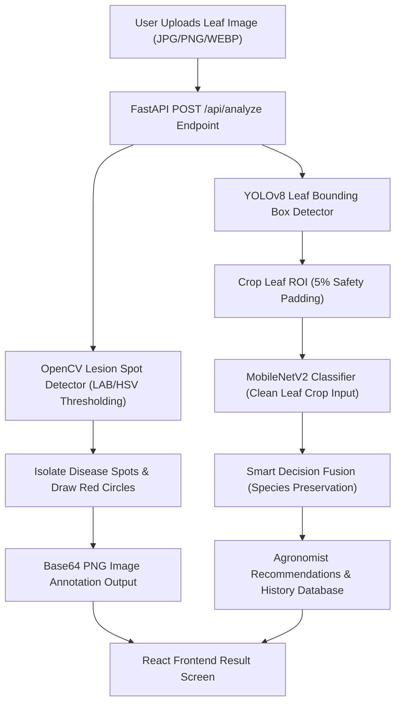

# 🌿 Crop Health AI: Leaf Disease Classification & Lesion Detection System

A computer vision platform for leaf disease classification, object detection, and granular lesion spot segmentation. Built with **FastAPI**, **React + TypeScript**, **PyTorch (MobileNetV2)**, **Ultralytics YOLOv8**, and **OpenCV**.

---

## 🛠 Technology Stack & Rationale

### 1. Frontend Architecture
* **React 18 + TypeScript + Vite**: Chosen for fast development, type safety, low bundle footprint, and instantaneous HMR.
* **Vanilla CSS (Design System Tokens)**: Utilizes custom CSS variables (`--green`, `--paper`, `--orange`) for fluid typography, custom card gradients, glassmorphism, and high-contrast responsive layouts.
* **Lucide Icons**: Semantic UI iconography (`Sprout`, `ScanLine`, `CheckCircle2`, `Leaf`).

### 2. Backend Architecture
* **FastAPI (Python 3.12)**: High-performance asynchronous web framework handling image uploads, Pydantic data schemas, and SQLAlchemy database ORM.
* **PyTorch & torchvision**: Deep learning engine for loading MobileNetV2 architecture, tensor normalization, and Grad-CAM explainability.
* **Ultralytics YOLOv8**: Object detection model providing real-time bounding box localization (`[x1, y1, x2, y2]`) of leaves and disease areas.
* **OpenCV (cv2) & PIL (Pillow)**: Image processing suite for HSV/LAB color space thresholding, contour extraction, and drawing lesion spot circles.
* **SQLite + SQLAlchemy**: Lightweight relational database tracking historical field logs, severity ratings, and confidence scores.

---

## 🧠 Machine Learning Models & Metrics

### 1. MobileNetV2 Classifier
* **Dataset**: PlantVillage Dataset (15 classes across **Potato**, **Tomato**, and **Pepper**).
* **Role**: Primary classifier for leaf disease recognition.
* **Metrics**:
  * **Top-1 Accuracy**: `95.44%`
  * **Top-3 Accuracy**: `99.12%`
  * **Macro Precision**: `0.9530` | **Macro Recall**: `0.9525` | **Macro F1-Score**: `0.9527`

### 2. YOLOv8s Object Detector
* **Dataset**: Merged Kaggle Leaf Bounding Box Dataset (`kaggle_working/merged_dataset`).
* **Role**: Detects leaf regions and ROI bounding boxes.
* **Metrics**:
  * **mAP@50**: `98.56%` (`0.9856`)
  * **mAP@50-95**: `96.45%` (`0.9645`)
  * **Precision**: `98.89%` | **Recall**: `98.27%`

### 3. OpenCV Lesion Spot Circle Detector (`ml/lesion_detector.py`)
* **Role**: Isolates necrotic/bacterial spots on leaf tissue using HSV and LAB color space thresholding.
* **Output**: Annotates the image with **bright red/amber double circles** around each disease spot and calculates precise spot-surface severity (`Mild`, `Moderate`, `Severe`).

---

## 🔄 End-to-End System Workflow



### Key Integration Highlights:
1. **Crop-First ROI Pipeline**: YOLOv8 crops the leaf region before MobileNet inference, stripping away soil/weed background noise.
2. **Smart Species Decision Fusion**: MobileNet acts as the primary authority for crop species (Potato vs. Tomato), preventing misclassifications caused by background overlap.
3. **Lesion Spot Annotations**: Instead of drawing one large box over the whole leaf, the system draws precise red/amber circles around each individual disease/bacterial spot.

---

## 📁 Repository Structure

```
crop/
├── backend/
│   ├── app/
│   │   ├── api/          # FastAPI route handlers
│   │   ├── core/         # Settings and configurations
│   │   ├── database/     # SQLAlchemy DB models & SQLite connection
│   │   ├── schemas/      # Pydantic request/response schemas
│   │   └── services/     # Analysis pipeline & recommendations logic
│   ├── ml/
│   │   ├── inference.py        # MobileNet inference & pre-cropped ROI prediction
│   │   ├── lesion_detector.py  # Lesion spot contour extraction & circle drawing
│   │   ├── yolo_model.py       # YOLOv8 object detector handler
│   │   ├── explainability.py   # Grad-CAM heatmap visualization
│   │   ├── labels.py           # 15 class definitions & human-readable formatting
│   │   └── model.py            # MobileNetV2 PyTorch model class
│   └── knowledge/              # Agronomist recommendations JSON database
├── frontend/
│   ├── src/
│   │   ├── api/          # Axios API client
│   │   ├── App.tsx       # Main React SPA (Analyze, History, Dashboard, Crops views)
│   │   └── App.css       # Design tokens, gradient cards, and layout styles
├── models/
│   ├── multicrop_classifier.pt # Saved MobileNetV2 PyTorch weights
│   └── yolo_detector.pt       # Saved YOLOv8s weights
├── evaluate_model.py           # Automated evaluation & metric scoring script
├── retrain_mobilenet_improved.py# Stage 2 fine-tuning & field augmentation trainer
├── notebookc6fea6f6a6.ipynb    # Kaggle training notebook
└── README.md                   # Project documentation
```

---

## 🚀 Running the Project

### 1. Backend Server (FastAPI)
```bash
cd backend
python -m uvicorn app.main:app --reload --port 8000
```

### 2. Frontend Application (Vite + React)
```bash
cd frontend
npm run dev
```

### 3. Evaluate Models & Scores
```bash
python evaluate_model.py
```
